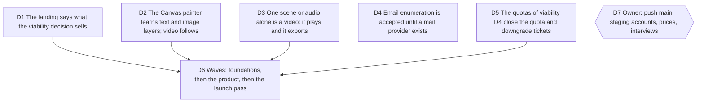

# Autonomous sprint: the backlog is worked to done, and the free export learns the whole product

Bruno, 2026-10-03, leaving for the day: "Je te laisse vraiment prendre les
décisions produit et les noter. Finis tous les tickets, si tu juges qu'il y a
des features rentables qu'on peut ajouter, prends la décision, implémente et
note-les." Jobs served: all of `goals/multimedia-saas/intake.md`. Touches
[viability](2026-10-03-viability.md) D1, D4, D5 and D6, and
[operating-model](2026-10-03-operating-model.md) D6 and D7.

Measured before deciding: the QA campaign left 35 open tickets (23 ready for
an agent, 6 to triage, 6 waiting for Bruno). Three findings cut across them:
the studio still writes the V1 file (two agents hit it), the three renderers
disagree on the card width by up to 43 px at 1080p, and the on-device
export, the free funnel of the whole business, cannot draw a text or image
layer at all: a scene-first project silently goes to the local server.

## D1 The landing says what the viability decision sells

**Decision:** Title, description, og and twitter tags, the hero and the README
first paragraph say the same thing: the sharpest code video you can make, in
your browser, from a pull request; text, images, video and audio in the same
scenes as the second line. The og image becomes absolute at build time. The
intake's non-goal "no rebranding before the mixed-media product is tested"
was the Codex plan's caution, not a decision of Bruno's; the viability log
has since chosen the positioning, and the landing cannot contradict it on
Product Hunt day.

**Why:**

- Ticket #60 blocked on this; the words are decided in viability D1.

**Rejected:**

- Waiting for Bruno: a copy change is reversible in one commit.

**Impact:** `index.html`, `hero.tsx`, `README.md`, ticket #60.

**Pivot:** "Keep the code-only landing."

## D2 The Canvas painter learns text and image layers; video follows

**Decision:** The on-device export paints TextBlock and ImageBlock layers from
the same scene compiler the DOM preview and the Remotion composition read,
with the same placement, crop, focal point, radius and z-order. VideoBlock
is a follow-up ticket (frames through an HTMLVideoElement seek per frame, or
WebCodecs decode), written when text and image are proven. Until video lands,
a project with a video layer tells the user plainly that Device cannot draw
video yet and offers the server.

**Why:**

- The rule is "what runs on the user's machine is free"; today the free path
  only runs for code. A scene-first studio whose free export cannot render a
  title card is not scene-first.
- Ticket #91's symptom (a silent POST to the local server) has this as its
  root cause; refusing better is the patch, painting is the fix.

**Rejected:**

- Making the server the only multimedia path: it is a laptop-time and
  privacy regression on the funnel.

**Impact:** `src/application/frame-painter/`, `render.worker.ts`, the export
panel copy, a new ticket for video layers.

**Pivot:** "Keep the painter code-only."

## D3 One scene or audio alone is a video: it plays and it exports

**Decision:** Play and Render are enabled from one scene, and for an
audio-only project; the preview runs the canonical duration (scenes plus the
audio tail), Loop adds the last-to-first morph in the preview as it does in
the file, and fps (24, 30, 60) is chosen in the export panel and carried by
the project file.

**Why:**

- The contract says a project may be audio-only; the studio contradicted it.
  A hold with a typewriter and a caption is a legitimate ten-second clip.

**Impact:** tickets #67, #85, #92.

**Pivot:** "Require two scenes."

## D4 Email enumeration is accepted until a mail provider exists

**Decision:** Sign-up keeps saying when an email already has an account.
When staging brings a mail provider (ticket #70), verification lands and the
response becomes uniform; ticket #62 is closed as "not now" with that
condition.

**Why:**

- Uniform responses without verification would lock out people who mistyped
  their own email; for a developer tool the enumeration risk is small.

**Pivot:** "Add verification before launch."

## D5 The quotas of viability D4 close the quota and downgrade tickets

**Decision:** Ticket #72 implements the ceilings; tickets #63 and #64 close
when it lands, since their questions were answered in the viability log.

## D6 Waves: foundations, then the product, then the launch pass

**Decision:** Wave 1 runs in parallel on separate areas: the V2 project file
and per-project compositions (#66, #82); the canonical card width across
renderers (#90); playback and export duration (#67, #85, #92); quotas,
dimensions and colour space (#72, #80, #81); the landing in two agents (#60
and #73; #61, #40, #42); the headless CLI (#74). Wave 2 builds on them: the
painter learns layers (D2, #91), media cleanup and import polish (#68, #69),
the studio polish batch (#88), the unified undo (#86), import replacement
policy (#83), single-frame diffs (#84), the 3,000-line performance (#87),
docs (#89), the Action and the skill (#75, #76). Wave 3 is the launch pass
(#78) and the full gates. Each wave ends with the orchestrator's serial run
of lint, both type checks, the full suite and the build, then commits by
domain and a fast-forward of `main`.

**Pivot:** "Different order" (name it).

## D7 Owner: push main, staging accounts, prices, interviews

`needs owner`. Unchanged from the two earlier logs: pushing `main` (the
session branch is pushed as `claude/project-status-862f90` for backup and
CI), the staging accounts (#70), the prices and the licence (#79), the DevRel
interviews (#77), the trusted proxy at deployment (#65).

## Executed: wave 1 (2026-10-03, evening)

Seven agents, fifteen tickets, six commits, gates green (249 files, 1,987
tests, lint, both type checks, build). Product calls taken by agents and
kept:

- The landing claim is measurable, not superlative: "as sharp as their
  preview, made in your browser from a pull request". ProRes 4444 tools also
  keep full chroma, so "the sharpest" could be disputed. Pivot: "use the
  sharpest". The sharpness proof is a still PNG pair (21.8 KB), both sides
  rendered by the on-device painter so the codec is the only variable.
- A V1 file always opens with the same IDs; a V2 file keeps its own; an
  opened file takes the active local project's id and can never overwrite
  another project. Media bytes are read by asset id across local projects.
- A scene without a code layer does not open yet (#96): the studio's spine
  is still the V1 code column; a title-card-first launch video needs it.
- Loop means the same thing on every project; the multimedia route learns
  it (#97) rather than hiding the toggle.
- fps lives in the project file only when it is not 60; the CLI loops a GIF
  by default and nothing else.
- Plan reads come from the Stripe projection whenever a database exists;
  monthly minutes are output duration of queued, running and succeeded jobs
  since the first of the UTC month; a replayed render is never counted twice.
- Found and fixed on the way: billing was broken in every browser (fetch
  called as a method of the adapter); the painter's window took the tallest
  frame's height; the renderers disagreed on the card width by 43 px.
