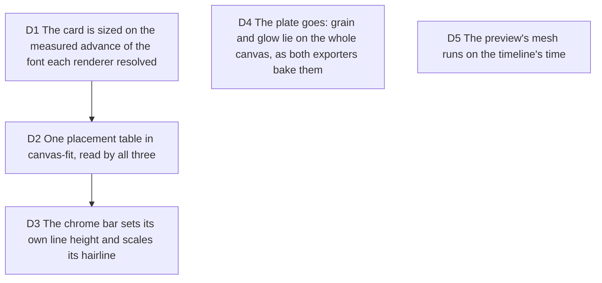

# Canonical card width: one measured advance, one placement table, three renderers

Ticket #90, from the on-device export QA of 2026-10-03: at 1080p the DOM preview
drew the window 1270 px wide at a text scale of 2.089, the composition 1263 px
at 2.2, the painter 1226.7 px at 2.2. Serves viability D1 (the preview is the
export) and the renderer rule of `CONTEXT.md`.

Measured before deciding: JetBrains Mono's advance is 0.600 of the size in every
scope (document canvas, worker, headless Chrome), so the server's nominal 0.62
made its window 36 px wider than its own `ch`-placed glyphs; the preview ignored
the fit and squeezed a fixed 42rem card into the export's slot; the preview's
chrome bar inherited the studio's 1.5 line height (Remotion: `normal`); and its
grain sat under a transformed ancestor, where `soft-light` cannot blend and
paints a flat veil: the "plate".

## D1 The card is sized on the measured advance of the font each renderer resolved

**Decision:** `measureCharWidthRatio` (src/application/layout/char-advance.ts)
measures `0` at `fontSize × BASE_VIDEO_SCALE` in the font the context resolved.
The preview (a document canvas), the composition (a canvas in headless Chrome,
after the face has loaded) and the painter (its worker's OffscreenCanvas) all
call it. `CHAR_WIDTH_RATIO = 0.62` is deleted and `charWidthRatio` is required
by `frameNaturalSize` and `fitCardToCanvas`.

**Why:** glyphs land on the advance of the resolved font (`ch` in the DOM,
`measureText` in the canvas); a card sized on any other number is wider or
narrower than the glyphs inside it. Each scope measures its own font because a
tab, a worker and a headless Chrome do not share one; `advanceDriftMessage` is
the net when two disagree.

**Rejected:** one number measured in the document and shipped to the server and
the worker: the server would size the card on a font it may not have resolved.
Keeping 0.62 as a fallback: an unmeasured card is a wrong card, so the type
system refuses it.

**Pivot:** "Size the card on a fixed advance."

## D2 One placement table in canvas-fit, read by all three

**Decision:** `BASE_VIDEO_SCALE` (2.2) and `CANVAS_MARGIN` (0.05) live in
`canvas-fit.ts`; the composition and the client export scene re-export them
instead of keeping copies. The text scale is `renderScaleFor(...) × fit.scale`
everywhere. The preview lays its card out at editor size with the exporters'
window width over the render scale, then one transform
(`previewCardPlacement`); it no longer measures its own DOM card to place it.
`tests/application/canonical-card-width.test.tsx` asserts that the composition,
the painter and the preview land on the same width and scale at three canvases.

**Pivot:** "Let the preview keep a fixed-width card."

## D3 The chrome bar sets its own line height and scales its hairline

**Decision:** `FrameChrome` sets `lineHeight: CHROME_TEXT_LINE_HEIGHT` and a
`border × scale` hairline, so both DOM renderers lay out exactly the bar
`chromeBarHeight` budgets and the painter draws. The server's hairline goes
from a fixed 1 px to 2.2 px at 1080p, the thickness the preview and the painter
already showed.

**Pivot:** "Keep a 1 px hairline in the server render."

## D4 The plate goes: grain and glow lie on the whole canvas, as both exporters bake them

**Decision:** no decision log asked for a plate. On the export canvas the
preview draws `GlowDecoration` (moved out of the composition so both use it)
and `GrainOverlay` directly in the aspect box, sized by a `scale` prop rather
than a transformed wrapper, and no longer on the card. The plain fit-to-viewport
card keeps its own grain.

**Why:** both exporters lay the grain full bleed under the card. Measured after
the change, the preview's background differs from the server frame at the same
timestamp by 0.5 (mean, 0 to 255, 16 px blocks), against 14.2 before.

**Pivot:** "Bake a plate into the exports."

## D5 The preview's mesh runs on the timeline's time

**Decision:** the preview paints the mesh at the composition time
(`playbackElapsedMs` while playing or scrubbed, the scene start when paused on
a scene), as the composition paints it at `frame / fps` and the painter at the
script's time. Paused, it holds. Reduced motion still shows the first frame.

**Pivot:** "Let the paused preview keep drifting."

## Left for the orchestrator

- The painter sets glyphs about 2 px above both DOM renderers at 1080p:
  `textBaseline = "middle"` is the em box's middle, CSS puts the baseline at
  half-leading plus the font's ascent. The fix is in `painter.ts` text drawing,
  outside this ticket's fit-math scope; it belongs to the wave-2 painter work.
- The preview draws the watermark under the window, the exporters at the canvas
  corner (`WatermarkOverlay`, `paintWatermark`).
- The painter budgets no caption height (`hasCaption: false` in `frameScene`)
  while the composition and the preview do; it matters once the painter draws
  captions.
