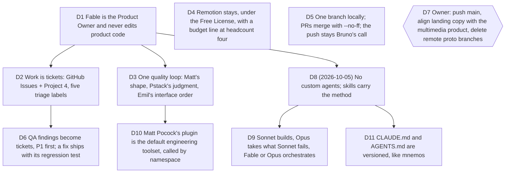

# Operating model: Fable is the Product Owner, work lives in tickets, Remotion stays

Bruno, 2026-10-03: "Tu es vraiment Product Owner donc je te laisse les rênes.
Cherche tout ce qui bloque, trouve des alternatives, prends les décisions et
note-les. La qualité produit me tient à coeur, la qualité de rendu des exports.
Il faut que le business model tienne et qu'on gagne de l'argent très vite."
Job served: every one in `goals/multimedia-saas/intake.md`, and the business
behind them. Touches
[multimedia-saas-foundation](2026-08-30-multimedia-saas-foundation.md) D7 and
D8, and the monetisation rule "what runs on the user's machine is free, what
runs on ours is paid".

Measured before deciding (2026-10-03): local `main` was 7 commits ahead of
`origin/main` and unpushed since 2026-09-14; 28 of 30 local branches were
either pre-rewrite history (23), a rejected integration attempt, a prototype
that already shipped as PR #49, or the heads of PR #53, #54 and draft #43; the
full suite on the merged `main` is 205 files, 1,696 tests, lint, both type
checks and the production build green; a first QA campaign of seven agents
found two P2 on the landing, two auth hardening holes (no rate limit, no body
limit) and one P1 regression (no account island on `/app` since the
multimedia integration). Remotion's licence text and FAQ were read in full.

## D1 Fable is the Product Owner and never edits product code

**Decision:** Bruno's interface is one session with Fable. Fable decides,
writes the decision logs, the briefs, the tickets, the memory and the workflow
docs, reviews agents' reports, runs the gates once and commits. It never edits
product code, tests or design files itself. Agents are an implementation
detail; reports to Bruno name outcomes and what is left, never agents.
Irreversible branches (money, legal, public claims, security posture,
deleting data, pushing `main`) are marked `needs owner`.

**Why:**

- Bruno's words, and the mnemos operating model (2026-09-25) that already
  measured why the orchestrator's context must hold judgments, not code.

**Rejected:**

- Fable fixing small things itself "to save an agent": each fix drags file
  contents into the most expensive context for the rest of the session.

**Impact:** `docs/agents/QUALITY_LOOP.md`, memory `fable-product-owner-mandate`.

**Pivot:** "Fable may edit small things itself."

## D2 Work is tickets: GitHub Issues + Project 4, five triage labels

**Decision:** Every piece of work is a GitHub issue on `delhombre/typelapse`
with one category label (`bug`, `enhancement`) and one state label
(`needs-triage`, `needs-info`, `ready-for-agent`, `ready-for-human`,
`wontfix`), added to GitHub Project 4 "Typelapse", whose Status column mirrors
the state (À trier, En attente de toi, Prêt pour un agent, En cours, Fait).
Tickets are tracer-bullet vertical slices with blocking edges
(`to-tickets`), triaged with `triage`. The backlog is the project, not a chat
message.

**Why:**

- Matt Pocock's skills assume this tracker and label vocabulary; mnemos
  already runs it and Bruno asked for the same here.

**Rejected:**

- Local markdown tickets under `.scratch/`: invisible to Bruno's phone and to
  the project board.
- Linear: one more tool for a one-person company.

**Impact:** labels created, Project 4 created and linked, `docs/agents/issue-tracker.md`,
`docs/agents/triage-labels.md`, `docs/agents/domain.md`, `CONTEXT.md`.

**Pivot:** "Track work somewhere else."

## D3 One quality loop: Matt's shape, Pstack's judgment, Emil's interface order

**Decision:** `docs/agents/QUALITY_LOOP.md` is the gate sequence every unit
of work runs: Frame (research) → Grill → Model → Build (tdd, smallest diff)
→ Interface (Emil's order: decide, foundations plus one material skill,
refine, review) → Prove (real browser, ffprobe on the file) → Ship. Agents run
one or two Emil skills per pass and look at the screen between runs. Before a
release, `emil-prep-for-prod` runs on the whole app.

**Why:**

- Emil's lesson "How to use aiforui skills" (read 2026-10-03) says five
  skills at once make a mess; the order is the method.
- Pstack's Prove It Works and Fix Root Causes are what the QA campaign
  already needed: the first agents proved journeys with files, not feelings.

**Rejected:**

- A free-form "use the skills" instruction: it produced seven agent briefs
  with no skill loaded.

**Impact:** `docs/agents/QUALITY_LOOP.md`; every future brief pastes the gate
it serves.

**Pivot:** "Drop a gate" (name it).

## D4 Remotion stays, under the Free License, with a budget line at headcount four

**Decision:** Typelapse keeps Remotion as the server renderer and ships hosted
rendering on it, under Remotion's Free License, without waiting for a written
answer from Remotion. When the company reaches four people (employees count;
customers who only receive videos do not), it buys the Company License:
Automators at $0.01 per render with a $100 monthly minimum, or Creators at
$25 per seat. The on-device WebCodecs export stays the default and the
fallback, behind `ExporterPort`.

**Why:**

- The licence text: free for "an individual, a for-profit organization with up
  to 3 employees, or a non-profit", commercially, "for the purpose of creating
  videos and images". The FAQ: "Even if you are incorporated, you can operate
  under the Free License, as long as your total headcount is 3 or less", you
  can "make money under the Free License" and run automations that render
  videos for customers, and a client who "never receives the project code,
  never runs Remotion" does not count toward headcount. Self-hosting needs
  nothing more; Cloud Rendering Units only concern Remotion's Lambda and Cloud
  Run offerings, which we do not use.
- The only prohibited use is selling a derivative of Remotion itself, which a
  video product is not.

**Rejected:**

- Replacing Remotion with the Canvas painter on the server: the painter is
  behind on captions and synthesized audio, and the licence does not require
  it.
- Waiting for a written answer: the terms are public and unambiguous for a
  one-person company.

**Impact:** memory `typelapse-monetization` (the "blocking constraint" is
closed), a line in the pricing decision to come, `goals/multimedia-saas/state.md`.

**Pivot:** "Do not ship hosted rendering on Remotion."

## D5 One branch locally; PRs merge with --no-ff; the push stays Bruno's call

**Decision:** PR #53 (the README demo renders itself) and PR #54 (the WebM
codec ladder) are merged into local `main` with `--no-ff`, their open bot
review threads fixed inside the merge commits, so GitHub marks them merged
when `main` is pushed. The 23 pre-rewrite branches, the rejected
`codex/multimedia-features-integration` (kept as tag
`archive/codex-multimedia-features-integration`), `proto/studio-shell` and
the local `feat/compare-page` are deleted. Draft PR #43 (/compare) stays on
origin until the repository opens. `vite.config.ts` reads `TYPELAPSE_API_URL`
so several dev servers run side by side for parallel QA.

**Why:**

- Bruno: "ne rester que sur main". The old branches were 70k lines behind a
  rewritten history and every one of their changes had landed through a PR.

**Rejected:**

- Squash-merging the two PRs: GitHub would not recognise them as merged.
- Deleting the remote `proto/studio-shell` and `feat/compare-page`: remote
  deletions are outward-facing; listed under D7.

**Impact:** `main` at 10 commits ahead of origin; memory
`codex-multimedia-merge`.

**Pivot:** "Reopen a branch" (name it).

## D6 QA findings become tickets, P1 first; a fix ships with its regression test

**Decision:** Every finding of the 2026-10-03 QA campaign that was not fixed in
place becomes a ticket with its severity in the title, the repro, the root
cause and the owning gate. P1 (a journey or a sale blocked) is fixed before
anything else is built: the missing account island on `/app`, the cloud-save
fingerprint that disagrees with PostgreSQL's `jsonb` key order. P3 polish is
batched per screen and goes through gate 4.

**Why:**

- A product that cannot sign a user in cannot take money; everything in the
  viability decision depends on it.

**Rejected:**

- Fixing findings ad hoc in chat with no ticket: nothing to triage, nothing
  for Bruno to read on his phone.

**Impact:** GitHub issues to be created from the agents' reports; Project 4.

**Pivot:** "Build features before closing P1s."

## D7 Owner: push main, align landing copy, delete remote proto branches

`needs owner`. Three things only Bruno does: push `main` (ruleset, and his
rule that green CI is not permission); decide whether the landing's title,
meta, og and hero stop talking only about code and say "scene-first
multimedia motion studio" like the README (his own non-goal says no rebrand
before the mixed-media product is tested); delete `origin/proto/studio-shell`
and, when the repository opens, merge or close draft #43.

## Amendment 2026-10-05: skills, not agents

Bruno, 2026-10-05: "Tout ce qui va être agents et sous-agents présents,
devront être supprimés. On travaillera avec les skills de Matt Pocock sur
l'ingénierie par défaut avec le système de tickets reliés au projet github.
[...] On orchestre avec Fable mais comme j'ai atteint ma limite hebdomadaire,
j'ai basculé sur opus, sonnet pour les tâches, opus pour ce que sonnet n'arrive
pas à faire." Touches D1, D2 and D3.

Measured before deciding (2026-10-05): the only custom agents were
`comment-sicko` (user level, spawned by Pstack's `/no-comments`) and
`codex-rescue` (the Codex plugin); mnemos runs six project agents. A session in
a desktop-app worktree loaded neither the root `CLAUDE.md`, git-ignored since
the first commit, nor its `## Agent skills` block. The Matt Pocock setup of D2
matches plugin 1.2.3: tracker doc, the five labels on GitHub, domain doc.

## D8 No custom agents; skills carry the method

**Decision:** no subagent definition, in the repository or in the user's
configuration. `comment-sicko` went to the Trash, and the Codex plugin, the
only way to remove `codex-rescue`, is disabled. Work goes to the built-in
agents with a model and a brief that names the skills of its gate.

**Why:**

- Bruno's words. The gates already name the skill each role needs, so a
  persona agent is a second prompt to keep in step with the quality loop.

**Rejected:**

- Porting mnemos's six agents (senior-engineer, qa-engineer and the rest).

**Impact:** `docs/agents/QUALITY_LOOP.md` Roles, `CLAUDE.md`. Pstack's
`/no-comments` has no subagent left to spawn.

**Pivot:** "Bring back an agent" (name it).

## D9 Sonnet builds, Opus takes what Sonnet fails, Fable or Opus orchestrates

**Decision:** builders run with `model: sonnet`. A task Sonnet cannot finish
goes to `model: opus`, with Sonnet's failure named in the new brief. The
orchestrator is Fable, or Opus while Fable's weekly limit is reached.
Inventories stay on `Explore` with Haiku.

**Why:**

- Bruno's weekly Fable limit, and mnemos's usage economy (2026-09-25), which
  already runs Sonnet by default and Opus after a Sonnet failure.

**Rejected:**

- Opus builders by default, the D1 arrangement: the most expensive builder on
  routine slices.

**Impact:** `docs/agents/QUALITY_LOOP.md` Roles, `CLAUDE.md`, memory.

**Pivot:** "Builders go back to Opus."

## D10 Matt Pocock's plugin is the default engineering toolset, called by namespace

**Decision:** gates 0 to 3 and 6 name the plugin's skills with their
namespace (`mattpocock-skills:tdd`), and `mattpocock-skills:code-review`
joins Ship. The setup of D2 stands as it is.

**Why:**

- Same-name copies of these skills also sit in the user's skills folder; a
  bare name can load a different version than the plugin.

**Rejected:**

- Running `setup-matt-pocock-skills` again: its outputs exist and follow the
  plugin's templates, adapted to Project 4 and `docs/decisions/`.

**Impact:** `docs/agents/QUALITY_LOOP.md`, `CLAUDE.md`.

**Pivot:** "Use the bare skill names."

## D11 CLAUDE.md and AGENTS.md are versioned, like mnemos

**Decision:** `CLAUDE.md` leaves `.gitignore`; `CLAUDE.md` and its Codex twin
`AGENTS.md` are committed, with a "How we work" section: the skills by domain
and the models.

**Why:**

- A git-ignored file does not exist in a worktree, so agents there worked
  without the project rules or the tracker configuration. mnemos versions
  both files.

**Rejected:**

- A `.worktreeinclude` alone: it fixes new worktrees on Bruno's machine, not
  a fresh clone.

**Impact:** `.gitignore`, `CLAUDE.md`, `AGENTS.md`. Before pulling `main` into
the main checkout, its untracked root `AGENTS.md` has to go, or git refuses
the merge.

**Pivot:** "Keep CLAUDE.md local."
