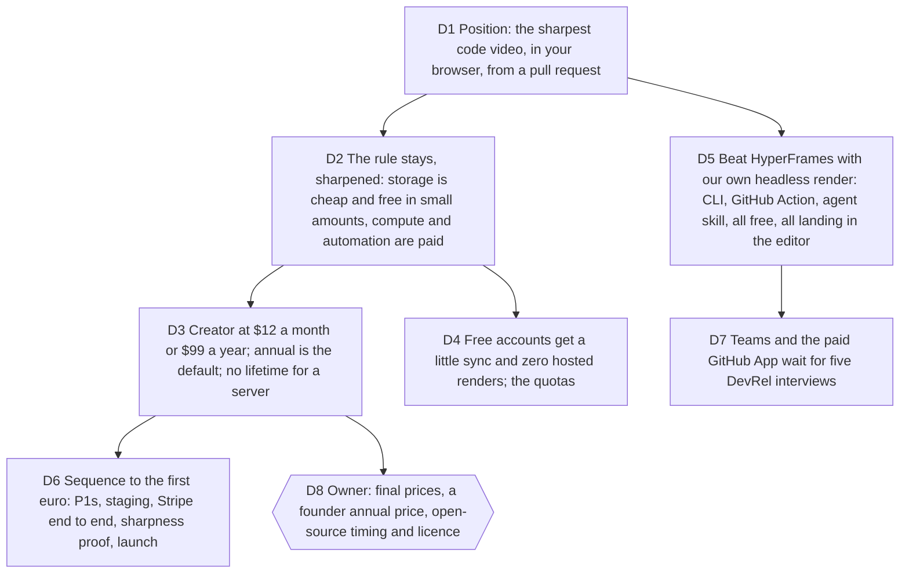

# Viability: sell the server and the automation, give the machine away, be the sharpest

Bruno, 2026-10-03: "Il faut que notre business model tienne et qu'on puisse
gagner de l'argent très vite. La qualité de rendu des exports me tient à
coeur. Regarde les concurrents et faisons mieux." Jobs served: launch video,
tutorial, code and release story (`goals/multimedia-saas/contract.md`), and
the business behind them. Touches the monetisation rule of 2026-08-09 (what
runs on the user's machine is free, what runs on ours is paid),
[multimedia-saas-foundation](2026-08-30-multimedia-saas-foundation.md) D8
(Creator before Studio) and [operating-model](2026-10-03-operating-model.md)
D4 (Remotion stays).

Measured before deciding, in
[docs/research/2026-10-03-competitors-and-pricing.md](../research/2026-10-03-competitors-and-pricing.md)
(24 tools, primary sources where they exist):

- Nobody ships a GUI editor that turns a pull request into a video. The two
  PR-URL tools are agent skills with one fixed style and no editor; HeyGen's
  `pr-to-video` has 298k skill installs and HyperFrames 56k stars, Apache 2.0,
  no render fee. That is the competitor, not snipcast.
- Code-video money is small on its own (Snappify about $3k MRR after years;
  snipcast $12/mo, no free tier, "500+ users"). "Make a developer look good
  on video" sells to individuals (Screen Studio about $30k its first month,
  8,000 customers in nine months, $29/mo or $108/yr). Launch videos cost $2k
  to $8k from a freelancer, which is the budget a mixed-media tool displaces.
- Developers punish subscriptions on occasional-use tools (Screen Studio's
  removal of its lifetime licence in October 2025 drew visible backlash and
  clones). Free local tiers with a paid upgrade grow (Cursorful 60k users,
  $79 once; Cap 23k stars, $58 lifetime or $12 per seat).
- No competitor documents chroma subsampling or sells sharp text. Only
  ProRes 4444 tools (Rotato, Jitter Max, Hackreels on the server) carry full
  chroma, and none is web-playable. Our AV1 4:4:4 WebM is alone.
- Distribution that worked for this category: Product Hunt (500 to 1,000
  upvotes for polished dev visuals), agent skills (298k installs), free GitHub
  Actions; Hacker News ignores paid SaaS launches (1 to 2 points).
- Remotion's Free License covers us until headcount four (contractors count;
  customers who only receive videos do not). Automators thereafter: $0.01 per
  render, $100 per month floor.

## D1 Position: the sharpest code video, in your browser, from a pull request

**Decision:** Typelapse is sold on three facts nobody else states: the file is
as sharp as the preview (4:4:4 chroma on WebM, measured on glyphs; WYSIWYG
across the three renderers), it runs in the browser with no account and
nothing uploaded, and it starts from a pull request, a diff or a commit and
lands in a real editor. Mixed media (text, image, video, audio) is the second
sentence, the one that displaces the $2k launch video, not the first.

**Why:**

- The research's five gaps, in order: code-sharp export, PR import inside an
  editor, local and free, mixed media, teams. The first three are already
  true today and cost nothing to claim.
- The threat is a free agent skill with one style. "An editor where the
  preview is the export" is the answer an agent skill cannot give.

**Rejected:**

- Leading with "scene-first multimedia studio": true, but the market has
  Jitter and Tella there, and the words do not say why to switch. It stays
  the README's technical truth and the second line of the pitch.

**Impact:** ticket #60 (landing positioning, owner), the sharpness
side-by-side section (new ticket), `README.md` first paragraph.

**Pivot:** "Lead with mixed media."

## D2 The rule stays, sharpened: storage is cheap and free in small amounts, compute and automation are paid

**Decision:** What runs on the user's machine is free and stays free,
including 4K and 4:4:4 export. Paid is what runs on ours: hosted renders
(captions and synthesized audio, long videos, no laptop time), automations
(render by URL, GitHub Action with hosted output, the future GitHub App), and
storage beyond a small free allowance. The product never paywalls a client
feature and never watermarks a local export.

**Why:**

- The trust premium measured on Screen Studio's backlash and Cursorful's
  growth: a local tool that never locks your work is the acquisition engine.
- Remotion's licence and server cost sit exactly on the paid side; the
  on-device painter is outside both.

**Rejected:**

- A paid "commercial use" licence on the local studio (Cap, Cursorful): it
  would be honour-based in a repository meant to open, and it muddies the
  one-sentence rule.

**Impact:** `Plan` value object, pricing copy, `CONTEXT.md` ("the rule").

**Pivot:** "Charge for a local feature."

## D3 Creator at $12 a month or $99 a year; annual is the default; no lifetime for a server

**Decision:** One paid plan at launch, Creator: $12 per month or $99 per year
(the yearly price shown first, the monthly as the escape hatch). It includes
hosted renders within a fair monthly allowance stated in minutes of output,
cloud projects and private media within a stated storage ceiling, render by
URL and the Action's hosted output. No lifetime tier: a server is a recurring
cost. Prices are in USD on Stripe; the landing shows only what
`/api/billing/catalog` returns.

**Why:**

- $12 is snipcast's monthly price with a free tier they do not have, under
  Screen Studio's $29 for a tool used less often, above Snappify's $9 where
  video is "experimental". $99 a year undercuts Screen Studio's $108 and
  snipcast's $99 is the same anchor with a far better free tier beneath it.
- Annual first answers the subscription complaint without the lifetime
  mistake Screen Studio's founder called a mistake; it also brings cash in
  the month Bruno asked for.

**Rejected:**

- $29 a month: Screen Studio sells daily-use recording; our hosted features
  are weekly-use at best.
- A $79 lifetime: Cursorful can, since nothing runs on its servers; we
  cannot.

**Impact:** Stripe prices (owner creates them, D8), `STRIPE_CREATOR_*` env,
pricing copy, the allowance sentences in the account island.

**Pivot:** "Change the Creator price" (name it).

## D4 Free accounts get a little sync and zero hosted renders; the quotas

**Decision:** A free account exists so that cloud save and the PR-by-URL flow
can be tried: 3 cloud projects, 100 MB of private media, 0 hosted renders,
render by URL returns the editor link rather than a file. Creator: 100 cloud
projects, 5 GB media, 60 minutes of hosted output a month at up to 4K, 3
concurrent jobs. Ceilings are capabilities in the domain, never marketing
numbers in copy until telemetry confirms the costs. Past hosted outputs stay
downloadable for 30 days after a downgrade.

**Why:**

- Storage is cents; a render is CPU, Remotion's future fee and our time. The
  rule in D2 draws the line there.
- Ticket #63 (no quota) and ticket #64 (downgraded accounts lose their
  renders) needed an answer that is a policy, not a patch.

**Rejected:**

- Free hosted renders as a hook: contradicts the rule and funds nothing.
- Deleting outputs at downgrade: a user who paid for a file owns the file.

**Impact:** `Plan` limits, project and asset quotas in the API, the 402 copy,
tickets #63 and #64.

**Pivot:** "Different ceilings" (name them).

## D5 Beat HyperFrames with our own headless render: CLI, GitHub Action, agent skill, all free, all landing in the editor

**Decision:** The engine that already renders the README demo
(`scripts/render-demo.mjs` through the real route) becomes a documented
headless path: a CLI (`typelapse render <pr-url|diff|project.json>`), a free
GitHub Action that renders a PR into an artifact and comments a link to open
it in the editor, and an agent skill (`typelapse pr-to-video`) published where
HeyGen's lives. All three are free and local; the hosted output (a URL
instead of an artifact, captions, audio) is what Creator adds.

**Why:**

- 298k installs of a PR-to-video skill is the largest demand signal in the
  research, and that tool has no editor and one style. Meeting it on its own
  channel, then offering the editor, is the funnel.
- A free Action is unreviewed and immediate; the paid GitHub App needs a
  verified org and 100 installs, so it comes after.

**Rejected:**

- A paid GitHub App first: the Marketplace prerequisites and the unverified
  demand (D7).
- Competing on price with a free tool: we are free too, on the machine.

**Impact:** new tickets (CLI, Action, skill), `server/routes/render.ts`
reuse, docs.

**Pivot:** "No headless path."

## D6 Sequence to the first euro: P1s, staging, Stripe end to end, sharpness proof, launch

**Decision:** In this order, each a ticket with a pass condition:
1. Close the P1 (account island, #57) and the P2 (cloud fingerprint, #58).
2. Staging: managed PostgreSQL, R2, Stripe test mode, Better Auth, through a
   `/wizard` script for the steps only Bruno can do; `pnpm hosted:check`
   green.
3. Prove sign-up → checkout → webhook → private asset → cloud project →
   queued render end to end in staging, in a browser, with ffprobe on the
   output.
4. Ship the sharpness proof: a landing section with a side-by-side zoom of
   our WebM against a 4:2:0 export of the same frame, and the measured
   numbers from `video-encoding.ts`.
5. `emil-prep-for-prod` on the app, then Product Hunt and X with the
   self-rendered demo as the asset; the Action and the skill ship the same
   week to catch the agent channel.

**Why:**

- Every item is already built except the staging accounts; the first euro
  is gated by ops and proof, not by features.

**Rejected:**

- Building teams, brand kits or the GitHub App before a paid user exists.

**Impact:** tickets for each step, `goals/multimedia-saas/state.md` next
gate.

**Pivot:** "Reorder the sequence."

## D7 Teams and the paid GitHub App wait for five DevRel interviews

**Decision:** The team workspace domain (already merged, not wired) and the
paid GitHub App are not built further until five to ten DevRel or
engineering leads have said what a release video is worth to them. Bruno
runs the interviews; the questions are a ticket.

**Why:**

- The research found no public evidence of teams paying for release-notes
  videos. The proven budget is launch videos, which Creator already serves.

**Rejected:**

- Wiring seats now because the domain exists: cost without a buyer.

**Impact:** ticket (interviews, owner), the team-workspaces memory.

**Pivot:** "Build teams now."

## D8 Owner: final prices, a founder annual price, open-source timing and licence

`needs owner`. Bruno decides: the final Creator prices (D3 is the
recommendation), whether to offer a founder annual price (for example $79 a
year locked for the first 200 accounts, to turn launch attention into cash),
when the repository opens and under which licence. On the licence, the
research adds one fact to the 2026-08-09 decision: Cap sells hosted and
commercial tiers on an AGPL codebase with 23k stars; MIT lets anyone host
Typelapse's server side. The recommendation is to decide the licence before
the Product Hunt day, since it cannot be changed credibly after.
