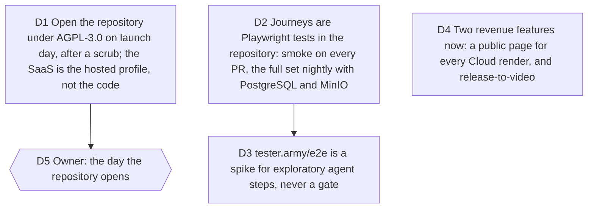

# Open source, automated journeys and the next revenue features

Bruno, 2026-10-04, after the merge of #115: "Je ne sais pas si c'est une
bonne idée de mettre en open source ? Mais garde à l'esprit qu'on construit
un SaaS. Teste ou mets en place un moyen de tester tous les parcours de
manière automatisée. Est-ce que tous les tickets ont été traités ? Si oui,
il faut voir s'il y a des features utiles et rentables qu'on peut ajouter.
Prends les décisions, note-les." Jobs served: all of them, and the business.
Touches [viability](2026-10-03-viability.md) D5 (the free Action and skill
need public code) and D8 (licence left to the owner),
[autonomous-sprint](2026-10-03-autonomous-sprint.md) D7, and the 2026-08-09
monetisation rule that rejected AGPL.

Measured before deciding: the repository is private with an MIT file; the
Action (`uses: delhombre/typelapse@main`) and the skill (`npx skills add
delhombre/typelapse`) cannot install from a private repository, and the CLI
they run imports the whole renderer in process, so "publish only the CLI"
would publish the renderer anyway. In the research, Cap (AGPL, 23k stars)
sells hosted and commercial tiers on an open codebase; HyperFrames (Apache
2.0, 56k stars) is the free competitor; Hacker News rewards open source and
ignores paid SaaS launches. Every journey of the sprint was proven by hand in
headless Chromium with ffprobe on the files, and none of that is a test that
runs again. tester.army/e2e is an open-source CLI that mixes deterministic
locators with cached agent steps and takes an API key or a ChatGPT, Copilot
or SuperGrok subscription; no Anthropic key is present on this machine.

## D1 Open the repository under AGPL-3.0 on launch day, after a scrub

**Decision:** The repository opens, whole, under AGPL-3.0, on the day Bruno
pushes the launch button, after a scrub ticket has removed anything that
must not be public (tokens, emails, course install links, internal
references) and the LICENSE has been switched from MIT. Companies that
cannot use AGPL can buy a commercial licence later; that is a second
revenue line, not a launch feature. The hosted profile stays in the same
repository: what we sell is running it, with the accounts, the queue, the
storage and the support, not the right to read it.

**Why:**

- The distribution plan depends on it: the Action, the skill and the CLI
  only install from public code, and the on-device "free and local" claim is
  only credible when anyone can read what runs on their machine.
- AGPL answers the SaaS worry: a company that hosts a modified Typelapse must
  publish its modifications, and most companies simply will not run AGPL
  code as a service. Cap has sold on exactly this basis.
- MIT, the current file, would let anyone host our server side for money
  with nothing owed; the 2026-08-09 note rejected AGPL for "blocking the
  Team tier", which it does not: the licence binds people who host our code,
  not us.

**Rejected:**

- Staying closed: no Action, no skill, no Hacker News, a free tier nobody can
  verify.
- Open core with a private hosted folder: the hosted code already lives
  beside the rest and a split would cost weeks for a moat that is not in the
  code.

**Impact:** LICENSE (switched by the scrub ticket, effective on opening),
README licence line, a CONTRIBUTING and SECURITY file, the scrub ticket,
`docs/launch/checklist.md`, memory `open-source-gating`.

**Pivot:** "Stay closed", or "MIT".

## D2 Journeys are Playwright tests in the repository

**Decision:** A `tests/e2e` suite with `@playwright/test`, run against a
`vite preview` build: one spec per product promise, deterministic, with
ffprobe assertions on exported files and a frame compared with the preview
where WYSIWYG is the promise. A smoke subset (landing, studio authoring,
device MP4 export, PR import, project file round trip) runs on every pull
request in the Quality gate, under ten minutes. The full set, including the
hosted journeys against PostgreSQL and MinIO services and the real worker,
runs nightly and on demand. Failures carry the trace and the video.

**Why:**

- The sprint proved every journey once by hand; a product that ships weekly
  needs the proof to run itself. Playwright is what the agents already used
  for every proof, it is free, and it runs in CI without a vendor.

**Rejected:**

- A vendor's cloud as the gate: a second subscription for what a runner does.

**Impact:** `tests/e2e/**`, `playwright.config.ts`, `.github/workflows/ci.yml`
(smoke job) and a nightly workflow, `docs/agents/QUALITY_LOOP.md` gate 5 (a
journey that landed gets its spec), package scripts `e2e` and `e2e:smoke`.

**Pivot:** "No e2e in CI".

## D3 tester.army/e2e is a spike for exploratory agent steps, never a gate

**Decision:** One spike: install `@tester.army/e2e` (or its real package
name) in a scratch folder, point it at the preview build, write two or three
agent steps ("add a text scene, export, check the file downloads") with an
API key if one is provided, and report cost, flakiness and whether its
cached steps are worth keeping beside Playwright. It never blocks a merge.
Using the Claude Code subscription itself is not an option the tool offers;
an Anthropic API key is, and the owner decides whether to provide one.

**Why:**

- Bruno asked; the tool's design (deterministic locators plus cached agent
  steps) is honest, and exploratory agent steps can find what scripted
  journeys do not, but they cost tokens on every new path and cannot be the
  thing CI trusts.

**Impact:** a short report under `docs/research/`, a ticket to keep or drop.

**Pivot:** "Make the agent steps part of CI".

## D4 Two revenue features now: a public page for every Cloud render, and release-to-video

**Decision:**

1. Every Cloud render gets a public page, `/v/<id>`, with the video, its
   size and codec, the project title, an "Open in the studio" link and
   Open Graph video tags, served from the hosted profile with a signed, long
   lived object URL. It is the Creator plan's shareable output and the viral
   loop: every shared video is a link back. A free account never has one,
   since it has no Cloud render. The owner can disable a page.
   Amended 2026-10-05: the page is private until the owner publishes it
   ([next-wave](2026-10-05-next-wave.md) D8).
2. A GitHub release or tag URL renders a changelog video: the CLI, the
   Action (`on: release`) and the studio import accept
   `github.com/<owner>/<repo>/releases/tag/<tag>` and compare it with the
   previous tag, chaptered by commit like a multi-commit pull request, with
   the release title as the first card. This is the use case Velo and ngram
   sell on release text, done on the real diff.

Deferred, with the reason: brand kits (free by the rule, no revenue), team
seats and the paid GitHub App (interviews first, viability D7), a
founder price (owner, #79).

**Why:**

- The share page costs little (the output and the storage exist), makes
  Creator visible to non-customers, and gives the landing something true to
  show. Release-to-video reuses the chaptering engine and sits exactly where
  the research found paying tools with weaker visuals.

**Rejected:**

- Watermarking free exports to push Creator: breaks the rule that the
  machine is free.

**Impact:** server route and page for `/v/<id>`, OG tags, the Cloud receipt
in the export panel, CLI and import for release URLs, the Action's inputs,
tests in all three.

**Pivot:** "No public pages", "No release import".

## D5 Owner: the day the repository opens

`needs owner`. Opening is irreversible and public. Everything before it
(scrub, licence file, CONTRIBUTING, SECURITY, the checklist line) is
prepared by agents; Bruno flips the visibility and tags v0.1.0 for the
Action in the same hour.

## Executed: waves 7 and 8 (2026-10-04)

Nine agents, fourteen tickets, nine commits, two pull requests (#126
merged, the next one open), gates green including both Playwright suites
(302 files, 2,404 tests; 19 local specs; 6 hosted specs). Calls kept:

- The public page is served by the API as static HTML so crawlers and people
  get one document; media addresses are stable and redirect to a fresh
  signed URL after re-checking the flag; a poster is rendered by the worker.
- A release past 30 commits is one change with a notice; a first tag past
  the cap still refuses.
- The hosted E2E profile starts its own API, worker and preview; MinIO runs
  over TLS with a generated certificate because the R2 adapter is not
  loosened for tests; the Better Auth rate limit behind the preview proxy
  is absorbed by retries in the helpers.
- The landing fit only steps down for a given width, so it cannot loop.
- tester.army/e2e stays a non-blocking exploratory tool pending a key.
- The scrub found nothing secret; LICENSE is AGPL-3.0-only now in the file,
  effective when the owner opens the repository.
- Found by the suites and ticketed: #127 (cloud copy out of date after a
  plain reload).
