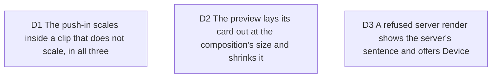

# Renderer drifts and the size refusal: the push-in clips under the bar, the preview lays out at export size, a refused server render offers Device

Tickets #114 (two drifts measured in #104: code over the chrome bar under the
push-in, hold frames 1 to 1.6 px low in the preview) and #113 (a server render
refused for size). Serves viability D1 (the preview is the export) and the
renderer rule of `CONTEXT.md`. Touches canonical-card-width D2. No domain change.

Measured before deciding, 3-scene code project with focus zoom, 1080p, preview
at 1920 device px (DPR 2.0611), against the device and server MP4s:

- With the push-in, the preview and the composition drew the first row over the
  hairline; the painter cut it under (`clipBody`, then `applyZoom`). Both DOM
  renderers scaled the very box that clipped, so the clip grew with the zoom.
- On a hold frame the preview's layout was exact (window 356.641 px at editor
  size against 356.65, card centred within 0.01 px), but its rows were 0 or
  1.1 px below the exports', row by row. CSS rounds a line's ascent, descent and
  half-leading to whole CSS px of the size it lays out at: the baseline sits at
  16 px for 14 px type and 35 px for 30.8 px type, and the glyphs then snap to
  whole px in the card's own space. Laid out at editor size and scaled 2.2x,
  every row sat on a 2.2 px grid.
- The server already answered 400 for code over 50,000 characters and the panel
  showed it, but in a fragment ("max 50000 characters") and with nothing to do next.

## D1 The push-in scales inside a clip that does not scale, in all three

**Decision:** the rule lives in `focus-zoom.ts`: the push-in scales the code
inside the body box, which clips at its own, unscaled size. The painter already
did. Both DOM renderers now wrap the code in one component, `FocusZoomBody`
(outer box clips with the window's radius, inner box scales), and the two
copies of `zoomStyle` are gone.

**Why:** one picture in three renderers; the painter's cut is the one that
keeps the title bar a title bar.

**Rejected:** letting the painter draw over the bar like the DOM: it puts code
on the window's chrome, which no window does.

**Impact:** `focus-zoom.ts`, `focus-zoom-body.tsx`, `live-preview.tsx`,
`server/remotion/composition.tsx`; tests `tests/server/focus-zoom-clip.test.tsx`
and a case in `tests/presentation/live-preview-canvas.test.tsx`.

**Pivot:** "Let the push-in draw code over the title bar."

## D2 The preview lays its card out at the composition's size and shrinks it

**Decision:** on the export canvas the preview multiplies every editor size of
its card (type, padding, margin, radius, chrome, reels bar, caption, clip and
fades) by `previewCardPlacement(...).layoutScale`, the exporters' render scale,
and divides the card's transform by it. The editor-size fields
(`windowWidth`, `cardScale`) keep their meaning, so the canonical-card-width
and readable-floor tests are unchanged. The plain fit-to-viewport card stays at
editor size.

**Why:** the composition lays the same CSS out at that size, so the preview's
line boxes round exactly as the server's do, by construction. Snapping the
card's top to the device grid was rejected: the error is per row (a 2.2 px
grid), not one offset. Measured after: rows within 0.10 to 0.15 px of both
exports on 10 of 12 rows; the other two differ by one whole pixel where the
canonical baseline falls just under a half pixel, the same kind of flip the
server and the device show between themselves (1.0 px on one row). Chrome
hairline: preview to device 0.08 px (0.24 before), to server 0.46 px (0.62).

**Rejected:** dividing the layout scale by the device pixel ratio as well
(tried and measured: Chrome rounds font metrics in CSS px, so the title rose
2 px and the rows 1 px).

**Impact:** `canvas-fit.ts` (`layoutScale`), `live-preview.tsx`. Side effects
for the orchestrator: the studio's `.code-frame-glow` shadow is now 1 canvas px
deep in its ring instead of 2.2 (closer to the composition's own 1 px ring);
a PNG captured while the export canvas is showing is about 2.2 times larger in
each dimension, since `exportPng` captures the card as laid out.

**Pivot:** "Lay the preview's card out at editor size again."

## D3 A refused server render shows the server's sentence and offers Device

**Decision:** the server words its size refusals as sentences the panel shows
as they are ("Scene 2's code is too long for the server: 60,000 characters,
over the limit of 50,000."). When the server path fails, the store probes the
device and, when it can encode, the failed outcome carries
`alternative: "device"`; `ExportStatus` shows "Render on this device", which
sets Where to Device and renders. Never switched to unasked.

**Why:** the device has no such cap (the painter windows a long file), and a
refusal with no next step is a refusal that gets retried as is.

**Rejected:** refusing on the client before the upload: the cap is the
server's rule and stays worded by it.

**Impact:** `server/remotion/render-request.ts`, `export.store.ts` (server path
only), `export-status.tsx`, `app.css` (a status action keeps its words on one
line); tests in `tests/server/render-request.test.ts` and
`tests/presentation/export-server-refusal.test.tsx`.

**Pivot:** "Show the refusal without offering Device."
