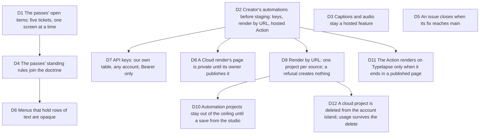

# The next wave: the passes' open items, and the automations Creator already sells

Bruno, 2026-10-05, once GitHub Actions ran again: "C'est fait, vous pouvez
continuer à travailler", after "il y a encore des pass UI/UX à faire".
Job served: a Creator gets what the plan sells, and every screen holds the
bar the passes set. Touches [viability](2026-10-03-viability.md) D2, D3 and
D4 to D6, [ui-passes](2026-10-05-ui-passes.md) D2, and
[operating-model](2026-10-03-operating-model.md) D8 to D10.

Measured before deciding (2026-10-05): render by URL and the Action's hosted
output, both sold in viability D3, have no route, no credential and no
ticket; the hosted guard reads the session cookie only. The on-device export
says "captions are not baked on this device yet" and "no audio track on this
device yet". The passes left five Open lists and eight Drift rows. Thirty
issues sat open while their Project 4 cards were in Fait: 23 had their fix on
`main`, six wait for PR #137. A server test on `main` expired at
2026-10-04T12:01Z because the hosted guard reads the real clock while its
fixture session lives one minute past a fixed date; #137 moves the fixture
far into the future, #144 moves the guard to the injected clock.

## D1 The passes' open items: five tickets, one screen at a time

**Decision:** #139 (the studio's remaining surfaces read the system), then
#140 (export dock and island), then #141 (the phone sheet); #142 (capture
library) after #139; #143 (landing follow-ups, with the URL-free half of
#112) on its own. Each runs gate 4 in Emil's order with Craft after
`emil-ui-polish` and ends on `emil-ui-review`.

**Why:**

- Bruno asked for more passes, and the passes themselves listed what they
  saw and did not fix, with owners.
- The chain follows the shared stylesheet, so two agents never edit the same
  rules at once.

**Rejected:**

- One sweep across every screen: Emil's lesson is one or two skills per run,
  and the passes proved the screen-by-screen order.

**Impact:** Project 4, `docs/design/passes/`, `docs/design/SYSTEM.md`.

**Pivot:** "Stop the passes" or "Do this screen first" (name it).

## D2 Creator's automations before staging: keys, render by URL, hosted Action

**Decision:** build what viability D3 sells and nobody can use yet: API keys
from the account island (#144), render by URL for a key or a session (#145),
and the Action's hosted output (#146). A free account's render by URL
returns the studio link (viability D4). Keys are hashed, shown once,
revocable, rate limited, and authenticate only the render and import routes.

**Why:**

- The price promises them, and they are the step from the free Action to a
  paid account: the funnel viability D5 drew.
- They are testable now against the local hosted services; only the
  production URL and staging (#70, #112) wait for Bruno.

**Rejected:**

- Waiting for staging: the staging run (#71) would then prove a plan that
  cannot deliver two of its promises.
- A paid GitHub App: still behind the DevRel interviews (viability D7, #77).

**Impact:** server auth and routes, the account island, `action.yml`, the
README. Security posture changes: a second credential type exists. Nothing
reaches production before #70 and the trusted-proxy decision of #65.

**Pivot:** "No API keys" (render by URL and the hosted Action then wait).

## D3 Captions and audio stay a hosted feature

**Decision:** the on-device painter does not learn captions or synthesized
audio in this wave; the export keeps saying so.

**Why:**

- Viability D2 lists captions and synthesized audio among what hosted
  renders add. Building them on the device first would give away the reason
  to render on our servers before anyone has paid for it.

**Rejected:**

- Painter parity now: a real WYSIWYG gain, but a pricing decision, not a
  polish one.

**Impact:** none; the notes in the export stay.

**Pivot:** "Bake captions on the device."

## D4 The passes' standing rules join the doctrine

**Decision:** `docs/design/DECISIONS.md` takes the two rules the passes left
to the orchestrator, written within its line budget by #139's agent: a
full-window root clips and never scrolls; phone chrome clears the safe areas
(the row from `max(10px, inset-top)`, the sheet's stops from the phone sheet
module, the instrument above `inset-bottom`), enforced by the phone-sheet
test. D2 there gains the hero exception the landing pass recorded, and the
stale citations (Drift 7 and 14) are corrected.

**Why:**

- Both rules already hold in the code and have a test; written down, the
  next pass does not rediscover them.

**Rejected:**

- Leaving them in the pass files: a pass file is history, the doctrine is
  what the next agent reads.

**Impact:** `docs/design/DECISIONS.md`, `docs/design/SYSTEM.md`,
`docs/decisions/2026-08-09-hero-direction.md`.

**Pivot:** "Drop a standing rule" (name it).

## D5 An issue closes when its fix reaches main

**Decision:** the orchestrator closes an issue when the commit that fixes it
is on `main`, with that commit in the closing comment, and removes its state
label; a card in Fait with an open issue is a bug in the process. The 23
issues fixed on `main` were closed on 2026-10-05; #131 to #136 close when
#137 merges.

**Why:**

- `docs/agents/issue-tracker.md` already says the column and the label are
  one state; the merged PRs had not named their issues with closing keywords.

**Rejected:**

- Closing keywords alone: a PR that fixes several issues needs one keyword
  per issue, and the waves missed it.

**Impact:** Project 4, the closing comments.

**Pivot:** "Leave issues open until Bruno closes them."

## D6 Menus that hold rows of text are opaque

**Decision:** the source menu, its form popovers and the project menu take
the opaque studio surface in both shells, not the 88% material. DECISIONS D5
says so in one line (#140).

**Why:**

- Looked at, not guessed: on a phone the menus cover the stage, and the
  mesh showed through the lower rows as an orange and grey blotch
  (`139/after/phone-light-01-source-menu.png`). Text held 7:1, the surface
  read as dirty.

**Rejected:**

- Keeping the material and dimming the stage behind the menu: a second
  layer to keep in step for every menu.

**Impact:** `src/presentation/studio-camera.css`, `docs/design/DECISIONS.md`.

**Pivot:** "Menus go back to the glass."

## D7 API keys: our own table, any account, Bearer only

**Decision:** keys live in a minimal Drizzle table (migration 0006), not in
`@better-auth/api-key`. They travel as `Authorization: Bearer` and count only
on `/api/cloud/*`, where a valid cookie still wins. Any account may hold
keys: a free account's render is refused by the plan (402), as viability D4
says, not by the key. A key may publish its own render's page, which the
Action's hosted output needs (#146). Unknown keys get no per-IP limit until
the trusted-proxy decision (#65).

**Why:**

- The plugin, measured on 1.6.26: its verify reads the real clock, it keeps
  a key valid at the instant of `expiresAt` while our sessions end there, and
  its limiter, anchored on the last accepted request, would cut off an
  Action polling its job.

**Rejected:**

- The plugin with patches around it: three behaviours to override in a
  security path.
- `x-api-key`: one header for one credential is enough, and Bearer is what
  every HTTP client and the Action already send.

**Impact:** `server/auth/`, `server/db/`, `server/routes/api-keys.ts`, the
account island, migration 0006 to apply before any deployment.

**Pivot:** "Use the Better Auth plugin" or "Keys only for Creator".

## D8 A Cloud render's page is private until its owner publishes it

**Decision:** `/v/<id>` answers 404 until the owner publishes the render, in
the studio or with `PUT /api/cloud/jobs/:id/public` and a key. This is what
shipped with #119 (`is_public` defaults to false); the 2026-10-04 log said
every Cloud render gets a public page, and is amended to point here.

**Why:**

- A studio project can hold code that is not public; a page that appears
  by default would publish it without a click. The trust premium viability
  D2 measured is lost once, not per page.

**Rejected:**

- Public by default with an opt-out: one forgotten toggle leaks a client's
  code.

**Impact:** `docs/decisions/2026-10-04-open-source-e2e-and-growth.md` D4,
the Action's hosted output (#146) publishes explicitly.

**Pivot:** "Pages are public by default."

## D9 Render by URL: one project per source; a refusal creates nothing

**Decision:** `POST /api/cloud/render/source` keeps one cloud project per
account and source, so the same source answers the same job and a changed
one adds a revision. Size, minutes and renders in flight are checked before
any write. The CLI's import cascade is the only importer. Four follow-ups:
render-by-URL projects stay out of the project ceiling until someone saves
them from the studio (#148); a cloud project can be deleted from the studio
(#149); an optional server GitHub token, public repositories only, and a
time budget on reads (#150); the PostgreSQL contract tests run in CI (#151).

**Why:**

- An Action that renders every push would otherwise create a project per
  push, and reach the ceiling in a week.
- No screen deletes a cloud project today, so a Creator at the ceiling had
  no way out.

**Rejected:**

- A new project per request: the ceiling then measures pushes, not work.
- Deleting untouched render-by-URL projects automatically: deleting data is
  Bruno's call, and the ceiling rule of #148 makes it unnecessary.

**Impact:** `server/routes/cloud.ts`, `src/application/import/`,
`src/application/render/`, the CLI.

**Pivot:** "A new project per render."

## D10 Automation projects stay out of the ceiling until a save from the studio

**Decision:** a project only render by URL has written is an *automation
project*: the cloud-projects ceiling and the allowance do not count it. A
save from the studio (a session write on `/api/projects/:id`) makes it a
*regular project*, which counts; that save is refused with the ceiling's 402
when the account is already at the ceiling, and the 101st studio project is
still refused. A Creator at 100 regular projects still renders a 101st source
by URL. Nothing is deleted automatically. Both terms are in `CONTEXT.md`.

**Why:**

- An Action that renders every pull request would otherwise lock its owner
  out of saving within weeks.

**Rejected:**

- Deleting untouched automation projects: deleting data is Bruno's call.
- Counting them: the ceiling would measure pushes, not work.

**Impact:** migration 0007 (`projects.automation`), the project repository
port, `render-by-source`, `server/routes/projects.ts`, `CONTEXT.md`. Open:
render by URL overwrites a project whose source changed even after a person
saved it; decide (keep the saved one, or refuse) before the studio can open a
cloud project.

**Pivot:** "Count render-by-URL projects again."

## D11 The Action renders on Typelapse only when it ends in a published page

**Decision:** with `api-key` and `api-url`, the Action asks render by URL,
waits up to ten minutes, publishes the page and comments the share page and
the studio link. A free key, a refusal, a timeout, an outage or a GIF leaves
the runner to render as today, with one line saying why; a Typelapse outage
never reddens a pull request. The theme is a render option on the wire and a
property of the saved project, shared with the CLI's `--theme`, so the same
source with another theme is a new revision of the same project. Private
repositories fall back to the runner. Without a key, nothing changes.

**Why:**

- Viability D2: the runner is the user's machine and stays free; the hosted
  output is what Creator adds, not a dependency the free path takes on.

**Rejected:**

- Replacing the runner outright when a key is set: a hosted failure would
  fail the user's workflow.
- A diff fallback for private repositories: it would publish a page from
  code the key holder may not own publicly; a product call for later.

**Impact:** `action.yml`, `cli/hosted-render.ts`, `cli/pr-comment.ts`, the
render-by-URL route, the README. The fork note changes once #112 gives
`api-url` a default.

**Pivot:** "A key means hosted or nothing."

## D12 A cloud project is deleted from the account island; usage survives the delete

**Decision:** the account island lists the account's cloud projects (the
first such list in the studio) and deletes one behind the shared
confirmation, which names what goes: revisions, media, renders and their
share pages. The delete queues the stored files for the cleanup worker in
the same transaction and takes the owner and job locks. The open local
project is untouched; the next save makes a new cloud copy. A delete
returned the project's render minutes to the month, because usage is summed
from the jobs' rows: #152 makes the month's usage a record a delete does not
touch.

**Why:**

- No screen reached the delete route, so a Creator at the ceiling had no
  way out; and deleting rows without the files leaked storage.
- The minutes loophole was reachable over the API already; one click in the
  studio made it a product rule to close, not to leave.

**Rejected:**

- Soft delete as the fix: it keeps the user's data against their click; a
  usage record is the smaller change.

**Impact:** the project repository, the account island, `CONTEXT.md`, #152.

**Pivot:** "Delete only over the API."
