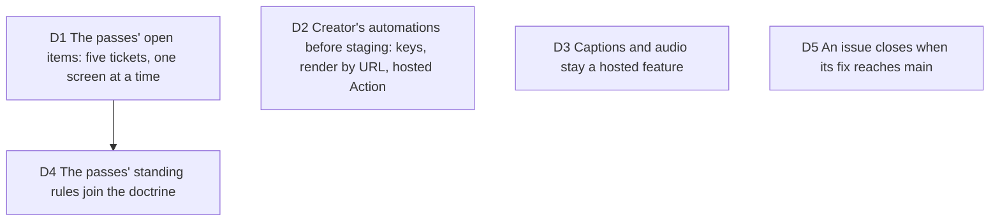

# The next wave: the passes' open items, and the automations Creator already sells

Bruno, 2026-10-05, once GitHub Actions ran again: "C'est fait, vous pouvez
continuer à travailler", after "il y a encore des pass UI/UX à faire".
Job served: a Creator gets what the plan sells, and every screen holds the
bar the passes set. Touches [viability](2026-10-03-viability.md) D2, D3 and
D4 to D6, [ui-passes](2026-10-05-ui-passes.md) D2, and
[operating-model](2026-10-03-operating-model.md) D8 to D10.

Measured before deciding (2026-10-05): render by URL and the Action's hosted
output, both sold in viability D3, have no route, no credential and no
ticket; the hosted guard reads the session cookie only. The on-device export
says "captions are not baked on this device yet" and "no audio track on this
device yet". The passes left five Open lists and eight Drift rows. Thirty
issues sat open while their Project 4 cards were in Fait: 23 had their fix on
`main`, six wait for PR #137. A server test on `main` expired at
2026-10-04T12:01Z because the hosted guard reads the real clock while its
fixture session lives one minute past a fixed date; #137 moves the fixture
far into the future, #144 moves the guard to the injected clock.

## D1 The passes' open items: five tickets, one screen at a time

**Decision:** #139 (the studio's remaining surfaces read the system), then
#140 (export dock and island), then #141 (the phone sheet); #142 (capture
library) after #139; #143 (landing follow-ups, with the URL-free half of
#112) on its own. Each runs gate 4 in Emil's order with Craft after
`emil-ui-polish` and ends on `emil-ui-review`.

**Why:**

- Bruno asked for more passes, and the passes themselves listed what they
  saw and did not fix, with owners.
- The chain follows the shared stylesheet, so two agents never edit the same
  rules at once.

**Rejected:**

- One sweep across every screen: Emil's lesson is one or two skills per run,
  and the passes proved the screen-by-screen order.

**Impact:** Project 4, `docs/design/passes/`, `docs/design/SYSTEM.md`.

**Pivot:** "Stop the passes" or "Do this screen first" (name it).

## D2 Creator's automations before staging: keys, render by URL, hosted Action

**Decision:** build what viability D3 sells and nobody can use yet: API keys
from the account island (#144), render by URL for a key or a session (#145),
and the Action's hosted output (#146). A free account's render by URL
returns the studio link (viability D4). Keys are hashed, shown once,
revocable, rate limited, and authenticate only the render and import routes.

**Why:**

- The price promises them, and they are the step from the free Action to a
  paid account: the funnel viability D5 drew.
- They are testable now against the local hosted services; only the
  production URL and staging (#70, #112) wait for Bruno.

**Rejected:**

- Waiting for staging: the staging run (#71) would then prove a plan that
  cannot deliver two of its promises.
- A paid GitHub App: still behind the DevRel interviews (viability D7, #77).

**Impact:** server auth and routes, the account island, `action.yml`, the
README. Security posture changes: a second credential type exists. Nothing
reaches production before #70 and the trusted-proxy decision of #65.

**Pivot:** "No API keys" (render by URL and the hosted Action then wait).

## D3 Captions and audio stay a hosted feature

**Decision:** the on-device painter does not learn captions or synthesized
audio in this wave; the export keeps saying so.

**Why:**

- Viability D2 lists captions and synthesized audio among what hosted
  renders add. Building them on the device first would give away the reason
  to render on our servers before anyone has paid for it.

**Rejected:**

- Painter parity now: a real WYSIWYG gain, but a pricing decision, not a
  polish one.

**Impact:** none; the notes in the export stay.

**Pivot:** "Bake captions on the device."

## D4 The passes' standing rules join the doctrine

**Decision:** `docs/design/DECISIONS.md` takes the two rules the passes left
to the orchestrator, written within its line budget by #139's agent: a
full-window root clips and never scrolls; phone chrome clears the safe areas
(the row from `max(10px, inset-top)`, the sheet's stops from the phone sheet
module, the instrument above `inset-bottom`), enforced by the phone-sheet
test. D2 there gains the hero exception the landing pass recorded, and the
stale citations (Drift 7 and 14) are corrected.

**Why:**

- Both rules already hold in the code and have a test; written down, the
  next pass does not rediscover them.

**Rejected:**

- Leaving them in the pass files: a pass file is history, the doctrine is
  what the next agent reads.

**Impact:** `docs/design/DECISIONS.md`, `docs/design/SYSTEM.md`,
`docs/decisions/2026-08-09-hero-direction.md`.

**Pivot:** "Drop a standing rule" (name it).

## D5 An issue closes when its fix reaches main

**Decision:** the orchestrator closes an issue when the commit that fixes it
is on `main`, with that commit in the closing comment, and removes its state
label; a card in Fait with an open issue is a bug in the process. The 23
issues fixed on `main` were closed on 2026-10-05; #131 to #136 close when
#137 merges.

**Why:**

- `docs/agents/issue-tracker.md` already says the column and the label are
  one state; the merged PRs had not named their issues with closing keywords.

**Rejected:**

- Closing keywords alone: a PR that fixes several issues needs one keyword
  per issue, and the waves missed it.

**Impact:** Project 4, the closing comments.

**Pivot:** "Leave issues open until Bruno closes them."
