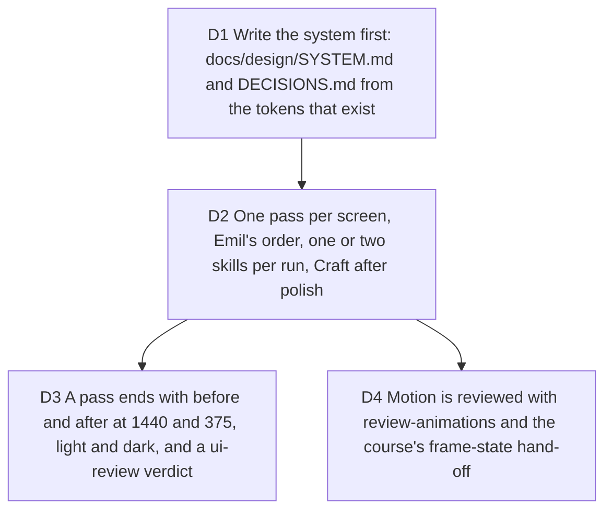

# UI passes: the system first, then every screen through Emil's loop

Bruno, 2026-10-05, after a first look: "c'est bien mais il y a encore des
passes UI/UX à faire avec les skills et cours que je vous ai donné." Jobs
served: every one; the quality bar ([typelapse-quality-bar], ui.camera as the
reference). Touches [operating-model](2026-10-03-operating-model.md) D3 (gate
4) and the aiforui lessons "Defining a system" and "How to use aiforui
skills".

Measured before deciding: the sprint ran gate 4 per ticket, one or two Emil
skills per diff, never a whole screen at once; there is no `docs/design/`
in this repository (mnemos has SYSTEM.md and DECISIONS.md and its agents
read them before any UI work); the tokens live in `src/app.css` and
`src/presentation/studio-camera.css` and in memory notes about the radius
and hover doctrine.

## D1 Write the system first

**Decision:** `docs/design/SYSTEM.md` names the tokens (color, type, space,
radius, shadow, motion) with the rule behind each, extracted from the CSS
that ships, and `docs/design/DECISIONS.md` records the standing doctrine
(radius, hover, island, paper, materials). Every UI agent reads both before
touching a screen, and adds to DECISIONS.md only through its pass file.

**Why:** the course lesson "Defining a system": an agent that cannot read the
system invents one per screen.

**Pivot:** "No system doc, read the CSS."

## D2 One pass per screen

**Decision:** Screens: the landing; the studio desktop shell (island,
timeline, step builder and inspectors); the export dock, status, Cloud
receipt, source hub and account island; the studio on a phone; the public
render page with the 404 and the error states. Each pass: `emil-prototype`
only when a direction is open, `emil-design-foundations`, one material skill,
`emil-ui-polish`, `emil-animations` where motion exists,
`craft-design-engineering`, `emil-unslop-design` when a surface reads
generated, then `emil-ui-review`. Findings and decisions go to
`docs/design/passes/2026-10-05-<screen>.md`.

**Pivot:** "Fewer screens" (name them) or "stop at polish".

## D3 Proof of a pass

Before and after screenshots at 1440 and 375, light and dark; the
`emil-ui-review` verdict with its should-fix list done; no regression in the
parity and e2e suites.

## D4 Motion

Reviewed with `review-animations` and `emil-animations`, values rather than
adjectives (the course's frame-state hand-off): durations, curves and the
properties animated are written in the pass file.
