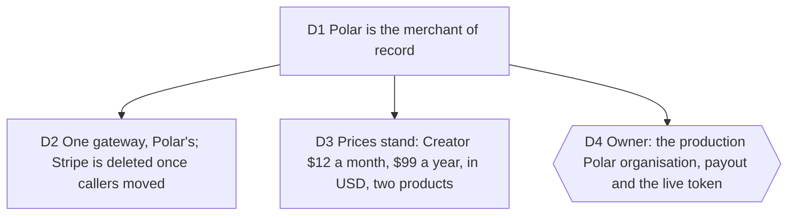

# Billing: Polar is the merchant of record; the Stripe gateway is replaced, not kept

Bruno, 2026-10-06: "Oui je valide, on facture comment ? Via polar ?", after
the business model brief. Job served: the first euro of viability D6, taken
without a one-person company running VAT and sales-tax compliance across the
world. Touches [viability](2026-10-03-viability.md) D2 to D4 and D8, and
[open-source-e2e-and-growth](2026-10-04-open-source-e2e-and-growth.md) D4.

Measured before deciding (2026-10-06, from polar.sh/docs and stripe.com/en-be):
Polar takes the liability for VAT, GST and US sales tax globally, is
registered in the jurisdictions as thresholds are reached, and files and
remits; the seller keeps only its income tax. Fees: Starter 5% plus 50 cents
a transaction, plus 1.5% on non-US cards, plus 0.5% on subscriptions for
early members; disputes $15; payouts $2 a month plus 0.25% plus 25 cents.
Stripe from Belgium: 1.5% plus 25 cents on EEA cards, 3.15% international,
Billing 0.7%, Tax 45 cents a transaction where registered, and the OSS and
non-EU registrations stay ours. On a $12 month, Polar keeps about $1.30 and
Stripe about $0.55; on a $99 year, about $7 against $2.25. The gap, about
6% of revenue, buys the compliance a founder would otherwise do by hand.
Our code: 937 lines behind one `BillingService`, Stripe named in its types,
two webhook families mapped, a Checkout and a Portal; Stripe has never run
live (no key was ever set).

## D1 Polar is the merchant of record

**Decision:** Typelapse sells through Polar. Polar is the seller of record
toward the customer, collects and remits VAT, GST and US sales tax, issues
the invoices and runs the customer portal. Typelapse keeps its own plan
projection from Polar's webhooks, as it did from Stripe's.

**Why:**

- Bruno's words, and the arithmetic above: at this volume the fee gap is
  smaller than one accountant's quarter.
- A one-person company selling worldwide B2C software would otherwise owe
  OSS returns in the EU and registrations in the UK and US states as sales
  grow; a mistake there is a tax debt, not a bug.

**Rejected:**

- Stripe with Stripe Tax: cheaper per transaction, but the registrations,
  filings and liability stay ours.
- Lemon Squeezy or Paddle: same model, but Polar's sandbox, TypeScript SDK
  and Better Auth adapter fit the stack we have, and its fees sit between
  the two.

**Impact:** `server/billing/`, `server/routes/billing.ts`, the billing
projection store, the client billing adapter, `.env.example`, the README's
Deployment and Business model sections, `pnpm hosted:check`.

**Pivot:** "Bill with Stripe after all."

## D2 One gateway, Polar's; Stripe is deleted once callers moved

**Decision:** the `BillingService` keeps its shape; its gateway becomes a
Polar gateway built on `@polar-sh/sdk` (checkout sessions, subscriptions,
customer portal sessions, webhook verification), with provider-neutral type
names. Polar's `subscription.active`, `updated`, `canceled`, `uncanceled`,
`revoked` and `past_due` events and `order.paid` feed the projection, keyed
by `external_customer_id` set to our account id. The Stripe gateway, its
tests and the `stripe` dependency are deleted in the same change, after the
callers moved (Pstack: migrate callers, then delete the legacy API).

**Why:**

- Two gateways nobody runs are two surfaces to keep honest; Stripe never ran
  live, so nothing is lost.

**Rejected:**

- Keeping Stripe behind a flag "in case": a flag that is never flipped is
  dead code with a secret attached.

**Impact:** #155. The e2e hosted suite gets a billing journey against the
Polar sandbox (test card 4242) when a sandbox token is in the environment,
and skips otherwise.

**Pivot:** "Keep the Stripe gateway."

## D3 Prices stand: Creator $12 a month, $99 a year, in USD, two products

**Decision:** viability D3's prices are confirmed by Bruno. In Polar they are
two products, "Creator, monthly" and "Creator, yearly", priced in USD with
Polar's currency presentment for the rest; the landing shows only what the
catalog endpoint returns, as before. A founder price, if any, is a third
product and stays open in #79 with the opening date.

**Why:**

- Polar models one pricing model per product; a monthly and a yearly plan
  are two products shown side by side.

**Rejected:**

- EUR as the default currency: the competitors we price against quote USD,
  and Polar presents local currency anyway.

**Impact:** the catalog maps two product ids instead of two price ids
(`POLAR_CREATOR_MONTHLY_PRODUCT_ID`, `POLAR_CREATOR_ANNUAL_PRODUCT_ID`).

**Pivot:** "Change a price" (name it).

## D4 Owner: the production Polar organisation, payout and the live token

`needs owner`. Only Bruno creates the production organisation on polar.sh,
its payout account, the two products with the prices of D3, the webhook
endpoint secret and the organisation access token, and puts them in the
deployment's environment (#70). For the build, a sandbox organisation on
sandbox.polar.sh and its token in the worktree's `.env` are enough; the
builder creates the sandbox products through the API.
