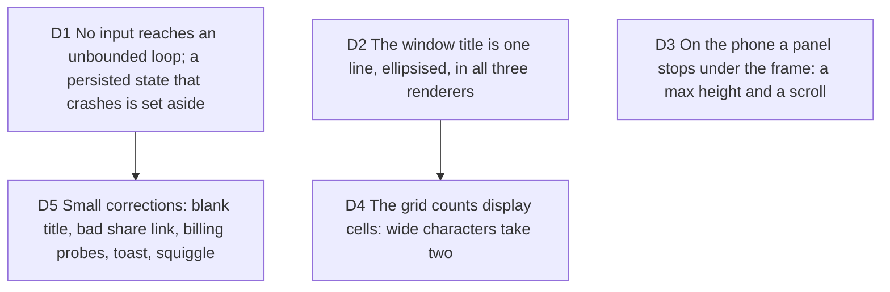

# The gate's second pass: a crash loop, and three places where the renderers disagree

Bruno, 2026-10-06, "continue à travailler"; the gate's first pass led to
PRs #175 to #180, all merged; decision D9 of
[verify-gate-findings](2026-10-06-verify-gate-findings.md) says the gate
runs again on `main` before new features. Job served: a person who types
something unusual never loses their studio, and the three renderers draw
the same frame. Touches [verify-gate-findings](2026-10-06-verify-gate-findings.md)
D2 and D4, [renderer drifts](2026-10-04-renderer-drifts-and-size-refusal.md),
and the magic-move engine's grid.

Measured before deciding (2026-10-06, evidence under
`.craft/evidence/2026-10-06-main-2/`, untracked, Docker up this time): a
focus range `1-1000000` throws `RangeError: Maximum call stack size
exceeded` (`focusLineSet` fills a Set without a ceiling, then a spread into
`Math.min`), the persisted project replays the crash on every reload and
only clearing site storage recovers; `1-120000` passes, `1-200000` crashes.
A 54-character PR title wraps to two lines in the preview and is painted on
one clipped line in the PNG and the MP4. On a 390px phone the Frame and
Look panels start at y 400 and 416 while the frame ends at y 451; Export
and Motion start below it. CJK and emoji take one grid cell each in the
engine, so the `;` after `café` paints over the `é` in every renderer. The
gate's fixes of the first pass all hold (D1 to D8 OK, D4 partial).

## D1 No input reaches an unbounded loop; a persisted state that crashes is set aside

**Decision:** focus ranges are clamped to the step's line count at parse
and at use (`focusLineSet` never holds more lines than the code has), the
min and max of a focus set are computed by iteration, never by spreading a
Set into `Math.min`, and the focus field refuses what it cannot read
(`abc`, `0`, `5-2`) with the field's existing invalid state instead of
silently rewriting it. Independently, the studio's boot wraps the restore of
the persisted project: a restore that throws sets the project aside under a
recovery key, starts from the default project, and says in one line that
the last project could not be opened and was kept. "Reload to pick up where
you left off" is shown only when a reload can.

Amended the same night after the first build failed review: the guard arms
only when a stored project was actually restored and disarms at the first
commit after it; on a throw while armed it first mounts the default project
without touching storage, and only if that commits does it set aside the
draft and the active project's entry (never the whole library), keyed by
project id with no count-based eviction; a default project is never kept; the
notice appears only when a copy was written and carries one action,
"Download it", the kept project as the studio's JSON. Ranges are parsed
without the line count on load (a saved `"2, 8-10"` on a 5-line step opens
unchanged); the clamp lives at the field and at use. The field's refusal of
`5-2` and `0` replaces the old silent normalization; a hand-written file
keeps normalizing at use.

**Why:**

- One typed range took the studio down for good, with a message that
  promised the opposite. A restore that can throw must not be the first
  thing the app does.

**Rejected:**

- Only clamping the range: the next unbounded input would loop the same
  way; the boot guard is the rule, the clamp is this instance.
- Clearing the stored project automatically: deleting a person's work is
  Bruno's call; setting it aside is not.
- A time window (any throw in the first seconds is the stored project's):
  a lazy chunk or a share payload that throws would move a healthy project
  aside, and a shell bug would evict it after a few boots.

**Impact:** `src/application/focus/line-ranges.ts`,
`src/application/magic-move/focus-zoom.ts`, the focus field in the step
inspector and the phone list, the studio persistence boot, `CONTEXT.md`
("recovery key"), tests.

**Pivot:** "Clear the stored project when it crashes."

## D2 The window title is one line, ellipsised, in all three renderers

**Decision:** the frame chrome's title is a single line that truncates with
an ellipsis at the width the bar leaves it, in the DOM preview, the Remotion
composition and the frame-painter alike. The truncation is a pure function
in `src/application/` (characters that fit for a given bar width in `ch`
units, with the ellipsis), called by the three renderers; `title=` on the
preview keeps the full name. A test paints the 54-character PR title and
asserts the preview's chrome and the painter agree on the string drawn.

**Why:**

- A title bar is chrome, one line is its convention on every platform, and
  a bar that grows with the title changes the frame's geometry between
  renderers (the first drift the renderer-drifts log warned about).

**Rejected:**

- Wrapping in the painter too: a taller bar for a longer title, and the
  code moves down with it.

**Impact:** `src/presentation/components/preview/frame-chrome.tsx`,
`server/remotion/` chrome, `src/application/frame-painter/painter.ts`
(title draw), a new `src/application/layout/window-title.ts`, tests.

**Pivot:** "Wrap the title everywhere."

## D3 On the phone a panel stops under the frame: a max height and a scroll

**Decision:** D4 of the first pass is completed: with the sheet at the peek,
every island panel on the phone has a maximum height that keeps its top
below the stage card's bottom plus the gutter, and scrolls inside when its
content is taller (Frame and Look today). The phone-sheet e2e asserts, for
each panel tab, that the panel's box does not intersect the card's box.

**Why:**

- Frame and Look hold the controls that act on the frame (padding, margin,
  radius, theme); covering the frame while adjusting it defeats the panel.

**Rejected:**

- Shrinking the stage above a tall panel: the first pass decided the stage
  never reflows for a panel.

**Impact:** the island panel styles for the phone (`cluster-panels.tsx`,
the panel rules of `studio-camera.css` or `app.css`),
`tests/e2e/mobile-shell.spec.ts`.

**Pivot:** "Let Frame and Look cover the frame."

## D4 The grid counts display cells: wide characters take two

**Decision:** the magic-move engine lays tokens out in display cells, not in
UTF-16 code units: East Asian wide and fullwidth characters and emoji take
two cells, combining marks take none, everything else one, through a pure
`src/application/text/display-width.ts` (a `wcwidth`-style table, no
dependency). The DOM preview, the composition and the painter position by
the engine's cells already, so they agree by construction; the painter's
`fillText` per token is unchanged. Tests cover `こんにちは世界 🚀 naïve café`.

**Why:**

- Strings with CJK or emoji are ordinary in code; a `;` painted over an
  `é` is a visible defect in every export.

**Rejected:**

- Measuring text in the DOM: the engine is DOM-free on purpose, and the
  painter and the server have no DOM.

**Impact:** `src/application/magic-move/engine.ts` (column advance),
`src/application/text/display-width.ts`, the frame-painter text layer if
it advances by character, `tests/application/`. Opus builds it: the engine
is the WYSIWYG contract.

**Pivot:** "Keep one cell per code unit."

## D5 Small corrections: blank title, bad share link, billing probes, toast, squiggle

**Decision:** one P3 ticket: a blank project name reverts to "Untitled"
without a thrown `Snippet title must not be empty` (the title is a draft
like the code, D2 of the first pass); a `#share=` payload that cannot be
read opens the default studio with one line saying the link could not be
read; the client does not call `/api/billing/*` when `/health` says
`billing:false`; the over-ceiling toast does not cover the Preview/Edit
switch; Monaco does not underline the `⋯` separator of a PR import. The
PR import's card sized on its tallest step (56 lines) is a product
behaviour (the frame fits the longest scene), noted, not changed.

**Why:**

- Each is one read or one line; together they are the texture.

**Rejected:**

- One ticket each.

**Impact:** `snippet.store.ts` (title draft), the share-link boot,
`plan.store.ts` or the billing client, the toast placement, the Monaco
language setup for the separator.

Third pass (2026-10-07, SHIP WITH NITS, evidence `2026-10-07-main-3/`):
the pill still covered the phone header (#202, placed by the shell's math
in #206); the nits of #203 (PR #208): Monaco validation off only while a
`⋯` line exists; the focus message names the last line; stored focus is
read leniently on hydration, which also means the server now persists a
lenient focus through `hydrateProjectDocument` (accepted: the domain
invariant and the strict field stay); the first cloud save asks the list
instead of probing (cost noted in #209); server ticks follow the typed
scene, and the v1 route's picture types it too; a top fade on the Look
panel; the caption band's height follows a pure display-cell line count
(one line keeps today's geometry, a two-line caption adds one line for the
whole video so the card never jumps between scenes). Open after it: #174,
#179, #182, #204, #205, #207, #209.

**Pivot:** "Leave the nits."
