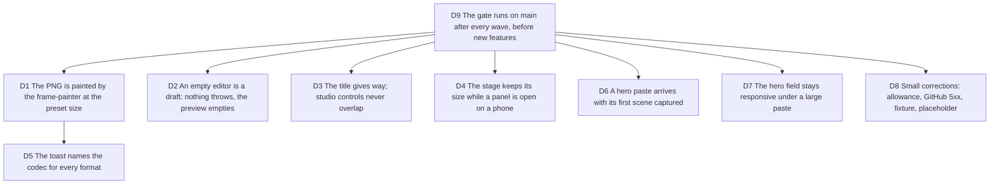

# The gate's first run on main: two blockers, four majors, and what the product promises

Bruno, 2026-10-06, after the Polar merge: "je te laisse la main maintenant,
continue à travailler". Job served: the wave that merged on 2026-10-06 never
went through `/craft-harness:verify`; its first run on `main` (7a39ca6)
returned DO NOT SHIP. Touches [next-wave](2026-10-05-next-wave.md) D1 and
D3, [ui-passes](2026-10-05-ui-passes.md), [renderer drifts]
(2026-10-04-renderer-drifts-and-size-refusal.md) and
[operating-model](2026-10-03-operating-model.md) D8 to D11.

Measured before deciding (2026-10-06, evidence under
`.craft/evidence/2026-10-06-main/`, untracked): the PNG export is a corner
crop of the DOM card whose size follows the window (754x494 at 1440x900,
1074x704 at 1920x1080, 424x278 for 9:16), in headless Chromium 151 and in
Chrome 154; the MP4 at the same preset is a correct 1920x1080 H.264. A PR
title of 50 characters pushes the Library button over Preview at 1440 and
over Preview and Edit at 1280. Emptying Monaco throws
`Snippet code must not be empty` and the preview keeps the old code. On a
390px phone the export panel resizes the stage card from 107x64 to 672x264.
The landing says the export names its codec; the toast names it for WebM
only. Filling the hero field with 8000 lines blocks the main thread 36 s.

## D1 The PNG is painted by the frame-painter at the preset size

**Decision:** the PNG snapshot is a frame of the client export: the
frame-painter paints the current scene at the size preset and aspect of the
export config, with the mesh background, and the file is that canvas. The
DOM capture (`modern-screenshot`) leaves `exportPng`. A test asserts the
file's dimensions for 1080p 16:9 and 9:16.

**Why:**

- The painter is the on-device renderer already; the PNG was the one export
  drawn by a fourth method, and it was the one that drifted.
- A snapshot that depends on the window is not a snapshot of the project.

**Rejected:**

- Fixing the scale passed to `domToBlob`: still window-dependent, still a
  fourth renderer, still no mesh.

**Impact:** `src/presentation/stores/export.store.ts`, a pure
`src/application/export/png-snapshot.ts` (or the painter's own entry),
`tests/application/`. The landing's "every aspect" claim becomes true.

**Pivot:** "Keep the DOM snapshot."

## D2 An empty editor is a draft: nothing throws, the preview empties

**Decision:** the domain invariant stands (a `Snippet` has code). The
editor's live value is a draft the store holds beside the snippet: an empty
draft renders an empty code card in the preview, disables Capture and Play
with the existing "Capture a scene" guidance, and never reaches
`Snippet.create`. Typing again resumes as today.

**Why:**

- Select-all, delete is the first thing a person does before pasting; a
  thrown error and a stale preview that Capture then records is a WYSIWYG
  break, not an edge case.

**Rejected:**

- Allowing empty code in the domain: every renderer and the server would
  then have to handle it.
- Catching the error and keeping the old code: the editor and the video
  still disagree.

**Impact:** `src/presentation/stores/snippet.store.ts`, the editor and
preview components that read the code, `tests/presentation/`.

**Pivot:** "Keep the old code in the preview when the editor is empty."

## D3 The title gives way; studio controls never overlap

**Decision:** in the studio header the project chip's title has a maximum
width and truncates with an ellipsis (the full title in `title=`), so the
Preview and Edit switch, Add source and Library keep their place from 1100px
up. A layout test or a Playwright assertion at 1280 and 1440 with a
50-character title proves no two header controls intersect.

**Why:**

- A PR import gives the project its PR title; conventional titles run 50 to
  70 characters. Edit mode unreachable after an import blocks the core
  journey.

**Rejected:**

- Wrapping the header onto two rows: the shell's one-row geometry is a
  SYSTEM.md rule.

**Impact:** `src/presentation/components/layout/project-chip.tsx`,
`scene-shell.tsx`, `src/presentation/studio-camera.css`.

**Pivot:** "Wrap the header instead."

## D4 The stage keeps its size while a panel is open on a phone

**Decision:** opening the export panel (or any island panel) on the phone
shell does not change the stage's layout: the `[data-export-target]` card
keeps its box, the preview frame stays. The phone-sheet test gains the
assertion.

**Why:**

- Measured: the card jumps to 672x264 at a negative offset and a band of
  huge code shows under the header until the panel closes.

**Rejected:**

- Hiding the stage behind the panel: the panel is a panel, the stage is the
  product.

**Impact:** the phone shell and export dock styles
(`mobile-shell.tsx`, `studio-camera.css` or the panel's module),
`tests/presentation/` phone-sheet test.

**Pivot:** "Let the panel reflow the stage."

## D5 The toast names the codec for every format

**Decision:** `exportCodecNote` returns the codec line for MP4 and WebM
(GIF has none), from the rung the worker chose: "MP4 · H.264 4:2:0" reads as
the WebM line does. The landing sentence then holds.

**Why:**

- The landing says the export names its codec; a public claim the product
  does not keep is a trust cost, and the worker already knows the label.

**Rejected:**

- Softening the landing sentence: the information exists, show it.

**Impact:** `src/application/export/export-label.ts`, its test, the
WebCodecs adapter's label for H.264 and HEVC rungs if missing.

**Pivot:** "Name the codec for WebM only."

## D6 A hero paste arrives with its first scene captured

**Decision:** the `#import=` intent from the landing lands in the studio
with the pasted code captured as scene one, so Play is live and the
typewriter animates it on arrival. The in-studio paste keeps today's
behaviour (a source change on an existing project asks before replacing).

**Why:**

- The hero button says "Import & animate"; landing on "0 scenes" with Play
  disabled is the promise broken at the first second.
- One captured scene is already an animation (typewriter mode).

**Rejected:**

- Changing the button copy to "Import": weaker promise, same product.

**Impact:** `src/presentation/components/layout/import-intent-boot.tsx`,
`tests/presentation/` import-intent tests, the landing e2e journey.

**Pivot:** "Land on the empty timeline."

## D7 The hero field stays responsive under a large paste

**Decision:** a paste of 8000 lines into the hero field completes within one
frame budget's order (under 200 ms on the test machine), measured by a test
or a Playwright timing. Whatever the field does per keystroke (highlight,
measure, intent encoding) is deferred, capped or moved off the input path.
The phone placeholder shows a whole URL ("https://github.com/…/pull/…" or a
shorter sentence) rather than a cut "https://github.com/o".

**Why:**

- 36 s of frozen page on a paste is a crash to a visitor.

**Rejected:**

- Refusing pastes over a size: the studio accepts them.

**Impact:** `src/presentation/landing/hero.tsx` and what it calls,
`tests/presentation/`.

**Pivot:** "Cap the hero at N lines."

## D8 Small corrections: allowance, GitHub 5xx, fixture, placeholder

**Decision:** four P3 fixes in one ticket: the island's allowance sentence
re-reads the count after "Cloud copy saved" (today it needs a reload); a
GitHub 5xx on a PR's diff endpoint tells the person the diff can be pasted
instead; the `@network` e2e fixture moves from `sindresorhus/is/pull/200`
(its diff endpoint answers 500) to `honojs/hono/pull/5189`; a project chip on
the phone keeps at least the first word of the title. The 300-character line
that shrinks the card to a strip is a layout-math change across three
renderers: its own ticket, not this wave.

**Why:**

- Each is one sentence or one read; together they are the texture the
  passes aim for.

**Rejected:**

- One ticket per nit: five briefs for five lines.

**Impact:** `studio-account-island.tsx` or the cloud summary store,
`src/infrastructure/import/pr-import.ts`, `tests/e2e/imports.spec.ts`,
`project-chip.tsx`.

**Pivot:** "Leave the nits."

## D9 The gate runs on main after every wave, before new features

**Decision:** after a wave merges, the orchestrator runs
`/craft-harness:verify` as a full product pass on `main` and turns the
findings into tickets before briefing any new feature. The hosted journeys
need Docker running; when it is not, the report says what it did not cover
and the owner starts it (`needs owner`).

**Why:**

- Seven PRs merged with green gates and a working product, and the first
  human-shaped pass still found two blockers the unit tests cannot see.

**Rejected:**

- Running the gate per PR only: the PNG bug predates every PR of the wave.

**Impact:** `docs/agents/QUALITY_LOOP.md` (Prove gate), `.craft/STATE.md`.

**Pivot:** "Verify per PR only."
