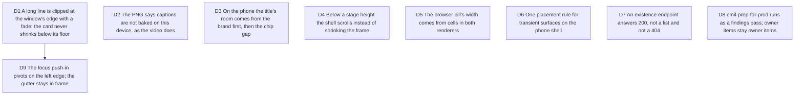

# After the gate: seven small rules, and the pass before production

Bruno, 2026-10-07, "go" after "il reste quoi ?": the three gate passes left
seven P3 tickets waiting for a decision, and viability D6's step 5
(`emil-prep-for-prod`, then launch) is the next agent-side step while
staging (#70) is Bruno's. Touches [viability](2026-10-03-viability.md) D6,
[next-wave](2026-10-05-next-wave.md) D3, [gate findings]
(2026-10-06-verify-gate-findings.md) and [second pass]
(2026-10-06-gate-second-pass.md) D2 to D5.

## D1 A long line is clipped at the window's edge with a fade; the card never shrinks below its floor

**Decision:** the fit already has a readability floor and a column limit;
a line longer than the window's columns is clipped at the right edge with
a short fade, identically in the DOM preview, the Remotion composition and
the frame-painter (the fade is painted, not CSS-only), and the card is
never scaled below the floor to make it fit. The math lives in
`src/application/layout/` (which columns are visible, where the fade
starts); the engine keeps laying out the full line so a morph still
glides. Ticket #174, Opus builds it.

**Why:**

- Measured: a 300-character line shrank the card to an unreadable strip
  (`b62-break-studio-cjk-longline.png`). A code video never wraps code;
  clipping is what every editor does.

**Rejected:**

- Wrapping long lines: changes line numbers and the morph's rows.
- Horizontal scrolling in the video: motion the person did not author.

**Impact:** `canvas-fit.ts`, `magic-move-canvas.tsx`, `frame-painter/`,
tests. **Pivot:** "Shrink to fit, whatever the width."

## D2 The PNG says captions are not baked on this device, as the video does

**Decision:** the on-device PNG keeps the caption band (its geometry
matches the preview and the on-device MP4) and the export note that already
says "captions are not baked on this device yet" for the video applies to
the PNG too. Next-wave D3 stands: captions stay a hosted feature. Ticket
#179.

**Why:**

- The band empty is the on-device video's look already; the fix the ticket
  needs is honesty in the note, not a fourth rendering of captions.

**Rejected:**

- Dropping the band from the still: the still would stop being a frame of
  the export (D1 of the gate findings).

**Impact:** `export-label.ts` or the note builder in `export.store.ts`,
tests. **Pivot:** "Bake captions on the device."

## D3 On the phone the title's room comes from the brand first, then the chip gap

**Decision:** down to 360px the project chip keeps "Untitled" whole: the
corner row gives room first by reducing the brand mark to its glyph, then
by tightening the chip gap; the controls keep their 44px hit areas. A test
at 360, 375 and 390 asserts the name is not clipped. Ticket #182.

**Why:**

- 360 is the most common Android width; a project called "Untitl…" on
  first open reads as broken.

**Rejected:**

- Dropping the title to one word: already the case, still clipped at 360.

**Impact:** `app.css` `.sc-corner-row`, `project-chip.tsx`, e2e.
**Pivot:** "Keep the full brand mark."

## D4 Below a stage height the shell scrolls instead of shrinking the frame

**Decision:** the desktop shell gives the stage a minimum height; when the
window is shorter, the shell scrolls vertically rather than fitting the
frame into what is left. The inspector keeps its place. Ticket #204.

**Why:**

- Measured: 1440x500 gave a 128px thumbnail. Below readability, a scroll
  is honest; a thumbnail is not.

**Rejected:**

- Collapsing the inspector first: hides the work to show the picture.

**Impact:** `scene-shell.tsx`, `studio-camera.css`, a layout test.
**Pivot:** "Always fit the window."

## D5 The browser pill's width comes from cells in both renderers

**Decision:** the browser bar's pill is sized from the title's display
cells (`displayWidth`) in the DOM chrome and in the painter alike, no
`measureText`, so a CJK or emoji label gives the same pill in both. Ticket
#205.

**Why:**

- The title string is already shared; the pill was the last measure that
  depended on a fallback font.

**Impact:** `painter.ts` chrome hunk, `frame-chrome.tsx`, the chrome test.
**Pivot:** "Measure the pill."

## D6 One placement rule for transient surfaces on the phone shell

**Decision:** under 1280px every transient surface (the import status pill,
the replace-question strip, the notice host) starts at
`phoneSheetGeometry(viewport).rowBottom + STAGE_TOP_GAP`, below the corner
row and above the stage, and stacks downward in that order; none covers a
control. The desktop placements stay. Ticket #207.

**Why:**

- #206 placed the pill; the two other surfaces still sat on the corner
  row, and a notice over the pill was toast on toast.

**Impact:** `import-intent-boot.tsx` (confirm strip), `notice-host.tsx`,
e2e at 390 and 375. **Pivot:** "Let a blocking question cover the row."

## D7 An existence endpoint answers 200, not a list and not a 404

**Decision:** `GET /api/projects/:id/exists` answers `200 {exists}` for the
signed-in owner; the first cloud save asks it instead of listing every
owned project (`list()`), and no 404 reaches the console. Ticket #209.

**Why:**

- A browser logs every 4xx; a list validates every document; one indexed
  read is the right cost.

**Impact:** `server/routes/projects.ts`, the repository port,
`hosted-project-sync.ts`, tests. **Pivot:** "Keep the list."

## D8 emil-prep-for-prod runs as a findings pass; owner items stay owner items

**Decision:** an agent runs `emil-prep-for-prod` (with `emil-performance`
and `emil-marketing-pages` where they apply) on the landing and the studio
as a findings pass: nothing edited, a report with repros, then tickets. The
URL-dependent half of #112 (robots, sitemap, canonical, og:url) and the
hosting's real 404 stay Bruno's until the production URL exists.

**Why:**

- Viability D6 step 5; the first euro is gated by ops and proof, and this
  is the proof side an agent can do now.

**Impact:** a report under `.craft/evidence/`, tickets. **Pivot:** "Run
prep-for-prod after staging."

**Outcome of #214** (the studio's boot weight, PR #225): `CodeEditor` mounts
the first time its slot is shown (the card unfolded, the phone sheet above its
peek) and stays mounted, so a Preview visit requests no Monaco; the build
writes the studio route's hashed files into the page, `/app` modulepreloads
them and the landing prefetches them on a link or the hero field being reached;
the Suspense fallback draws the studio's outline; `/app` has its own tab title;
`index.html` has a noscript and a pre-mount failure sentence. `/app` on mobile
went from 1,954 KB to 839 KB and TTI from 11.9 s to 6.1 s; LCP did not move
(6.2 s to 6.1 s), the next lever being Shiki's wasm and theme chunks.

## D9 The focus push-in pivots on the left edge; the gutter stays in frame

**Decision:** the focus zoom's push-in (`ZOOM_SCALE` 1.25) pivots only as
far left as needed to keep the line-number gutter in frame:
`origin = min(0.5, leftRoom / crop)` where `crop` is the width the push-in
moves out and `leftRoom` the margin plus gutter before the first column. A
short snippet keeps its centred pivot, a wide window moves it left, a
185-column cut gives 0. Whatever the push-in crops on the right is faded at
the window level (a push-in fade whose opacity follows the zoom), so no
glyph is sliced. One pure function states the rule and the DOM preview, the
Remotion composition and the frame-painter read it. Ticket #227, PR #229.
(Amended the same morning: an always-left pivot lost the end of short lines,
"greet(name: stri…", which is worse than the centred crop.)

**Why:**

- Measured on the fourth pass: under zoom a 300-character line was cut
  mid-glyph on the left with no fade and the gutter vanished; on `main` an
  ordinary snippet under zoom already lost its gutter from 37 columns and
  code cells from about 66. A code frame's left side carries the meaning
  (numbers, indentation); its right side is where lines end.

**Rejected:**

- A left window fade with the centred pivot: the gutter and margin (55px)
  are smaller than the crop (about 164px), so the gutter would fade out
  entirely.
- An always-left pivot: short snippets lost the end of their lines.
- Pivoting left only when a line is cut: the ordinary case kept losing its
  gutter; the clamp covers both with one rule.

**Impact:** `focus-zoom.ts`, `focus-zoom-body.tsx`, the painter's
`applyZoom` and a push-in fade, CONTEXT.md; zoomed exports of wide windows
change (the gutter comes back). **Pivot:** "Centre the push-in."
