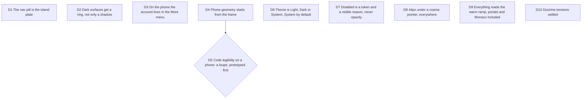

# Design audit 2026-10-08: every view, every component, phone and dark

Bruno, 2026-10-08, from his phone in dark mode on staging: the landing's
nav was unreadable, the studio title clipped, the frame a thumbnail; "êtes-
vous sûr d'avoir appliqué les cours et skills de Emil Kowalski ... et de
Gustavo ... sur chacun des composants, chacune des vues ?" They had not
been applied view by view. Four Opus audits ran the aiforui order (build,
refine, review, plus Craft) on the landing, the studio shell, the studio
panels and every other view, at phone and desktop widths in both themes.
Evidence: `.craft/evidence/2026-10-08-design-audit/` (git-ignored). Opus
decides as CTO and PO. Touches [after-the-gate](2026-10-07-after-the-gate.md)
D3 and D6, and #222.

## D1 The nav pill is the island plate

**Decision:** the landing's floating nav reads the dock tokens and the
island lift and never inverts over a dark band; its CTA stays the primary.

**Why:** measured 1.05:1 for the brand and the CTA in dark over `.lp-dark`.

## D2 Dark surfaces get a ring, not only a shadow

**Decision:** every raised surface has a dark value that is an inset 1px
ring (`--dock-hairline` or its role token); shadows alone do not carry depth
on a dark page.

## D3 On the phone the account lives in the More menu

**Decision:** under the phone shell the account island leaves the corner
row and becomes the More menu's first section. Closes #222.

**Why:** in hosted mode the fifth chip overlaps the project menu's button
(unreachable by touch) and clips the title ("Untitlec"). The phone tests ran
in local mode only; they now run in hosted mode too.

## D4 Phone geometry starts from the frame

**Decision:** on the phone the frame takes the full stage width (no desktop
inset), anchors under the corner row, and the sheet's "scenes" stop is
derived from the frame's height instead of a 55% share with a 120px floor.
9:16 has no "scenes" stop below the frame.

**Why:** 213x120 frame and 1-3px code with the sheet open on a 390px phone.

## D5 Code legibility on a phone: a loupe, prototyped first

**Decision:** a 1080p canvas cannot be read at 374px wide (4.7px code at
best). The proposal is a loupe: a tap on the frame magnifies the same image
to an 11px code floor, panning past about 40 columns. It is a new
interaction, so it goes through `emil-prototype` and Bruno's eye before any
build.

## D6 Theme is Light, Dark or System; System by default

**Decision:** a three-state choice; System follows `matchMedia` changes
live; only a forced theme rewrites the `theme-color` metas.

**Why:** one tap on "Switch to light mode" pinned light forever under a dark
OS, with no way back.

## D7 Disabled is a token and a visible reason, never opacity

**Decision:** a `--camera-disabled` token and, next to any disabled primary
action, the reason in a visible note (the rule `cluster-panels.tsx` already
states). First case: Export with zero scenes on the phone.

## D8 44px under a coarse pointer, everywhere

**Decision:** the D10 target rule extends from the island's root row to its
sheets, segmented controls, Undo, Dismiss and every studio control, through
one `@media (pointer: coarse)` rule.

## D9 Everything reads the warm ramp, portals and Monaco included

**Decision:** toasts, the import banner and every portal mounted outside
`.studio-root` take the warm tokens; the Monaco themes derive from them.

## D10 Doctrine tensions settled

- Scroll fades stay on the edge that still has content (Craft wins).
- The blue focus ring stays (D9 of the system doc).
- The dense `--sc-text-*` scale stays for tool chrome; prose and states
  respect the 12px floor. Bruno's device decides the rest.
- SYSTEM.md's contrast figures are corrected to the measured ones.
- Em-dashes in visible strings go; comments follow when a file is touched.
