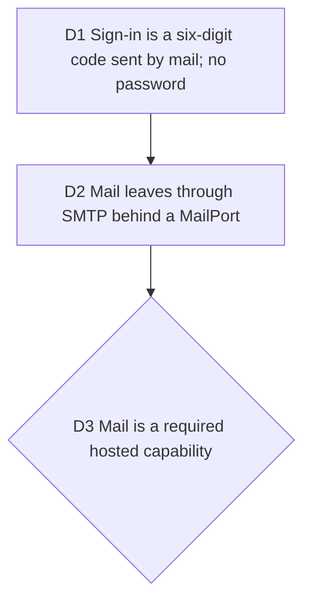

# Passwordless sign-in: a six-digit code by mail

Bruno, 2026-10-08, before proving #71 on staging: "Pour le auth, je pense
qu'un magiclink ou un code envoyé par mail est mieux. Un peu comme polar",
and maildev in a dev compose file to test mail locally. Opus decides as CTO
and PO with Fable's advice. Rewrites #234 (mail port), touches
[staging](2026-10-08-staging.md) D6 and #65.

## D1 Sign-in is a six-digit code sent by mail; no password

**Decision:** Better Auth's `emailOTP` plugin carries both sign-up and
sign-in: the person types an address, receives a six-digit code valid ten
minutes with three tries, and the session opens. `emailAndPassword` is
turned off. Sending a code is rate limited per address and per IP. The
error never says whether an address exists.

**Why:**

- A code works when the mail is read on the phone and typed on the laptop.
- Corporate mail scanners open links before the person does and burn a
  magic link; the DevRel teams of #77 sit behind exactly those scanners.
- No password means no reset flow, no breach to leak and one less form.

**Rejected:**

- A magic link, for the two reasons above.
- Keeping passwords beside the code: two ways in, twice the abuse surface.
- GitHub OAuth now: it comes with the GitHub App, later.

## D2 Mail leaves through SMTP behind a MailPort

**Decision:** a `MailPort` in the domain and one nodemailer SMTP adapter in
infrastructure. Locally, `maildev` in `compose.dev.yaml`; the hosted e2e
suite reads codes from maildev's API. On staging, any SMTP provider Bruno
picks (Resend, for example) sending from `typelapse.com`; its DNS records go
through `infra-infomaniak`.

**Why:**

- Three mails a month do not justify marrying the code to a provider's SDK.
- The same adapter serves maildev, staging and production.

## D3 Mail is a required hosted capability

**Decision:** `/health` reports `mail`, and `hosted:check` fails without an
SMTP configuration. Staging turns red until Bruno's SMTP is set, on purpose:
without mail nobody can sign in.

**Why:**

- A hosted build that cannot send the code is a hosted build nobody can
  enter; the release check must say so before a deploy, not after.

## Consequences

- #71 waits: its journey starts with sign-up, which changes shape here.
- #65 moves earlier: the auth rate limit is now the only defence of an
  endpoint that sends mail, so the trusted-proxy posture (Cloudflare, then
  ingress-nginx, then the pod) is due before staging opens to anyone but
  Bruno.
