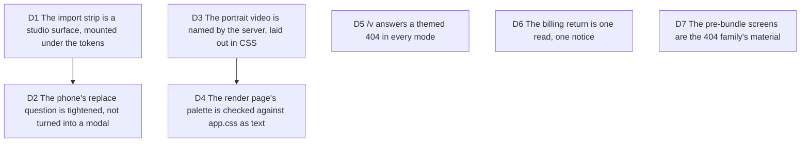

# Public pages fix: the audit's findings on every view but `/` and `/app`

Trigger: the 2026-10-08 design audit of every non-landing, non-studio view (123
screenshots, `.craft/evidence/2026-10-08-design-audit/public-pages/`). Job served:
the import link, the public render page, the return from checkout and the screens
before the bundle read as one product, on a phone and in the dark. Touches the audit's
D2 (a ring in the shadow stack) and D9 (portals take the warm ramp), after-the-gate D6
(`#207`, the transient surfaces' line), D8 (44px under a finger) and `#71` (the billing
return).

## D1 The import strip is a studio surface, mounted under the tokens

**Decision:** `ImportStatus` carries `studio-root sc-tokens` like the replace question
and takes `.sc-import-status` (studio-camera.css): `--camera-surface`, the ring inside
`--camera-material-shadow` and no border, `--r-surface`, the UI face at
`--sc-text-md`. A failure is `--camera-danger` ink with an icon and a second line, the
next step: "Check the link, or paste the diff instead." for a link,
"Check what you pasted, then try again." for a paste (`importNextStep`). The Dismiss
button is 40px to a pointer and 44px under a finger. From 1280px the question starts at
the status's 76px line (`DESKTOP_TRANSIENT_TOP`), so it no longer covers the
Preview/Edit switch.

**Why:** the strip sat beside the shell on Tailwind's cold ramp, with a border beside a
shadow, an 11px mono face and a red that failed on the dark paper.

**Rejected:** a toast through the notice host (it is another builder's, and a status
that waits on a fetch is not a notice).

**Impact:** `import-intent-boot.tsx`, `studio-camera.css`, `import-wording.ts`,
`tests/presentation/import-status.test.tsx`, `source-import-replacement.test.tsx`.

**Pivot:** "The import strip is a toast again."

## D2 The phone's replace question is tightened, not turned into a modal

**Decision:** under 1280px the question card is compacted (14px padding, a tighter gap
before the answers) so that its bottom lands above the frame at 360 and 390, one stage
gap from it. Both answers keep their 44px. The copy is unchanged.

**Why:** the question starts one stage gap under the corner row (`#207`) and the frame
starts 18px under that, so at 360 a four-line question covered the frame's top. A modal
with a scrim would hide the frame by design, and the question that says what an import
replaces is the one place the frame should stay visible.

**Rejected:** shortening the sentence (it is the truth about the autosaved draft, in
four places); `ConfirmDiscardOverlay` on the phone.

**Pivot:** "Ask on the phone in a modal with a scrim."

## D3 The portrait video is named by the server, laid out in CSS

**Decision:** `/v/:id` sets `data-portrait` on `.stage` when the video is taller than it
is wide. A stylesheet cannot compare two custom properties, and the viewport's shape is
not the video's. On a phone a portrait stage is capped at 60svh and its title at two
lines, so the action stays above the fold; the full title stays in the tab's title and
the player's label. From 640px the about column sits beside the picture.

**Impact:** `server/routes/render-page.ts`, `tests/server/render-page-route.test.ts`.

**Pivot:** "Keep the text under the video at every size."

## D4 The render page's palette is checked against app.css as text

**Decision:** the page keeps its inline palette (it loads no bundle), spelled as
app.css spells it, and `tests/server/render-page-tokens.test.ts` reads both files and
fails on the first difference: the ten tokens, the dark four, the Geist fallback
metrics. The fallback now has app.css's two faces (400 and 600).

**Why:** cross-cutting cause 1 of the audit: a copied value drifts the first time the
source changes.

**Pivot:** "Import the tokens from app.css at build time."

## D5 `/v` answers a themed 404 in every mode

**Decision:** `/v`, `/v/` and anything deeper than a render's own addresses answer the
`sentencePage` family, in the hosted route (a final `all("*")`) and, without render
pages, through `createRenderPageNotFoundRoute`, mounted by `createApp` because the
static site steps aside for `/v`. The dead-end pages say "This video is not available",
with the reason under it in ash.

## D6 The billing return is one read, one notice

**Decision:** `/app?billing=success|cancelled` is read once on mount
(`takeBillingReturn`, which drops only that parameter and keeps the hash), posted to the
notice host as "Creator is on." or "Checkout cancelled, nothing was charged.", and after
a payment the plan store is asked again. The host is not restyled.

**Impact:** `billing-return.ts`, `billing-return-boot.tsx`, `studio-route.tsx`.

## D7 The pre-bundle screens are the 404 family's material

**Decision:** the noscript and the failed boot are Geist (inline `@font-face`, the
render page's), centred on the paper, with the heading's weight and the paragraphs'
margins in an unlayered rule that beats preflight, a dark theme (the stored choice
through `data-boot-theme`, else the OS through the media query), the safe areas, and a
link that is a 44px target without moving the line. The 404 and the route error face
carry the Logomark, drop the landing's share tags for as long as they are on screen and
stack their actions under 380px. The skeleton's phone row takes the real row's numbers.

No domain change.
