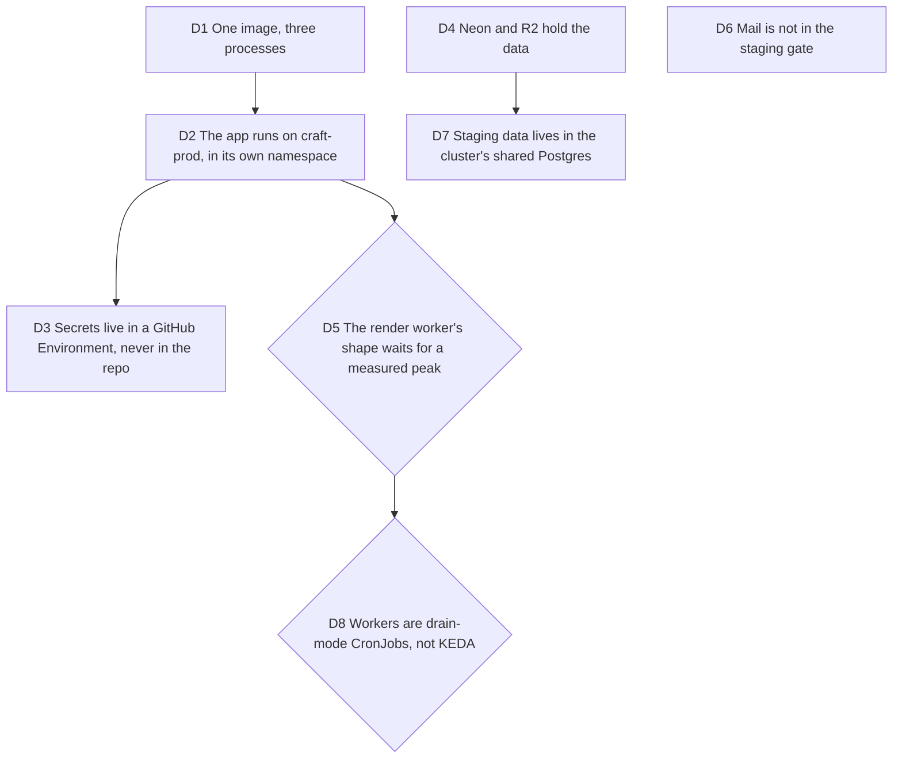

# Staging: one image on Bruno's cluster, data with third parties

Bruno, 2026-10-08, on #70: "celui-ci avec un coût nul parce qu'on n'a pas
d'utilisateur payant", files and data delegated to third parties (Cloudflare,
Neon), the app on his own Kubernetes cluster or a service we propose. Opus
orchestrates, Fable advises. Touches [viability](2026-10-03-viability.md) D6
step 2, which named Stripe: billing is Polar since #161.

## D1 One image, three processes

**Decision:** one Docker image, built once, started as the API (which also
serves the built app, so `/`, `/app`, `/api/*` and `/v/*` share one origin),
the render worker and the object-deletion worker. `pnpm db:migrate` then
`pnpm hosted:check` run as the release step, where the secrets live.

**Why:**

- The render worker needs Chromium, a scratch disk and up to fifteen minutes
  a job: no serverless runtime holds it, and three builds would drift.
- A single origin removes the proxy rule `.env.example` asked the host for.

## D2 The app runs on craft-prod, in its own namespace

**Decision:** staging runs on Bruno's Infomaniak cluster `craft-prod`
(amd64, already paid), host `staging.typelapse.com` (Bruno buys `typelapse.com`; he refused a brunodogbase.tech subdomain), in a
namespace `typelapse-staging` with its own quota and a deployer identity
that reaches only that namespace. Manifests follow brunodogbase.tech's
convention (plain manifests, `kubectl apply`, no Helm). The terraform change
in `infra-infomaniak` is prepared on a branch; Bruno plans and applies it.

**Why:**

- Zero cost was the constraint. Free tiers of Fly, Railway and Render do not
  hold a Chromium worker for fifteen minutes.
- The repo goes public under AGPL: its CI credential must not reach the
  shared `brunodogbase` namespace.

**Rejected:**

- Bigger nodes or a third node in steady state: they cost money.

## D3 Secrets live in a GitHub Environment, never in the repo

**Decision:** the `staging` GitHub Environment holds every secret; the deploy
workflow writes the Kubernetes Secret from it. Not SOPS-in-git as
brunodogbase.tech does.

**Why:**

- #70's acceptance says secrets never live in the repo, and an encrypted
  blob in a public history stays there for good.

## D4 Neon and R2 hold the data

**Decision:** PostgreSQL on Neon (free tier, pooled URL), files on a private
Cloudflare R2 bucket (free tier, CORS on the staging origin only), billing on
Polar sandbox. Not the cluster's shared Postgres nor Infomaniak's object
storage.

**Why:**

- Bruno wants data with third parties; the code already speaks `R2_*`, and
  Infomaniak's gateway would need a checksum workaround.

## D5 The render worker's shape waits for a measured peak

**Decision:** the render worker's memory request and limit, and whether it is
a Deployment or a Job per render, are set from the peak memory of a real
1080p render at concurrency 1 measured inside the image. Concurrency becomes
an environment value, 1 on staging. If the peak fits two nodes beside the
apps already there, a Deployment; otherwise a Job per render or a lower
staging resolution.

**Why:**

- The cluster's ADR leaves about 3.8 GiB free on two nodes; a guess either
  starves the worker or squeezes Bruno's other apps.

**Measured (#236):** a 1080p, 600-frame render at concurrency 1 peaks at
1.72 to 1.81 GB (cgroup `memory.peak`, amd64 emulated and arm64 native).
Live allocations: one node 836Mi requested of 2448Mi allocatable, the other
2084Mi; no metrics-server. An honest 1.75Gi request does not fit two nodes.

**Outcome:** the render worker is Burstable, request 512Mi, limit 2Gi, one
replica, `Recreate`, PriorityClass `typelapse-render-low` (below zero,
never preempts) so memory pressure evicts it and never Bruno's apps. The
namespace limits quota goes to 3Gi. If renders are evicted often, the
choice is a third node (6 EUR a month) or a dispatcher that starts a render
Job on demand; neither is taken now.

## D6 Mail is not in the staging gate

**Decision:** sign-up is email and password without required verification,
so no mail is sent today and #70 does not wait for one. A mail port and
adapter (verification, reset) is its own ticket.

**Why:**

- #70's acceptance criteria do not name mail, and #71 proves without it.

## D7 Staging data lives in the cluster's shared Postgres

**Decision:** the staging database is `typelapse_staging` on the cluster's
shared Postgres (`data` namespace), declared in `infra-infomaniak` like the
other apps; files stay on R2. The production database is chosen with #79,
when paying users exist. The Neon project made this morning stays idle as
the production candidate.

**Why:**

- Measured, not guessed: Neon's free plan gives 100 CU-hours a project a
  month; anything that polls the database keeps its compute awake, about
  186 CU-hours a month at 0.25 CU. The current workers already poll.
- Querying an in-cluster Postgres costs nothing, and its backups exist.

**Rejected:**

- A Redis wake-up signal from the API so nothing polls Neon: a new port,
  an adapter and an hourly sweep, built before a paying user (viability D6).

**Pivot:** D4 said Neon; amended by D7 the same day for the reason above.

## D8 Workers are drain-mode CronJobs, not KEDA

**Decision:** both workers run as Kubernetes CronJobs with a drain mode: a
pod starts on schedule (render every minute, deletion every 15 minutes),
processes what is due, and exits when the queue is empty.
`concurrencyPolicy: Forbid`, render request 1Gi and limit 2Gi at the low
PriorityClass of D5. A release suspends both, waits, migrates, resumes.

**Why:**

- Bruno asked for workers created on demand and removed when idle; a pod
  that exits on an empty queue in seconds is that, with no operator.
- Start latency of up to a minute on renders of 100 to 170 seconds is
  acceptable for staging.

**Pivot:** KEDA, proposed then dropped on 2026-10-08: it polls the queue
the same way, and its operator (150 to 250Mi) does not fit two nodes. It
comes back with a third node paid by revenue.

## Consequence for #65

The request chain is Cloudflare proxy, then ingress-nginx, then the pod: the
trusted-proxy posture now has a concrete answer to choose between
(`CF-Connecting-IP` or ingress-nginx's forwarded header). Decided with #65.
