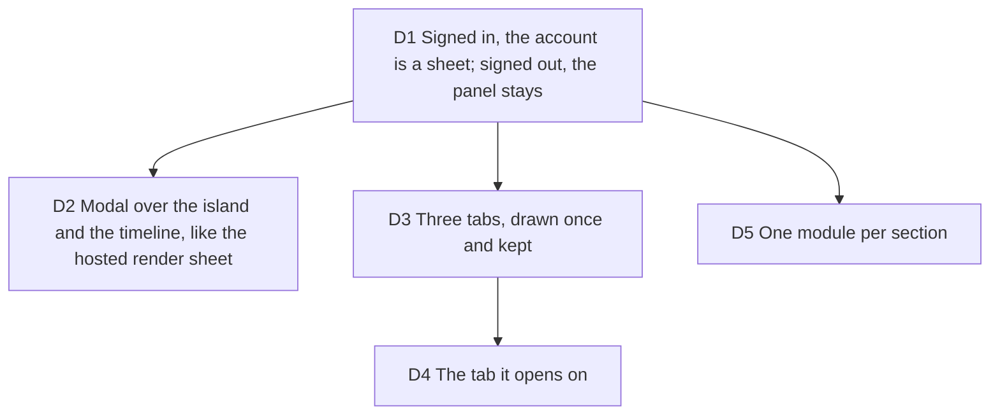

# The account sheet: the signed-in account as a bottom sheet with three tabs

Builder on #261, 2026-10-13, carrying out [ux-waves](2026-10-12-ux-waves.md) UX 12
(Polar's sidebar groups, Dub's plan and usage page) and gate-five's minor on the
desktop panel (its width and scroll cost on Free, Sign out under the fold at 1440x900).
Touches DECISIONS D1, D2, D8, D10, [design-audit](2026-10-08-design-audit.md) D3 and
[hosted-render-sheet](2026-10-13-hosted-render-sheet.md) D2.

Measured at 1440x900 before the change: the 312px panel scrolled on Free, Sign out
below its fold. After, the sheet is 576px tall and Free's Plan tab fits it.

## D1 Signed in, the account is a sheet; signed out, the panel stays

**Decision:** the account trigger opens `AccountSheet` (the studio's bottom sheet,
440px on a desktop) once signed in, and the existing small panel otherwise (the
sign-in form, the local mode, the cloud that is not there). On a phone the More
menu's account row opens the same sheet; the row closes the menu first
(`data-dismiss-menu`, as the Showcase and Library rows do) and focus comes back to
the More button. Sign out is the sheet's foot, out of every scroller, and only there:
the More menu's own Sign out row is gone (review of #299), and a sign-out from the foot
gives focus back to the More button on a phone, to Sign in on a desktop. The small
panel is named "Sign in to Typelapse", as the phone's inline form is, and keeps what
it showed while it leaves on a sign-in, so for a moment there are never two dialogs
named "Typelapse account".

**Why:** the panel stacked identity, plan, sync, projects and keys in 312px and put
Sign out under the fold; a sheet has the width for the plan card and a foot that
never scrolls.

**Rejected:** moving sign-in into the sheet too: the form is one field, and the
popover and the More menu already hold it well (#272, #153).

**Impact:** `studio-account-control.tsx`, `account-sheet.tsx`, `studio-utilities.tsx`,
`tests/presentation/account-sheet.test.tsx`, `tests/presentation/phone-account-menu.test.tsx`,
`tests/e2e/mobile-shell.spec.ts` (the signed-in row names the account; no Sign out in the menu).

**Pivot:** "Keep the account a popover under the avatar."

## D2 Modal over the island and the timeline, like the hosted render sheet

**Decision:** the sheet is the studio's modal bottom sheet, under its scrim. At
1440x900 it runs from y 324 to 900 (frame bottom 533, island 614 to 654, timeline 666
to 884); at 1280x800 from 224 to 800 (frame 146 to 438, island 514 to 554): there it
covers 73% of the frame and 78px of the frame stay visible above it. It covers
the island and the timeline, and the frame's lower part, while it is open, as the
hosted render sheet does (512 to 900 at 1440x900). The "covers neither the picture nor
the timeline" rule is gate-five's rule for the non-modal panel, which the person keeps
working beside; it does not apply to a modal sheet, which takes the page away until
Escape.

**Why:** a bottom-anchored sheet covers the timeline by construction, and the room
between the frame and the timeline (134px at 1440x900) holds no account. One height
for every tab (576px, 600px under a finger, capped at 74vh) keeps a press on a tab
from moving the sheet's top edge; Free's Plan, the tallest common tab, fits it.

**Rejected:** a sheet that shrinks to each tab (its top edge jumps under the pointer
at every switch); a sheet short enough to clear the frame (about 360px: every tab
would scroll, the cost gate five named).

**Impact:** `account-sheet.css`, `tests/e2e/hosted/account-sheet.spec.ts` (the
placement, logged and checked at both sizes).

**Pivot:** "The account must never cover the frame: make it a side panel."

## D3 Three tabs, drawn once and kept

**Decision:** Projects, Plan, API keys as WAI-ARIA tabs with automatic activation
(arrows, Home, End; one tab in the tab order), `AccountTabs`. A panel is drawn the
first time its tab is chosen (the keys are asked for only once someone looks) and
stays, hidden, after: a half-typed key name or a delete question survives a look at
another tab. Every panel is in the page from the start, so each tab's `aria-controls` names
one; it holds its section from its first visit. Each panel is its own scroller; it gets back its scroll on return, and
the control that had focus in it when its tab is pressed again or when Tab leaves the
tab for it, except a text field under a finger (no keyboard raised). Opened, focus
goes to the chosen tab, or to Copy key when a key waits. The line under the chosen
tab is a line, not a fill (D2), and glides on a transform with the snappy spring
(D8), at once under reduced motion. Coming into view reads the projects or keys list
again (one read per return, kept on purpose: the list on screen stays while it is read,
so nothing flashes), and a cloud copy that has just landed is read into the projects list.

**Why:** Polar groups the account into named places; Dub puts plan and usage on one
page. Tabs give both without a scroll through everything.

**Rejected:** unmounting a tab on leave (its scroll and its half-done work go);
manual activation (one more key for three short tabs).

**Impact:** `account-tabs.tsx`, `tests/presentation/account-tabs.test.tsx`,
`studio-api-keys.tsx` and `studio-cloud-projects.tsx` (no back button; an `active`
prop), `studio-bottom-sheet.tsx` (the panel no longer takes focus from something in
the sheet that took it first).

**Pivot:** "Show the three sections stacked in one scroll."

## D4 The tab it opens on

**Decision:** `openingSection`: API keys while a new key waits to be copied, else Plan
while billing is not in order (past due, ended), else Projects.

**Why:** a key shown once must not hide behind a tab, nor must a failed payment;
otherwise this project's cloud copy is what the account is opened for most.

**Rejected:** the last tab used (a notice could stay hidden behind it).

**Impact:** `studio-account-control.tsx`, `tests/presentation/account-sheet.test.tsx`,
the hosted journeys pick their tab (`openAccountPanel(page, account, tab)`); `billing.spec.ts`
opens the past-due and ended accounts with no tab and checks that Plan is chosen.

**Pivot:** "Open on Plan every time."

## D5 One module per section

**Decision:** `studio-account-control.tsx` (1195 lines) became the trigger and the
small panel (469); `auth-form.tsx` (the code form, still exported for the hosted render
sheet), `account-sheet.tsx`, `account-tabs.tsx`, `account-plan.tsx`,
`account-projects.tsx` and `account-identity.tsx` hold the rest. `priceLabel` stays in
`src/application/billing`. The stylesheet stays one (`studio-account-control.css`, read
by the design-system tests), with `account-sheet.css` for the sheet. The tests moved
with their modules (`auth-form.test.tsx`, `account-plan.test.tsx`), their 48 cases
unchanged but for how they open what they test. No store changed.

**Why:** each section changes for its own reason (billing, cloud, keys, auth).

**Rejected:** a new `components/account/` folder: the keys, projects and meter modules
and the stylesheet the tests read already live in `multimedia/`.

**Impact:** the files above; `hosted-render-sheet.tsx` and `use-studio-cloud-project.ts`
import from the new modules.

**Pivot:** "Keep the account in one file."
