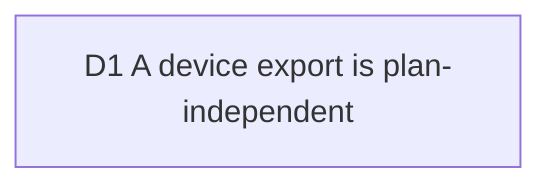

# Device exports are free: no plan clamps or watermarks what runs on the user's machine

Fable (PO/CTO), 2026-10-13, on #265: in a hosted build a signed-out or Free
visitor got a 1080p file stamped "Made with Typelapse" from an export on their
own machine, and the account copy had to drop its "up to 4K" claim because of it.
Touches [viability](2026-10-03-viability.md) D2 (the rule) and D4 (the hosted
ceilings), and [open-source-e2e-and-growth](2026-10-04-open-source-e2e-and-growth.md)
(which already rejected watermarking free exports).

## D1 A device export is plan-independent

**Decision:** No plan clamps the resolution, the frame rate or the duration of
an export that runs on the user's machine, and no plan forces a watermark on
it. The only watermark is the one the user wrote. The paid gates stay where the
cost is ours: hosted renders, cloud projects and private media.

In the domain this is structural, not a flag. `Plan` no longer carries
`maxFps`, `maxDurationMs`, `forcesBrandingWatermark`, `allowsCustomWatermark`
or the device clamps (`clampResolution`, `clampFps`, `effectiveWatermark`,
`BRANDING_WATERMARK`). `resolveDeviceExport(request)` takes no plan, so no
future entitlement can reach it. The one size limit that remains is the hosted
render rectangle, renamed `hostedMaxLongEdge` / `hostedMaxShortEdge` (and
`allowsHostedResolution`) so its scope is in its name; hosted behaviour is
unchanged.

**Why:**

- Viability D2 already says the product never watermarks a local export, and the
  landing promises "Free on your machine" and "up to 4K". The hosted build's
  signed-out visitor resolves `Plan.free()`, so the plan, not the rule, decided.
- Nothing on the hosted side ever read the device fields: the server's render
  route takes its own size and rate, and hosted jobs gate on the size rectangle
  and the monthly render time only. They were dead weight with a live bug on them.

**Rejected:**

- Watermarking free device exports to push Creator: breaks the rule that the
  machine is free, and is what the competitors we beat on trust do.
- Keeping the fields and having `resolveDeviceExport` pass an "unconstrained"
  plan: the parameter would be a lie, and the next entitlement added to `Plan`
  would be one forgotten call away from clamping a device export again.

**Impact:** `src/domain/value-objects/plan.ts`,
`src/application/export/resolve-device-export.ts` (was `resolve-export.ts`),
`src/presentation/stores/export.store.ts`, hosted render size check
(`hosted-render-job.ts`, `render-by-source.ts`), CONTEXT.md (Plan, Device
export), tests (`plan`, `resolve-device-export`, `export-device-plan-independent`,
hosted e2e `device-export.spec.ts`). #252's "up to 4K" copy can return.

**Pivot:** "Watermark free device exports" (name the plan and the mark).
