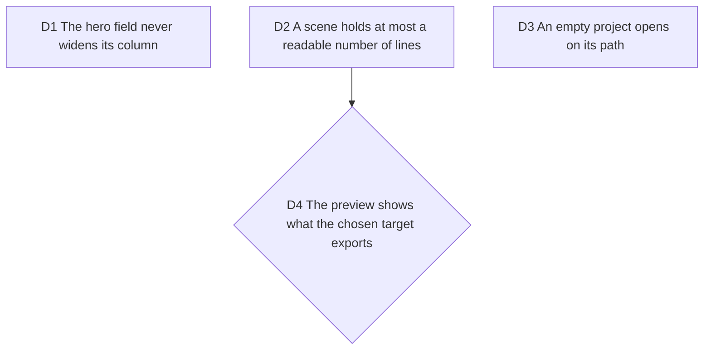

# Gate pass five: the first minute, on the file

Fable, 2026-10-13, after Bruno asked for a product that is pleasant to use
before any payment proof. `/craft-harness:verify` on main cfe2cf7 (after
#264): DO NOT SHIP, two blocking, two major, a list of minors. Evidence in
`.craft/evidence/2026-10-13-verify-main/` (git-ignored).

## D1 The hero field never widens its column

**Decision:** pasting any link into the landing's field leaves the page
width untouched at every viewport; the field clips or scrolls its text, the
column is `min-width: 0`, and the smoke test types a long URL before it
asserts no horizontal scroll.

**Why:** measured: a 21-character link pushes a 390px phone to 409px, the
hero's own example link to 591px with the button off screen; at 1440 the
field covers the engine. The comment claiming "the URL scrolls" was false.

## D2 A scene holds at most a readable number of lines

**Decision:** diff windowing caps a scene so the code stays readable in the
exported 1080p frame; the cap is chosen by measurement (effective code px
in the 1920x1080 frame for the tallest scene of a project), not by taste,
and a hunk beyond it continues in a following scene with the `⋯` separator.
Target: no scene below 18px effective code in 1080p for the hero's own
example PR.

**Why:** the PR the hero proposes gives 15, 29 and 56-line scenes; the one
card is fitted to the tallest and lands at 0.12 scale, 478px wide in 1920,
code at about 9px. The first video a visitor makes from our own example is
unreadable. Not a regression: `MAX_WALKTHROUGH_LINES = 50` with one card
for every scene.

**Rejected:** a per-scene card size (the morph needs one card), and a
smaller font (readability is the product).

## D3 An empty project opens on its path

**Decision:** with zero scenes, the phone studio opens with the sheet at
the "scenes" stop so the fork of #250 is on screen without a gesture; the
desktop studio opens in Edit so the fork shows. A project with scenes keeps
today's defaults (#246 stays open for that case).

**Why:** at 390 the fork sits at y 966 for an 844 viewport and 45% of the
screen is empty paper; on desktop `/app` opens in Preview where the fork
does not render. The path exists and nobody sees it.

## D4 The preview shows what the chosen target exports

**Decision:** when Where is "This device", the preview does not draw
captions as baked; it shows them as a note on the frame ("caption, hosted
only") or hides them, with the caveat linking to the hosted path (#254).
When Where is Cloud, captions draw as today. Wave 2, with #254.

**Why:** the PR import prefills captions, the preview shows them, the MP4
drops them. A preview that lies is the opposite of WYSIWYG.

## Minors

Tracked as one ticket for a builder: touch targets of the corner row and
the hero examples at 390 (D8), the wrong-code double message on tap, the
import banner's second line on rate-limit and offline, the step 02 copy,
`aria-current` on the landing nav, the forced-light `theme-color`, the
export pill under the sheet fade at 390 dark, the dock progress at 360, the
export filename's triple underscore, "Blank" affordance, the desktop account
panel over the frame.
