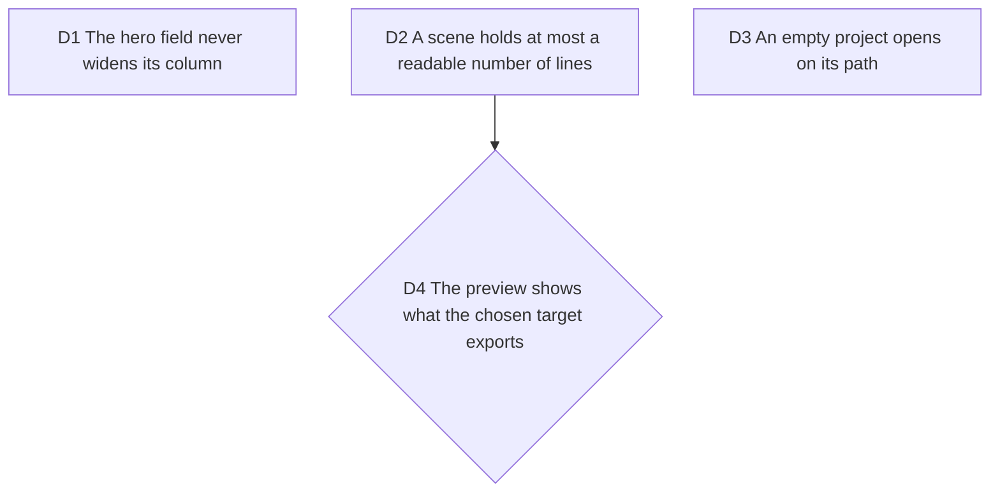

# Gate pass five: the first minute, on the file

Fable, 2026-10-13, after Bruno asked for a product that is pleasant to use
before any payment proof. `/craft-harness:verify` on main cfe2cf7 (after
#264): DO NOT SHIP, two blocking, two major, a list of minors. Evidence in
`.craft/evidence/2026-10-13-verify-main/` (git-ignored).

## D1 The hero field never widens its column

**Decision:** pasting any link into the landing's field leaves the page
width untouched at every viewport; the field clips or scrolls its text, the
column is `min-width: 0`, and the smoke test types a long URL before it
asserts no horizontal scroll.

**Why:** measured: a 21-character link pushes a 390px phone to 409px, the
hero's own example link to 591px with the button off screen; at 1440 the
field covers the engine. The comment claiming "the URL scrolls" was false.

## D2 A scene holds at most a readable number of lines

**Decision:** diff windowing caps a scene so the code stays readable in the
exported 1080p frame; the cap is chosen by measurement (effective code px
in the 1920x1080 frame for the tallest scene of a project), not by taste,
and a hunk beyond it continues in a following scene with the `⋯` separator.
Target: no scene below 18px effective code in 1080p for the hero's own
example PR.

**Why:** the PR the hero proposes gives 15, 29 and 56-line scenes; the one
card is fitted to the tallest and lands at 0.12 scale, 478px wide in 1920,
code at about 9px. The first video a visitor makes from our own example is
unreadable. Not a regression: `MAX_WALKTHROUGH_LINES = 50` with one card
for every scene.

**Rejected:** a per-scene card size (the morph needs one card), and a
smaller font (readability is the product).

**D2 follow-up (#275):** the cap is `MAX_SCENE_LINES = 24`, measured with the
diff import's look (14 px type, 2.2 video scale, a 72-column line, one
caption line): 18.8 px at 1920x1080 (a 56-row frame landed at 9.4), the fit
crosses 18 px at 25 rows, and one row is held back for a caption that wraps.
9:16 is bound by the line width (the example's longest line is 77 columns once node.ts is shown: 16.7 px), not by the rows. D2 targets the 1080p frame (16:9) only.
Splitting by page made the old 50-line total budget the wrong bound: it
existed to keep ONE frame cheap, and hid `src/router/trie-router/node.ts`, the
fix of the hero's own example. The total is now a page budget:
`MAX_WALKTHROUGH_PAGES = 4` (the line budget is derived, pages x 24 = 96, and
the pages themselves are cut at 4 when their scaffold pushes past it), the file
cap stays at 6. Measured on this machine at the default timing (1.2 s a step,
0.65 s a transition, so n steps run 1.85 n - 0.65 s):

| PR | pages | steps | duration | plan build |
| --- | --- | --- | --- | --- |
| honojs/hono#5189 (3 files, all shown, no marker) | 4 | 7 | 12.3 s | 122 ms |
| vercel/next.js#97139 | 4 | 10 | 17.9 s | 28 ms |
| oven-sh/bun#37643 | 3 | 8 | 14.1 s | 37 ms |
| honojs/hono v4.6.0...v4.7.0 (246 files), 4 pages | 4 | 11 | 19.7 s | 18 ms |
| the same, at 8 pages | 8 | 22 | 40.0 s | 117 ms |

4 is the number: the three hero examples already fit in it, and the longest
walkthrough lands at 19.7 s, under the 20 s a social clip tolerates (11
steps). 5 pages is 23.4 s, 6 is 28.9 s. The plan build stays small because no
frame passes 24 rows (plan builds timed warm, on a loaded laptop). The cap is a product constant, to revisit when a
long-form option exists. The cut of the middle by `MAX_DIFF_STEPS = 40` was a separate bug (#277), and
measuring it showed the 4 pages do not bound the steps: a page holds one step per
hunk, so 45 small hunks in one file stage 47 steps (74 s at 40, 88 s uncut), and
a PR chaptered by commit adds its chapters up. Decision (PO): the step cap is a
duration budget. n steps run 1.85 n - 0.65 s at the default timing, so
`MAX_DIFF_STEPS = 16` runs 29.0 s, under the 30 s ceiling (17 would be 30.8 s).
The three hero examples (7, 10 and 8 steps) and the 246-file comparison (11)
stay whole. Past the cap the walkthrough keeps whole chapters from the start,
ends on a `⋯ n more scenes` row, and the import says what it kept ("Showing the
first k of n commits", or "first 16 of 48 scenes" for a single change).

## D3 An empty project opens on its path

**Decision:** with zero scenes, the phone studio opens with the sheet at
the "scenes" stop so the fork of #250 is on screen without a gesture; the
desktop studio opens in Edit so the fork shows. A project with scenes keeps
today's defaults (#246 stays open for that case).

**Why:** at 390 the fork sits at y 966 for an 844 viewport and 45% of the
screen is empty paper; on desktop `/app` opens in Preview where the fork
does not render. The path exists and nobody sees it.

## D4 The preview shows what the chosen target exports

**Decision:** when Where is "This device", the preview does not draw
captions as baked; it shows them as a note on the frame ("caption, hosted
only") or hides them, with the caveat linking to the hosted path (#254).
When Where is Cloud, captions draw as today. Wave 2, with #254.

**Why:** the PR import prefills captions, the preview shows them, the MP4
drops them. A preview that lies is the opposite of WYSIWYG.

**D4 follow-up (#271):** `captionsBakedFor(target)` (`src/application/captions/`)
is true for the local server and Cloud, false for This device. Under This device
the frame keeps its caption band, which the painter also budgets, so the card never
moves, and draws nothing in it; the step's caption shows under the frame, outside
`[data-export-target]` and `[data-preview-frame]` (so no snapshot, loupe or fit
measures it), as a muted line tagged "Server only" (local build) or "Cloud only" (hosted build), the
target's own name from the one `WHERE_LABEL` table ("Not in this export" on a hosted build
whose Where lists nothing that bakes), with the caveat's own link, which is
now one component (`KeepCaptionsLink`) with two call sites. Switching Where fades
the frame's caption and the note under it on one spring (opacity only, D8) and takes the
frame caption's text out of the DOM when the fade ends. A local build has no Cloud, so the line has no link. The sheet its link can open is mounted with the stage, not in the note, so a plan that arrives mid-sheet and chooses Cloud closes it through its own path (focus falls back to the island's Export trigger). The
social preview draws no caption of its own and shares the frame, so it follows.
Proof: the band of the preview against the band of the on-device MP4 (2.6 mean
absolute difference, against 34.6 for the same band under the server target) in
`tests/e2e/device-export.spec.ts`. Cloud itself is covered by the unit test of
the rule, not by a hosted journey.

## Minors

Tracked as one ticket for a builder: touch targets of the corner row and
the hero examples at 390 (D8), the wrong-code double message on tap, the
import banner's second line on rate-limit and offline, the step 02 copy,
`aria-current` on the landing nav, the forced-light `theme-color`, the
export pill under the sheet fade at 390 dark, the dock progress at 360, the
export filename's triple underscore, "Blank" affordance, the desktop account
panel over the frame.

**Decisions the minors' PR made (#272, #281):**

- The code field is cleared on purpose after a wrong code. A code has three
  tries and a wrong one is not worth editing; the cursor goes back to the empty
  field. The refusal and the short-code line never stand together: the newer press
  takes the refusal's place, except "This code no longer works", which stays and
  stops any further try against a spent code.
- The landing's example rows are 44px on coarse pointers and 24px (WCAG 2.5.8's
  floor) on fine ones; the link spans the whole row, which names the repository
  and the pull request number (`oven-sh/bun #37643`) instead of a cut URL.
- The phone's corner row cannot reach 44px wide at 390: five icons at a 31px
  pitch in a 370px row whose project chip is at its floor. Done in #282: under a
  coarse pointer every control is a 44px column, and three moves the PO accepted
  make the room: the project name is renamed in the project menu (the chip is one
  button), a "Back to home" row ends the More menu (the logo link is gone), and
  Library joins Showcase in More. Library moves because with it kept the chip at
  360 would be about 108px, under the 111px that brand, "Untitled", chevron and
  padding need, and the name would end in an ellipsis again (#167, #182).
- A forced-light `theme-color` is the paper, `#faf9f6`, from one module pinned to
  app.css and index.html. The studio's own document background kept `#fafaf9`
  until #283 made every page read `--color-paper` (one paper, PR #296).
- The desktop account panel is 312px and ends above the timeline, so it covers
  neither the picture nor the timeline; its content scrolls inside it when it is
  taller than the room (the foot veil takes no room of its own).
