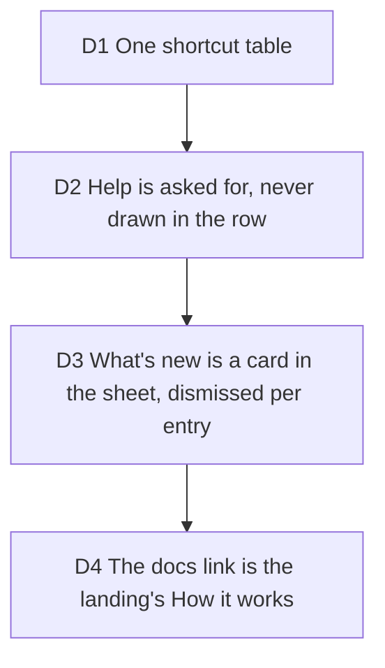

# The help sheet and What's new: one sheet, one shortcut table, a dismissal kept per entry

Builder on #259 and #260, 2026-10-13, carrying out [ux-waves](2026-10-12-ux-waves.md)
(UX 10 and UX 11). Touches [gate five](2026-10-13-gate-five.md) #282 (what More holds
under a finger) and the sheet doctrine of DECISIONS D2, D8 and D10.

## D1 One shortcut table

**Decision:** The keys were an inline `switch` and a `historyChord` function in
`use-keyboard-shortcuts.ts`. They are now one table, `STUDIO_SHORTCUTS`
(`src/application/shortcuts/studio-shortcuts.ts`), read twice: `matchShortcut` turns
a keystroke into an action id for the hook, and `keyCaps` turns a chord into the
keycaps the Help sheet prints. The guards (a modal, the loupe, a text surface) stay in
the hook, since they depend on where the event came from. The platform modifier is one
pure helper, `modifierLabel(platform)`: Cmd on Apple platforms, Ctrl elsewhere.

**Why:** a list written by hand beside the handler is the second copy that goes stale.
The only behaviour that moved: a chord with Alt held (Alt+Cmd+Enter) no longer captures
a scene, as undo and redo never took Alt.

**Rejected:** listing the keys in the sheet only; Ctrl+Y shown as the platform's
modifier (the studio reads Ctrl for it on a Mac too, so the sheet says Ctrl).

## D2 Help is asked for, never drawn in the row

**Decision:** Help has no trigger of its own in either shell. The desktop island has a
"Help" glyph, the phone's More menu has a row after the resources and before the file
actions, on both pointers, and both ask `useHelpRequestStore`, as the Showcase and the
library are asked for. The sheet is a `StudioBottomSheet` with 44px targets under a
coarse pointer.

**Why:** the corner row has no room left at 360 (#282); More already holds the browse
actions.

## D3 What's new is a card in the sheet, dismissed per entry

**Decision:** The card lists the latest three entries of a static file
(`src/application/changelog/entries.ts`, `latestEntries`), newest first. Dismiss stores
the shown ids under `typelapse:changelog-dismissed`, no network and no account. An entry
written later is not in that list, so the card returns with it. The More row, the More
button and the island's Help glyph carry a dot, in ink and not the primary (the one fill
of a zone, D2), while an entry is undismissed. The dot is described to assistive
technology, not part of the control's name.

**Rejected:** a count (it asks to be cleared); a card in More (the menu is the account
and the actions, and has no room for three entries).

## D4 The docs link is the landing's How it works

**Decision:** There is no docs site: `docs/` is the team's notes. The link is
`/#how-it-works`, the landing's section, as a plain address that opens in a new tab so
the studio keeps its project.
