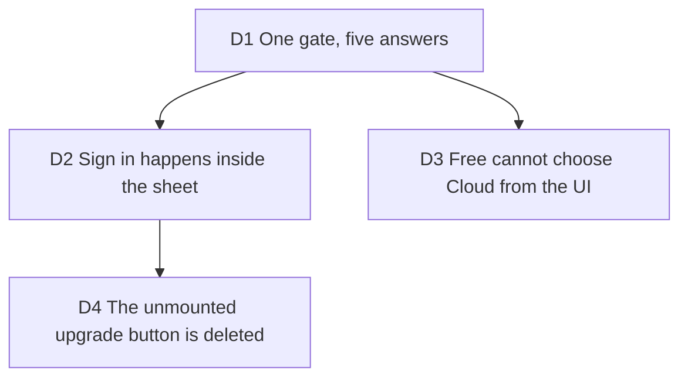

# The hosted render sheet: Cloud is listed for everyone, and the press explains it

Builder on #254, 2026-10-13, carrying out [ux-waves](2026-10-12-ux-waves.md) D3
(the paid side visible, gated at the action) and #265 criterion 3 (the signed-out
panel names the device ceiling). Touches [viability](2026-10-03-viability.md) D2 and D4.

## D1 One gate, five answers

**Decision:** `cloudGate` (`src/application/billing/cloud-gate.ts`) answers what
Cloud under Where is for a visitor: absent (a local build, or a hosted one with no
accounts to offer), sign-in (signed out, or the session still being read),
pending (signed in, the account's plan not read yet: Free is only the default),
upgrade (a plan with no hosted render time), open (any other). Gated, Cloud is
announced as a button that opens a dialog (`aria-haspopup`, no `aria-pressed`),
and its tooltip says what the press does. Both export
surfaces, the island's cluster and the desktop rail, ask it through
`useWhereSelect`, and the captions caveat's link asks it too.

**Why:** three places press the same thing; one pure function keeps them from
disagreeing, and it is tested apart from React.

**Rejected:** reading the server allowance's `hostedRenders` flag: it is fetched
only once Cloud is chosen, so it cannot gate the press that chooses it.

**Impact:** `cloud-render.tsx`, `cluster-panels.tsx`, `studio-cluster-mode.tsx`,
`island-primitives.tsx` (the `haspopup` option), `plan.store.ts`
(`accountPlanKnown`), `tests/application/cloud-gate.test.ts`.

**Pivot:** "Hide Cloud until the plan renders there."

## D2 Sign in happens inside the sheet

**Decision:** the sheet's "Sign in" swaps its body for the account panel's own
code form (`AuthForm`, now exported), on the same auth store, drawn `embedded`:
the sheet's title stays its title, the form leaves out its eyebrow, title and
pitch, its code step's heading is one level down, its check on leaving a field
is scoped to the sheet, and its filled button wears the primary (DECISIONS D2).
Signed in, the sheet turns into the Free view or, on Creator, chooses Cloud and
closes; focus left without a home goes to the sheet's heading.

**Why:** the account panel's open state is local to its control, and on a phone
the panel lives inside the More menu, which only `mobile-shell.tsx` opens.
Clicking a trigger from outside would work on a desktop only and would land
focus outside a modal that had just closed. The form is the same component, so
the code flow, its checks and its copy stay one thing.

**Rejected:** a request store the account control and the More menu subscribe
to: two more owners touched for the same result, and focus would still leave
the place the person pressed.

**Impact:** `hosted-render-sheet.tsx`, `studio-account-control.tsx` (`AuthForm`
and `priceLabel` exported, the `embedded` and `checkScope` props).

**Pivot:** "Sign in only in the account panel; the sheet links to it."

## D3 Free cannot choose Cloud from the UI

**Decision:** on Free the press opens the sheet (allowance, Upgrade to Creator)
and Where stays on this device. A Where already on Cloud (a plan that ended)
still meets the server's 402, which stays the real gate.

**Why:** choosing a target that can only be refused was the old dead end.

**Rejected:** letting Free choose Cloud and answering at Render with the 402:
the person learns the price of the action after taking it.

**Impact:** `tests/e2e/hosted/cloud-under-where.spec.ts` replaces
`free-cloud.spec.ts`; `tests/presentation/export-cloud-target.test.tsx`.

**Pivot:** "Let Free choose Cloud and meet the refusal at Render."

## D4 The unmounted upgrade button is deleted

**Decision:** `src/presentation/components/billing/upgrade-button.tsx` is gone.
The sheet calls `usePlanStore().upgrade()`, as the account panel's plan card does.

**Why:** its copy sold "no watermark, 4K/60fps" as paid, which
[device-exports-free](2026-10-13-device-exports-free.md) D1 makes false, and
nothing mounted it. `upgrade()` now refuses a second checkout while one is on
its way, so neither surface can start two.

**Rejected:** mounting it with new copy beside Render: a second upgrade control
in the island would be a second filled shape in that zone (DECISIONS D2), and the
sheet already says what Creator adds at the moment it matters.

**Impact:** `src/presentation/components/billing/upgrade-button.tsx` (deleted),
`plan.store.ts`, `tests/presentation/plan-store.test.ts`, CLAUDE.md and AGENTS.md.

**Pivot:** "Give Cloud its own upgrade control outside the sheet."
