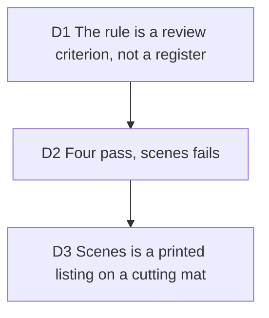

# The landing's figures answer to Anatomy's rule

Bruno, 2026-10-13 (#263), after finding the Anatomy skill. Carries out
[landing-pipeline](2026-10-08-landing-pipeline.md) D2 (our own figures, on
hairline's engine) and keeps it: the skill's one rule is borrowed, its register
is not. Anatomy's rule: a figure fails when it is too abstract (stacked plates,
floating slabs) or too flat (one slab with lines), and passes when it is a
recognisable object whose moving parts behave like the idea.

## D1 The rule is a review criterion, not a register

**Decision:** Anatomy's register (dense machines, 40 to 150 parts, hours per
figure) stays out. Hairline's engine, one stroke weight, no fills and at most
200 lines a figure stand. Only the criterion is applied, and a redraw adds the
four or five features that make the object what it is, not density.

**Why:** the landing's figures sit beside a screenshot and say what a
screenshot cannot; a dense machine would outweigh the product shot beside it.

**Rejected:** drawing the figures as Anatomy machines. It breaks D2 of the
landing pipeline (the engine is the system), the 200-line limit and the
four-millisecond frame budget.

**Impact:** none on code; it is how the figures are reviewed from now on.

**Pivot:** "Draw the landing's figures as Anatomy machines."

## D2 Four pass, scenes fails

**Decision:** scenes fails (too abstract); glide, safezone, local and queue
pass.

| Figure | Object | Verdict | Why |
| --- | --- | --- | --- |
| scenes | a pull request cut into slabs on a plinth | fail | Three identical windows on a plate: the "stacked plates" case. Nothing said diff or cut. |
| glide | a code window with its tokens as slabs | pass | The window reads, and the tokens are the idea: shared ones glide, dropped ones shrink first, new ones grow last. The mildest pass. |
| safezone | a phone with the feed's chrome on its glass | pass | A phone, and the card sliding under a zone is what the figure explains. |
| local | a laptop and the stack its frames land on | pass | The laptop reads, and frames leaving its screen for the desk and no further are the idea. |
| queue | a render server and its rail of jobs | pass | A cabinet with a mouth and vents, jobs whose dots say their size, the one being rendered at the mouth. |

**Why:** each verdict asks the same two questions, is it a recognisable
object, and does its motion behave like the idea.

**Rejected:** failing glide for a plain window. Its tokens are small solids
that travel and hop, which is the idea; the window is the stage, not the
subject.

**Impact:** `docs/decisions/` only; the verdicts are also in the PR body.

**Pivot:** "Redraw glide too."

## D3 Scenes is a printed listing on a cutting mat

**Decision:** a diff printed on tractor-feed paper, laid on a cutting mat with
its ruler. Sprocket rails with their holes run the length, a dashed cut crosses
the paper at every hunk, and the lines are a diff's: context, a solid line and
a bright gutter dot for an addition, a dashed line and a dim dot for a removal.
The page under the pointer tears free and stands up; as it stands it becomes a
scene. The gutter's dots close, the removed lines go and the code closes up,
the title bar draws itself across the page and its three lights come on. Same
three pages, stagger, hit test on the ground plane and lap timing as before;
the camera scale goes from 1.42 to 1.5, and the lap now reads the listing top
to bottom (scene 01, 02, 03), entering from the right, off the mat.

The rest pose stays what it was: page 01 lit and standing, 02 barely lifted, 03
flat. It is the before and after in one image.

**Why:** the figure's job is "a diff becomes scenes", and the diff has to be
legible as a diff for the transformation to mean anything.

**Rejected:** a flat rest (all three pages lying, the listing at rest and
nothing standing). Hairline rule 05 rejects a flat regular row; the rest is the
image a reader keeps after a once-only lap; and under reduced motion it is the
only image the figure ever shows, so it has to carry the idea alone.

**Impact:** `src/presentation/landing/figures/scenes.ts`, the Paste label and
hint in `pipeline.tsx`, `tests/presentation/landing-redrawn-figures.test.ts`
(one lap in order with no answer in passing, reduced motion on the final frame).

**Pivot:** "Rest the listing flat."
