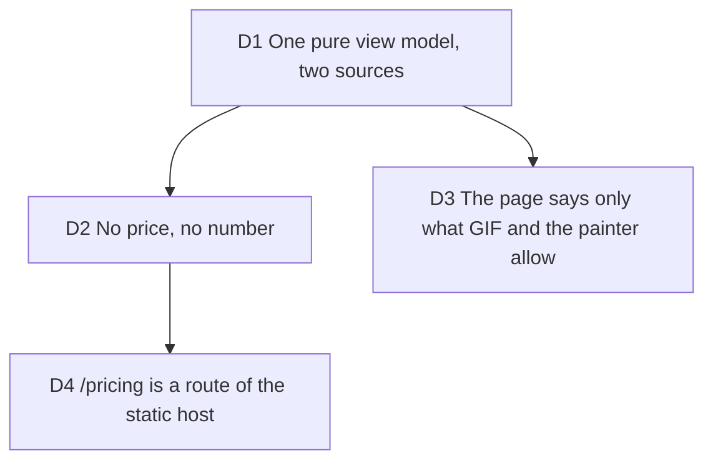

# The public pricing page: facts from the Plan, prices only from the catalog

Builder on #256, 2026-10-13, carrying out [ux-waves](2026-10-12-ux-waves.md) D3 (the
paid side visible to everyone) after [device-exports-free](2026-10-13-device-exports-free.md)
D1 (a device export is whole and free). Final prices wait on #79.

## D1 One pure view model, two sources

**Decision:** `pricingView` (`src/application/billing/pricing-view.ts`) builds the page
from a catalog reading (pending, unavailable or ready) and the Plan value object.
The table's Creator column, the free-account note and the cancel answer's days come
from `Plan.pro()` / `Plan.free()` through `formatBytes`, `formatMinutes` and
`hostedOutputGraceDays`; the device card's "up to 4K" is `RESOLUTION_TIERS.at(-1)`
and its rate is passed in from the export panel's list, both pinned by a test.
The page component lays it out and decides nothing.

**Why:** a page typed by hand drifts from the plan rules the first time a ceiling
moves; the account panel and the hosted sheet already read these sources.

**Rejected:** reading the fps list from the application layer (it lives in the export
panel, which this ticket does not touch; the dependency rule forbids the import).

**Impact:** `pricing-view.ts`, (the page sits under `landing/`: the dependency rule keeps the landing's parts out of the studio, and the page wears them) `src/presentation/landing/pricing/`, `tests/application/pricing-view.test.ts`.

**Pivot:** "Write the table's numbers into the page."

## D2 No price, no number

**Decision:** the Creator card shows prices only when the catalog states them,
annual first, with a saving only when both prices prove it (rounded down). A 503, a
network failure and an empty catalog all read as "unavailable": the card says what
Creator adds, "The price is not published yet.", and links to the studio, where
Cloud under Where opens the hosted sheet. The e2e asserts the card holds no digit
and no currency sign in those cases (the table and the questions keep their plan
facts, which are not prices). A sandbox catalog shows the test mode line beside the
price, the same rule as #264.

**Why:** #79 has not set final prices; a number here would be a promise.

**Impact:** `creator-card` `data-price-state`, `tests/e2e/pricing.spec.ts`.

**Pivot:** "Show the last known price from a build-time constant."

## D3 The page says only what GIF and the painter allow

**Decision:** the Free card claims "MP4 and WebM up to 4K at 60 fps, and GIF and PNG
from the same frame", not "every format at 60 fps": a GIF is capped at 20 fps
(`GIF_MAX_FPS`). The table says captions and audio are "Not yet" on the device: the
on-device painter bakes neither (`frame-painter/scene.ts`); this row changes when the
painter does.

**Why:** the account panel's "every format up to 4K and 60 fps" is the line the brief
quoted, and it is slightly wider than the GIF path. A public page is read as terms.

**Pivot:** "Reuse the account panel's sentence word for word."

## D4 /pricing is a route of the static host

**Decision:** `createStaticSite` answers `/pricing` (and `/pricing/`) with the app's
shell and a 200, like `/app`. The nav pill on the page is the landing's, given its own
links (`DynamicNav` takes `links` and `hasHero`), with `aria-current="page"` on its own
entry; the footer moved to `site-footer.tsx` so both pages share it and carry the link.

**Why:** any other path is a real 404 in the hosted build, which `vite preview` in the
e2e would not show. The refund answer is a placeholder that promises nothing, for Bruno.

**Impact:** `server/static/static-site.ts`, `tests/server/static-site.test.ts`,
`dynamic-nav.tsx`, `site-footer.tsx`, the account panel's one anchor.

**Pivot:** "Serve `/pricing` from the landing's chunk."
