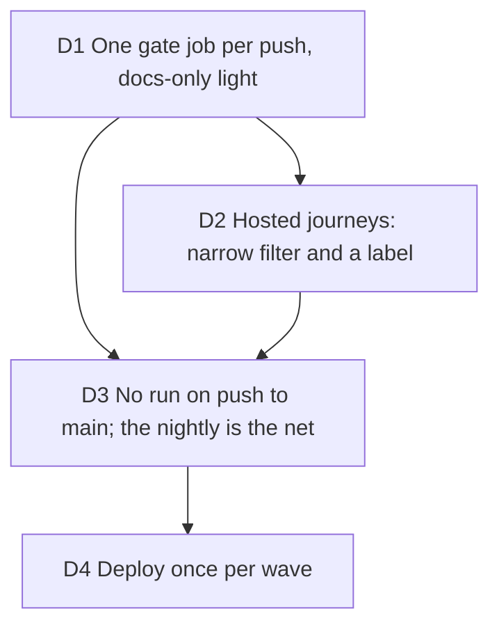

# CI diet: the gate runs once per pull request push, nothing runs on a merge

Issue #340, 2026-10-14: GitHub Actions is blocked on the repository (#338) and the
private repository's 2,000 to 3,000 included minutes a month were going at about 22
billed minutes per pull request push, 14 per merge and 5 per staging deploy. The job
served: Bruno and the builders merge without waiting on a bill. Touches the #303
review (P2-3) and the Ship gate of `docs/agents/QUALITY_LOOP.md`.

Measured before deciding (week of 2026-10-07, 438 runs): Quality gate 8.6 min, E2E
smoke 4.9, Render PR 4.4, Advisories 0.6, three one-job minutes of rounding, plus the
hosted journeys 12.9 on nearly every code pull request, and the same gate replayed on
every push to `main`.

## D1 One gate job per push, docs-only light

**Decision:** the E2E smoke, the paths filter and the docs-only switch live inside
the `Quality gate` job (the ruleset requires it by name). A pull request whose files
are all Markdown runs lint, `tests/docs` and `tests/cli/action.test.ts` and still
reports "Quality gate". Render PR runs on the `render` label or by hand only. The
`Hosted gate` and `Changed paths` jobs are gone; the first comes back the day #302
requires the journeys. `ci.yml` has no `labeled` trigger: a label would re-run about
11 minutes.

**Why:** every extra job is rounded up to a whole billed minute, and the smoke job
repeated checkout, install and a second build. Render PR gated nothing and the gate
already renders a clip.

**Rejected:** skipping the gate on non-`hosted` label events (a skipped required
check reads as passing); a `paths:` filter on the workflow (it leaves "Quality gate"
pending forever on a skipped pull request).

**Impact:** `ci.yml`, `render-pr.yml`, `docs/agents/QUALITY_LOOP.md`.

**Pivot:** "A docs-only pull request must run the whole gate."

## D2 Hosted journeys: a narrow filter and a `hosted` label

**Decision:** the journeys run on `server/**`, the stores, the billing rules, the
account UI, their own harness and the two workflows, or when the pull request carries
the `hosted` label at push. This reverses the #303 review's P2-3 (the filter widened
to all of `src/`) on purpose: cost over coverage.

**Why:** the wide filter made the 13 minutes of the hosted job the price of nearly
every code push. What the narrow filter misses is run by the nightly, unfiltered.

**Rejected:** keeping `src/**`; dropping the job from pull requests altogether.

**Impact:** `ci.yml`, QUALITY_LOOP gate 5, `tests/e2e/hosted/README.md`.

**Pivot:** "Put the hosted journeys back on every code pull request."

## D3 No run on push to main; the nightly is the net

**Decision:** `ci.yml` drops its `push` trigger. The nightly gains a `gate` job
(lint, both typechecks, `pnpm test` on `main`, about 8 minutes a day) beside its
journeys. A merge that breaks `main` through two green pull requests on different
bases is seen the next night, not at the merge. The deploy's release gate
(`hosted:check`) checks the hosted configuration, not the code, and cannot stand in.

**Why:** a merge lands the head that was gated (`--match-head-commit`), so the
`main` run replayed 14 minutes on the same code. "Require branches up to date" is
unreadable here: the rulesets API answers 403 on a private Free-plan repository, so
it cannot be relied on until the repository is public.

**Rejected:** a scheduled run of the whole Quality gate on `main` (the nightly gate
is the part a merge can break; the rest ran on the pull request); a `push` run on
`main` limited to `paths`.

**Impact:** `ci.yml`, `e2e-nightly.yml`, QUALITY_LOOP Ship, `docs/launch/checklist.md`.

**Pivot:** "Run CI on every push to main again."

## D4 Deploy once per wave

**Decision:** the staging deploy runs once per review wave or nightly, not per merge;
it stays manual, with no schedule. Builders push once per review round after
`verify.sh` is green, never a lone "merge main" push, and reviewers read the branch
in a worktree.

**Why:** 12 deploys on 2026-10-14 for 5 billed minutes each; pull requests averaged
three to four pushes.

**Rejected:** a scheduled deploy (it would deploy whatever `main` is, unattended).

**Impact:** QUALITY_LOOP Ship and Pushes.

**Pivot:** "Deploy staging on every merge."
