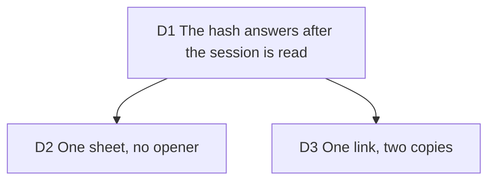

# The Cloud intent: a deep link to the hosted render sheet

Builder on #290, 2026-10-14, after [hosted-render-sheet](2026-10-13-hosted-render-sheet.md)
(#254, #279) and [pricing-page](2026-10-13-pricing-page.md) (#256). Carries out
[ux-waves](2026-10-12-ux-waves.md) D3 (the paid side visible to everyone) for a visitor who
has not opened the studio yet.

## D1 The hash answers after the session is read

**Decision:** `/app#cloud` is taken once on arrival by `CloudIntentBoot`, the way
`#import=` is (`takeCloudIntent` scrubs the hash before anything async). The answer
is a pure function of `cloudGate` (`cloudIntentAction`, `application/billing/cloud-intent.ts`):
signed out or Free, open the sheet; Creator, choose Cloud and open nothing; a local
build, nothing. While the session is being read or a signed-in account's plan is not
read, it waits. After ten seconds it opens the sheet anyway, which has words for both
("Checking account…", "Checking your plan…"). A `hashchange` on an open studio is
followed, as the import's is, after asking the server for the plan again when the account is
signed in and its plan already known: the plan in memory can be older than an upgrade made in
another tab, and Upgrade would then answer "already subscribed". The hash is scrubbed before
that await. A sheet already open when a late intent fires (Cloud under Where pressed while it
waited) is left alone, opener included. A Creator, who gets no sheet, is told once through the
notice store, "Cloud is selected under Where", on this direct path only. No haptic: a link is
not a press.

**Why:** `cloudGate` says "sign-in" for a session not read yet, so answering at once
would flash the signed-out offer at a Creator and close it a few hundred ms later. The
sheet's own effect would have closed it; the flash is what the wait removes.

**Rejected:** opening at once and letting the sheet correct itself (the flash).
Selecting Cloud with no word at all (a Creator would land with nothing said).
Waiting forever (a link that does nothing is worse than a sheet that says it is checking).

**Impact:** `cloud-intent.ts` (application and `presentation/utils`), `cloud-intent-boot.tsx`,
`studio-route.tsx`, `useCloudAccount` in `cloud-render.tsx`, `tests/application/cloud-intent.test.ts`,
`tests/presentation/cloud-intent-boot.test.tsx`, `tests/e2e/hosted/cloud-intent.spec.ts`.

**Pivot:** "Open the sheet on the first render and let the plan close it."

## D2 One sheet, no opener

**Decision:** the sheet is the stage's (`surface "stage"`, #284), the one mounted with the
frame on every shell, and it opens with `opener: null`. Closed, focus falls back as #284
defined: this surface's Cloud under Where if it is on screen, else the island's Export
trigger. Nothing in the sheet's focus or Escape code changed. `#cloud` is no arrival
payload: the stored draft is still restored and the loading outline draws the draft's mode.

**Why:** the cluster and the rail sheets belong to an export panel that may be closed;
the stage's does not. No editor is requested: on a phone the code sheet stays at its stop
(#214 holds).

**Rejected:** the Export panel's sheet (`"cluster"` or `"rail"`): it exists only where that
panel is mounted, which a closed panel or the other shell does not guarantee.

**Impact:** `cloud-intent-boot.tsx` (no new store: it calls `show("stage", null)`),
`hosted-render-sheet.tsx` untouched, `studio-boot-weight.spec.ts` (#214) still green.

**Pivot:** "Open the Export panel first, then its sheet."

## D3 One link, two copies

**Decision:** the pricing page's Creator action links to `/app#cloud` in both of its states
(`CLOUD_INTENT_PATH`, carried by `pricingView().creator.action.to`). A priced catalog says
"Start a hosted render" and "Opens the studio on Cloud"; any other says "See Creator in the
studio" and "Opens the studio". The "choose Cloud under Where" sentence is gone: the link
does the choosing.

**Why:** a call to action that ends in instructions is a weak one (#290). Without a price
the page promises no hosted render, so the words stay neutral; the destination is the same
because the sheet says honestly what the account can do.

**Rejected:** a different link for the unpriced card (`/app`, as before): the sheet already
says honestly what the account can do, and one destination is one thing to test.

**Impact:** `pricing-view.ts` (`action.to`), `pricing-page.tsx`, `pricing-view.test.ts`,
`pricing-route.test.tsx`, `tests/e2e/pricing.spec.ts`.

**Pivot:** "Link to /app only when the catalog has no price."
