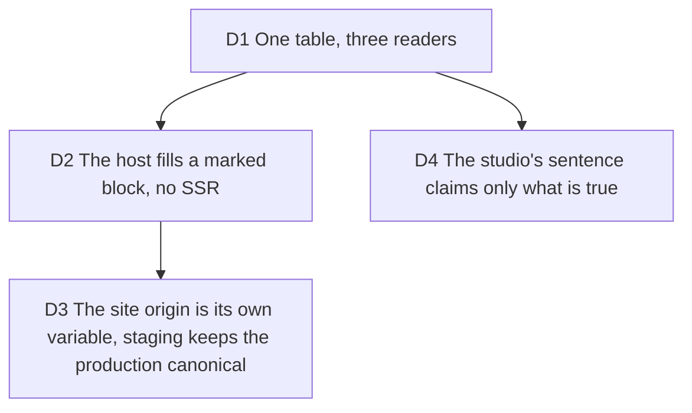

# Route head: one table says what each public page is called, and the host serves it

Builder on #294, 2026-10-14. The trigger: a shared `/pricing` link unfurled as the
landing, because the tags were set by the client and scrapers (Slack, X, LinkedIn,
iMessage) run no JavaScript. Serves the public pages of [pricing-page](2026-10-13-pricing-page.md)
and the share card of the landing; touches the static host it introduced.

## D1 One table, three readers

**Decision:** `ROUTE_HEADS` (`src/application/routing/route-head.ts`), keyed like
`APP_PATHS`, holds each route's title, optional share title, description and share
image. The static host, the client hook `useRouteHead` and the pricing view read it.
The table is the source of the pricing description (`pricingView().description` reads
it); its numbers come from `billing/device-export-claim.ts`, which the entry bundle
can load without the pricing view. The pricing and landing descriptions stay under
160 characters, a test pins it.

**Why:** two copies of a sentence drift the first time one moves, and the client and
the scraper would then disagree about what the page is.

**Rejected:** keeping `pricingView` as the source (the table is loaded by the entry
bundle, the view is not); a per-page string in each component.

**Impact:** `route-head.ts`, `use-route-head.ts`, `pricing-view.ts`, `document-title.ts`,
`tests/application/route-head.test.ts`.

**Pivot:** "Write the page's title in the page again."

## D2 The host fills a marked block, no SSR

**Decision:** `index.html` carries the landing's tags between `<!-- route-head -->`
and `<!-- /route-head -->`. At startup the API replaces that block once for every
path in `APP_PATHS` (trailing slash too) and serves the result. The 404 shell keeps the
landing's defaults. A build without the block stops startup. The hook edits the tags in
place on a client-side walk, and puts the landing's back on leave, canonical and share
card included, on the origin the host wrote.

**Why:** string replacement of a known block needs no renderer and no dependency, and a
page added to `APP_PATHS` gets its tags from the table or fails a test.

**Rejected:** server rendering the app (a runtime for four tags); a prerender step at
build time (the origin is a runtime fact, see D3).

**Impact:** `server/static/route-head.ts`, `static-site.ts`, `index.html`, `tests/server/static-site.test.ts`,
`tests/presentation/route-head-parity.test.tsx`.

**Pivot:** "Prerender the pages at build."

## D3 The site origin is its own variable, staging keeps the production canonical

**Decision:** canonical, `og:url` and the share image are written on `TYPELAPSE_SITE_ORIGIN`,
default `https://typelapse.com`, validated at startup (an http(s) origin or no start).
Staging does not set it.

**Why:** `TYPELAPSE_APP_URL` is where a deployment is reached, and staging is not where
the site lives. A staging canonical on staging would invite a search engine to index a
duplicate; the production one tells it which page counts, and a card pasted from staging
still loads its image from production.

**Rejected:** reusing `TYPELAPSE_APP_URL` (staging would canonicalise itself); a build
argument (an image per environment).

**Impact:** `.env.example`, `docs/launch/deploy.md`.

**Pivot:** "Staging gets its own canonical."

## D4 The studio's sentence claims only what is true

**Decision:** the `/app` description says the export runs on your own device and that
nothing is uploaded unless you pick a hosted render.

**Why:** a hosted render uploads the project, so "nothing is uploaded" is true of the
device path only, as everywhere else the claim is limited to it.

**Rejected:** a shorter sentence under 160 characters that drops the condition.

**Impact:** `route-head.ts`, a test pins the sentence.

**Pivot:** "Say nothing about uploads on the studio."
