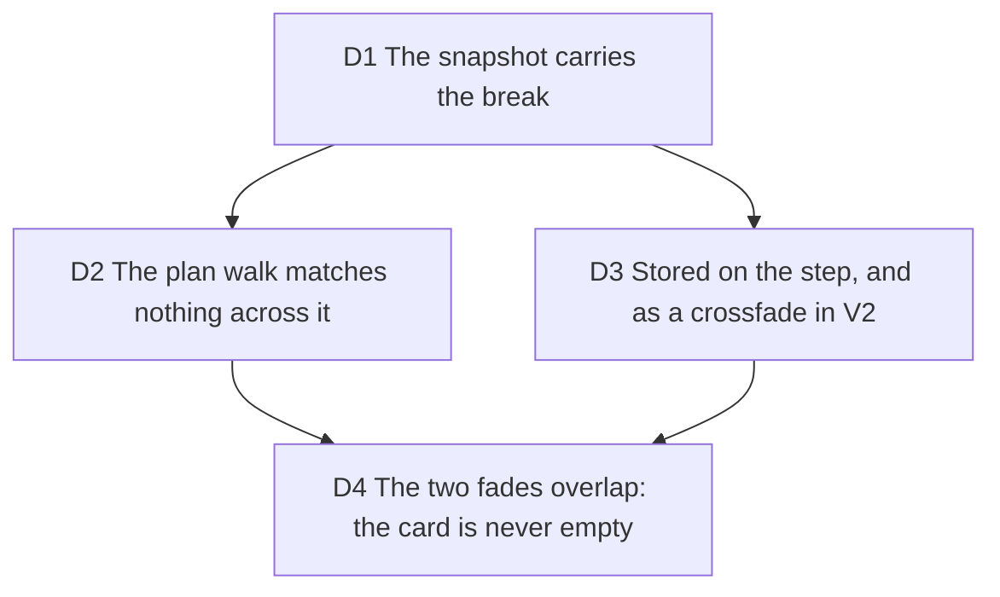

# Scene break: a page or a chapter fades in, it never morphs token by token

Issue #280: exporting honojs/hono#5189, letters crossed lines while the video
went from the node.test.ts page to the node.ts page. The magic move morphed
every pair of steps, pages (#275, gate five D2) and chapters included; the
chapters.ts comment saying the engine "cross-fades the pair" was false. Touches
D12 (preview equals export): the three renderers must keep drawing one plan.

Measured before deciding (on-device MP4 of the fixture, 1080p60, 12.3 s): the
break is the transition at 8.60 to 9.25 s (hold 1.2 s, morph 0.65 s, step 4 to
step 5); every frame inside it shows fragments of both files gliding.

## D1 The snapshot carries the break

**Decision:** `CodeSnapshot.sceneBreak` is set on the first frame of every page
after the first (`diff/snapshots`) and on the first frame of every chapter
after the first (`diff/chapters`). The step cap (#277) keeps whole chapters
and drops the tail, so it makes no jump of its own. A chapter whose before-state is the code already on screen
(two commits on the same lines) is a direct edit: its first frame morphs, no
break. `normalizeSnapshots` hands the break of a dropped empty
opener to the next frame kept, drops it with a dropped duplicate, and never
leaves one on the first frame.

**Why:** the pagination and the chaptering are the only places that know two
frames are unrelated. The chapter rule compares the chapter's before state with
the code on screen by exact equality (a continued edit morphs); a similarity
score decided later in the keyer would guess.

**Rejected:** a similarity threshold in the keyer: it would also fade real
edits that rewrite most of a page.

**Impact:** `src/application/diff/{types,snapshots,chapters}.ts`,
`src/application/import/diff-project.ts`; tests in `snapshots`, `chapters`,
`diff-project`.

**Pivot:** "A page that continues the same hunk should morph, not fade."

**Amended (review of #307):** the first version broke into every chapter after
the first, unconditionally: two commits on `const x = 2` then `const x = 3`
faded the whole card for a one-character edit, on the PR import. The pivot
fired for chapters: the break is now set only when the chapter's before-state
differs from the last frame already shown (`chapters.test.ts`, "morphs into a
chapter that edits the code the previous one ended on").

## D2 The plan walk matches nothing across a break

**Decision:** `planMagicMove` takes `breaks` (one per step) from both keyers
(`infrastructure/highlighting/magic-move-keyer.ts`,
`server/remotion/magic-move-plan.ts`). For a break pair it never calls the
keyer's sync: each side is its own frame, laid out in its own window, keys
prefixed `out:` and `in:` so two tokenizations cannot collide. The loop back to
the first step is a break whenever any step after the first opens one. The plan
shape is unchanged: no flag, no consumer reads anything new. The painter, the
preview and the Remotion composition are untouched (D12); the timing of the
fade lives in the engine (D4), which all three reach through the one call in
`video-script`.

**Why:** with zero shared keys the fade is a timing of the engine (D4's
overlap), reached through the one reader, `video-script`: no new drawing code,
so nothing can drift between renderers.

**Rejected:** a `kind` on `FrameTransition`: it would have one reader
(`video-script`, which every renderer goes through), and the keys already say
the same thing: no shared key is no match.

**Impact:** `src/application/magic-move/plan.ts`, both keyers; tests in
`magic-move-plan`, `infrastructure/magic-move-keyer`, `server/magic-move-plan`,
`video-script` (same frame count, no token moves, opacity monotonic per side).

**Pivot:** "The renderers need to know a transition is a break (to draw
something other than tokens)."

## D3 Stored on the step, and as a crossfade out of the scene before it in V2

**Decision:** `Step.sceneBreak` (kept by `Step.with`), `sceneBreak?: true` on
the V1 step payload (project file, share link, CLI) and on the render request
step. In V2 the break is the outgoing transition of the scene before it:
`crossfade` instead of `magic-move`, same duration, so the video keeps its
length (`project/scene-break.ts`). Any transition that is not a magic move
reads back as a break. The studio composition, the V1 to V2 migration and both
V2 to V1 readers round-trip it; `code-card-input` reads it for the server.

**Why:** the studio persists V2, so a flag that only lived on the step would
vanish on reload. The V2 schema already had `crossfade`; no new key.

**Rejected:** a new scene key (the V2 parser refuses unknown keys, and the
transition already says what the scene does on its way out); `cut` (V2
requires it to last 0 ms, which would shorten the video).

**Impact:** a crossfade also drives the scene-level opacity of authored layers
linearly and does not glide shared layers (`scene-timeline`): a layer kept
across a page break fades with it. Files: `domain/entities/step.ts`,
`project/{project-payload,project-document,migrate-v1-project,studio-document,studio-composition,scene-break}.ts`,
the snippet, export and composition stores, `server/routes/render.ts`,
`server/render/v2/code-card-input.ts`, `cli/render-project.ts`.

**Pivot:** "A user must be able to turn a break back into a morph in the studio."

## D4 The two fades overlap: the card is never empty

**Decision:** when two non-empty frames share no token, `renderTransition`
(`magic-move/engine.ts`) overlaps the fades: the old frame fades out linearly
until 0.6 of the morph, the new one fades in from 0.4 on easeOutCubic, while
the card eases to its new height. An explicit timing from a caller still wins.
The most visible token never drops below about 0.245 (`magic-move-engine` and
`video-script` tests: above 0.2 on every frame of the break).

**Why:** the two-beat timing waits for the glide to clear the space; across a
break there is no glide, so its gap only showed an empty numbered card for
12 to 14 frames at 60 fps (0.20 s, a third of the morph). The overlap is short
and centred: at its crossing both files sit near a quarter opacity, which reads
as a dissolve rather than as clutter.

**Rejected:** the first version of this decision, the engine's two-beat fades
unchanged (out by 0.34, in from 0.6): its pivot, "the empty beat reads as a
glitch", fired in review. Also rejected: easeOutCubic on the exit (one empty
frame remains), easeInOutCubic on both sides (four), a hard cut (the card
height would jump).

**Impact:** `src/application/magic-move/engine.ts` (`BREAK_TIMING`, a
`leaveEase` parameter); any morph between two unrelated non-empty frames gets
it, a hand-captured pair included. No gutter work: the numbers are clipped to
the interpolated body height in the painter and the canvas. Proven on the
fixture: `.craft/evidence/2026-10-14/280/` (shared checkout, untracked): before
and after strips of the on-device MP4 at 8.60 to 9.10 s, the server render's
strip, and `wysiwyg-mad.txt` (device against server on the card crop).

**Pivot:** "The overlap reads as two files on top of each other: cut through
the middle instead."

**Amended (#316):** on a file longer than a window the two sides sit in
different windows (`firstRow`), and the morph's scroll made the incoming tokens
glide while they faded. Across a break `video-script` now scrolls nothing: each
side is drawn on its own window, and the reported `firstRow` holds the outgoing
one until the outgoing side has faded (`BREAK_OUT_END`, 0.6), then takes the
incoming one. It reads the engine's own predicate (`isSceneBreak`: something on
both sides, no shared token), now exported, so the timing and the scroll cannot
disagree about a pair.
During a break on a long file the gutter shows the outgoing window's numbers
until 0.6 while the incoming code is visible from 0.4: inherent to a single
gutter, and unreachable by import (pages are at most 24 rows).

**Amended (#330):** the focus zoom still glided across the whole break: with
page A under a push-in (1.25) and page B without, the camera pulled back while
the two pages dissolved, and B appeared at about 1.14 on its way to 1.0.
`video-script` now eases the zoom over the first `BREAK_ENTER_START` of a
break only (0.4, `BREAK_TIMING.enterStart`, exported next to `BREAK_OUT_END`),
before the incoming page is visible, so B shows from its first frame at its
final zoom and no camera moves while two unrelated pages cross. A hold at the
outgoing zoom then a jump at 0.6 was rejected: B is already at 0.7 opacity by
then. A morph keeps its zoom over the whole transition. Still one reader, so
the three renderers follow with no drawing code. Proven on a device MP4
(`.craft/evidence/2026-10-14/330/`, before and after strips) and by the hono
fixture's script, byte-identical to main (738 frames, same hash: its imports
carry no focus).
