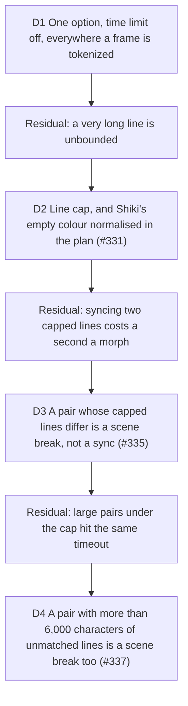

# Whole-line tokenization: no clock in the token plan

Builder on #315, 2026-10-14. The trigger: during the #307 review on a loaded
machine, keyer tests failed in a parallel run and passed alone. Shiki's per-line
time limit had cut `greet(name: string) {` into one token, and the client keyer's
cache kept it. Serves D12 (preview equals export); touches the two keyers of
[scene-break](2026-10-14-scene-break.md) and D5 of [staging](2026-10-08-staging.md).

Measured before deciding (TypeScript, github-dark, idle machine, limit off): a
72-column line, the width a scene is built for, tokenizes in 0.34 ms; 500 columns
10.5 ms; 5,000 columns 171 ms; 20,000 columns 1.1 s (507 ms with the limit);
50,000 columns 3.1 s; 100,000 columns 9.3 s; 200,000 columns 22 s.

## D1 One option, time limit off, everywhere a frame is tokenized

**Decision:** `WHOLE_LINE_TOKENIZATION` (`src/infrastructure/highlighting/whole-line-tokenization.ts`)
is `{ tokenizeTimeLimit: 0 }`. The studio's keyer, the server's keyer
(`server/remotion/magic-move-plan.ts`) and the static poster (`shiki.adapter.ts`),
the only three Shiki call sites in the repo, spread it into their options. At 0
vscode-textmate skips the check.

**Why:** the limit is wall clock, so with it the tokens depend on how busy the
machine is, and the hosted render (a shared node, staging D5) can build a
different plan from the device for the same project. Shiki 3.23 reads `tokens`
from `tokenizeLine2` and drops `stoppedEarly`, so a cut line cannot be detected
from outside: off is the only setting under which a cached tokenization is known
whole. For a line a frame is built for, the 500 ms limit never protected anything;
it only fired on a descheduled process.

**Rejected:** a raised finite limit with a retry (no signal to retry on; a
token-count heuristic misfires on comment lines, which are one token); keeping the
limit and not caching (the server has no cache and still diverges).

**Residual:** nothing bounds a very long line any more. The only caps are on whole
documents (`MAX_IMPORTED_CODE_CHARACTERS` 1,000,000, `MAX_STEP_CODE_CHARS`
50,000), none per line, and the time check ran between `scanNext` calls, so what it
really bounded was a long line with many tokens: a minified bundle line pasted or
imported. That line now freezes the studio's main thread (9.3 s at 100,000
columns, 22 s at 200,000) and costs the server up to about 3 s per step, 16 s per
render. Hostile backtracking is the rarer case of the same gap. D2 (#331) bounds
the length; backtracking under the cap stays open (D2 Residual).

**Proof:** `tests/support/stalled-clock.ts` advances `Date.now()` a second per read,
which trips the limit on every line. Without the option the three tests fail (each
line one token); with it the studio's stalled plan equals the unhurried one and
its cache holds it, the server's plan for the hono fixture equals the studio's, and
the poster's HTML is the unhurried HTML.

**Impact:** `whole-line-tokenization.ts`, `magic-move-keyer.ts`, `shiki.adapter.ts`,
`server/remotion/magic-move-plan.ts`; tests in `tests/infrastructure/magic-move-keyer.test.ts`,
`tests/infrastructure/shiki-adapter.test.ts`, `tests/server/magic-move-plan.test.ts`,
`tests/support/stalled-clock.ts`; ticket #331.

**Pivot:** "A frozen studio on a pasted minified file is worse than a plan that
differs under load: put the limit back until #331 lands." Fired by the residual
and answered by D2: the cap is the deterministic bound, so the limit stays off.

## D2 A line cap, and Shiki's empty colour normalised in the plan

**Decision:** `WHOLE_LINE_TOKENIZATION` also carries `tokenizeMaxLineLength:
MAX_TOKENIZED_LINE_COLUMNS` (2,000), so the three call sites get it from the one
object. Shiki returns a line of that length or more as a single token coloured
`""`. `planMagicMove` (`src/application/magic-move/plan.ts`, the one place every
token passes) plans an empty colour as `undefined`. The DOM preview leaves the
span's colour unset and inherits the card's foreground; the painter's
`token.color ?? foreground` now reaches its fallback. No renderer code changed:
the plan carries the meaning, and the three paint the theme foreground (a
three-level test pins it: plan, DOM, painter).

**Why:** the clock bounded a long line, nothing else did (D1 residual). Length
is as deterministic as the code, so a capped plan is the same on the device and
on a loaded render node. 2,000 columns is 3.1 times `VISIBLE_COL_LIMIT` (648),
the most any canvas shows, and 28 times the 72 a frame is designed for; below it
a line is highlighted as before, so the hono fixture plan is byte-identical (its
longest line is 77 columns; hash of both plans equal before and after). A capped
line costs 0.1 ms (a line just under the cap about 25 ms), where 200,000 columns
took 22 s in the measure above and 10 s on a second, lighter line (the same
superlinear shape; both measured, idle machine).
`""` could not be left to the renderers: the canvas ignores `fillStyle = ""` and
keeps the previous token's colour, the DOM inherits, and the export would
disagree with the preview.

**Rejected:** 4,000 or 5,000 columns (about 60 ms per line, a longer window in
which a row of long lines still stutters, and past 648 columns nothing is on screen to gain);
normalising in the painter and the canvas separately (two places to forget, and
the server video would still be a third); a token-count heuristic.

**Trade-off, accepted:** the visible 648 columns of a line over 2,000 lose their
highlighting and draw in the theme foreground. A minified line is unreadable at
the card's size either way; a long line a reader would want coloured is rarer than
a pasted bundle that freezes the studio.

**Residual:** a line under the cap is still tokenized in full (up to about 25 ms
each), and the cap bounds length, not backtracking: a hostile line under 2,000
columns can still cost the time its grammar takes, and no clock cuts it. Diffing two steps that each carry a 200,000-column line is a separate
cost (about 340 ms for three steps with the loop), inside `syncTokenKeys`, not
tokenization.

**Proof:** remove `tokenizeMaxLineLength` from the option and
`tests/infrastructure/capped-line.test.tsx` fails on the 200 ms bound and on the
one-token boundary, `tests/server/magic-move-plan.test.ts` on its bound and
single-token check, and `tests/infrastructure/shiki-adapter.test.ts` on the poster
span. Remove the `""` to `undefined` step in the plan and the plan test in
`tests/application/magic-move-plan.test.ts` and `capped-line.test.tsx` (plan and
canvas painter, whose `fillStyle` stays empty) fail; the DOM test passes by
design, since the DOM inherited already.

**Pivot:** "Highlight what the card shows of a long line": tokenize its first
`VISIBLE_COL_LIMIT` columns instead of dropping the whole line to the foreground.

**Impact:** `whole-line-tokenization.ts` (`MAX_TOKENIZED_LINE_COLUMNS`),
`magic-move-keyer.ts` (option type), `application/magic-move/plan.ts`;
`CONTEXT.md` (Line cap); tests in `tests/infrastructure/capped-line.test.tsx`,
`tests/application/magic-move-plan.test.ts`, `tests/server/magic-move-plan.test.ts`,
`tests/infrastructure/shiki-adapter.test.ts`; ticket #331.

## D3 A pair whose capped lines differ is a scene break, not a sync

**Decision:** `PlanKeyer` (`src/application/magic-move/plan.ts`) gets an optional
`canSync(from, to)`. `planMagicMove` asks it after tokenizing a morph's two codes;
a pair it declines is planned by `sceneBreak` (#307), the same path a chapter
break takes: each side laid out in its own window with keys only it holds, every old
token fading out and every new one in. `canSync` is
required, so a keyer added later has to decide it. Both keyers pass `canSyncKeys`
(`whole-line-tokenization.ts`): false when the capped tokens of the two sides (a
token of `MAX_TOKENIZED_LINE_COLUMNS` or more, the only way a token gets that
long) are not the same contents in the same order. Capped lines that both sides
hold alike do not decline: the diff trims what they share and matches them in tens
of milliseconds, so an edit beside a pasted minified line, or a scroll past it,
still glides. The loop's last-to-first morph goes through the same check. The rule
reads the tokens of the codes the diff will see, which for a morph between two
nearby windows is the union slice (`plan.ts`), rows no frame shows included: that
is deliberate, the diff's cost is the union's, so a differing capped line only the
union holds still declines the pair.

**Why:** the sync of D2's Residual was measured in the #334 review and again here
(idle machine, TypeScript, two unrelated lines, loop on): `syncTokenKeys` hands
two codes to diff-match-patch, whose timeout is one second of wall clock, and on
lines it cannot match it spends all of it. 2 morphs (2 steps with the loop) took
2.06 s at 200,000 columns, and 100 capped lines of 5,000 columns over 2 steps
2.14 s; the plan is rebuilt on every keystroke, so each was a freeze of that
length on the studio's main thread. A capped line has nothing for the diff to find
(one token of data, drawn in the foreground, D2), and the timeout also makes the
diff a function of the clock, not of the code: a cut diff is coarser, so the same
project could plan differently on a loaded render node, the mismatch D1 removed
for tokenization. Declining the pair costs nothing, is deterministic, and is the
same decision on the client and the server because it reads only the tokens.
After: the same two cases plan in 17 to 39 ms (studio and server); the hono pull request's plan hashes
the same (sha256 `a4e4cca0...2bff`, studio and server alike).

**Rejected:** caching the sync per (fromCode, toCode) pair in the keyers (b): it
leaves the first plan, and every plan after an edit of either code, at a second a
morph; it needs a cache in the server's keyer, which has none; and a timed-out diff
would be cached with its clock-dependent result. Skipping inside `syncTokenKeys`
or patching `diff-match-patch`'s timeout: a dependency's internals, and a smaller
timeout makes the clock-dependence worse. A rule on the pair's total length instead
of capped tokens: it would also decline edits of ordinary code that happen to be
long, which morph well.

**Narrowed after review:** the first cut declined any pair holding a capped
token. Measured, that turned an edit on `const b = 2` next to an identical capped
line from 16 shared keys of 17 to 0, and a scroll between two windows of a 400-line
file holding one capped line from 1,996 shared keys to 0, while syncing those
cases costs little (an identical 200,000-column line with an edit elsewhere plans
in 60 to 75 ms with the loop; 100 identical capped lines of 5,000 columns around
one edit in about 140 ms with the loop, 70 ms without). The issue's own scenario,
a pasted minified file across steps, would have lost all morphing on every
neighbouring step. Only a pair whose capped lines differ now declines.

**Trade-off, accepted:** a capped line edited, replaced or removed between two
steps used to glide (when the diff finished) and now fades out and in; the lines
around it fade with it, since a scene break is the whole card. A line past 2,000
columns is one unhighlighted token that nobody reads at the card's size.

**Residual:** the cost is bounded by the cap only for capped lines. Uncapped but
large pairs hit the same timeout: 10 unrelated rows of 1,999 columns plan in
1.26 s, 100 unrelated rows of 300 columns in 1.43 s (the window is
`VISIBLE_ROW_LIMIT` rows; a real code of that size is rare, but a pasted table or
data file qualifies). A bound on the pair's total size would cover it; it needs a
threshold that does not decline ordinary morphs, so it is left to a measured ticket.

**Proof:** drop `canSync` from the two keyers and
`tests/infrastructure/capped-sync.test.ts` fails on its 100 ms bounds (studio and
server, 2 s), on the break shape, and the 100-row case; widen the rule back to any
capped token and the same file fails on the identical-line cases (an edit beside it,
100 identical lines, the scroll past it); drop the check in
`planMagicMove` and `tests/application/magic-move-plan.test.ts` fails on a sync
that must not run. A pair with no capped token still syncs (same file, and the
unchanged hono plans in `tests/server/magic-move-plan.test.ts`).

**Pivot:** "A pasted minified file must glide, not fade": fired if a capped line a
step holds alike still fades; answered by the narrowing above. A stronger form,
"a changed minified line must glide too", would need a bounded diff of its own.

**Impact:** `application/magic-move/plan.ts` (`PlanKeyer.canSync`, required),
`whole-line-tokenization.ts` (`canSyncKeys`), `magic-move-keyer.ts`,
`server/remotion/magic-move-plan.ts`; tests in
`tests/infrastructure/capped-sync.test.ts`, `tests/application/magic-move-plan.test.ts`;
ticket #335.

## D4 A pair with more than 6,000 characters of unmatched lines is a scene break too

**Decision:** `canSyncKeys` also declines a pair when the text with no counterpart
is more than `MAX_SYNCED_EDIT_CHARACTERS` (6,000, `whole-line-tokenization.ts`).
Measured as a bag of lines: trim the common head and tail of the two codes, split
each remaining middle into lines, match the lines of one against the other as a
multiset, and sum the characters of the lines left over on both sides (an edited
line counts on both, reordered lines count for nothing). Lines are compared
without their leading whitespace and counted without it, so a reindent or code
wrapped in a block is the same lines under another margin; the change in the sum
of the lines' leading whitespace is added to the count, because the diff still pays
for the spaces. Two guards complete it (below). O(n), deterministic. It
declines nothing when one side's middle is empty (a block appended or removed). The keyers,
`planMagicMove` and the `canSync` contract are unchanged: the declined pair takes
the #307 break path as in D3. Tokens-only (`code` and `tokens` of the two
tokenizations), no clock: the studio and the server decide alike.

**Why:** the sync of D3's Residual: diff-match-patch spends its whole second on text
it cannot match, and the plan is rebuilt on every keystroke. Measured before
(idle machine, TypeScript, two steps with the loop, cold): 10 unrelated lines of
1,999 columns 2.08 s, 100 of 300 columns 2.15 s (1.26 s and 1.43 s a morph).
`syncTokenKeys` cannot be bounded from outside: shiki-magic-move calls
`diff(a, b)` bare, and diff-match-patch-es reads its one-second `diffTimeout` from a
frozen default, so (b) is not available without patching a dependency. The cost
follows what differs, not the codes' length (the diff trims the common head and
tail first; D3 narrowed for the same reason), and is steeply superlinear in it.
The first cut measured the middle alone (what is left after the trim); review
showed that is the distance between two edits, not their size: the first and last
line edited in 100 lines of 72 columns leave a middle of 14,470 characters, 203
lines 29,508, a rename every fourth line of 100 lines 9,449, one character inserted
at the head and the tail of 203 x 72 lines 29,638, and each syncs in 1 to 17 ms.
The bag of lines counts only the lines the other side lacks, so those pairs count
a few hundred characters and sync; unrelated pages keep a bag at 97% or more of
the middle, so the figures below hold for the bag.
Unrelated text, four generators, worst of three seeds: unmatched characters 2,000
characters 9 to 22 ms, 4,000 26 to 37, 6,000 52 to 77, 8,000 100 to 157, 10,000 147
to 221, 16,000 372 to 532, about 20,000 and up the whole second, at 72 or 300
columns alike. 6,000 keeps the worst pair under 80 ms.

| Morph | Unmatched characters, both sides | Against 6,000 |
| --- | --- | --- |
| hono pull request, largest of 3 syncs (loop included) | 593 | 10x under |
| six templates, largest | 626 | 9.6x under |
| 12-step diff import of 10 or 50 hunks (`projectFromDiff`) | 70 | 86x under |
| 24 rows of 72 columns, fully unrelated, other side too | 2,950 (22 ms) | 2x under |
| first and last line edited, 100 or 203 lines of 72 columns | 162 (middle 14,472 / 29,510) | 37x under |
| one character inserted at the head and the tail of 203 x 72 | 290 (middle 29,638) | 20x under |
| a rename every fourth line of 100 lines of 72 columns | 3,516 (middle 14,076) | 1.7x under |
| the same 100 lines reordered | 0 (sync 61 to 82 ms) | syncs |
| the same 100 lines, every line reindented by 2 spaces | 200 (margin change; cost 13 ms a morph) | syncs |
| 203 lines with 120 spaces of margin removed | 24,360 | declined (a timeout) |
| 100 lines with 80 spaces of margin removed | 8,000 | declined (461 ms) |
| 100 lines of 300 columns, reversed | 0 unmatched, 60,000 held (62 ms) | syncs, at the pair cap |
| 203 lines of 1,999 columns, reversed | 0 unmatched, about 812,000 held (9.9 s) | declined by the pair cap |
| the same lines wrapped in a function, body indented (203 lines) | 26 (cost 21 ms a morph) | syncs |
| 100 rows of 300 columns, unrelated (the issue) | about 60,000 | declined |
| 10 rows of 1,999 columns, unrelated (the issue) | about 40,000 | declined |

The rule measured against its alternatives, the pair's total characters (the
union) and the middle alone: the window is `VISIBLE_ROW_LIMIT` (203) rows, so the
union of two scrolled windows of a 72-column file is about 29,000 characters of
which nothing differs.
A total-size bound low enough to stop the stall (under 20,000) would refuse every
morph of a file of that size, an edit included; the bag of lines refuses only what
the diff has to search.
After: the two cases plan in 18 and 27 ms in the studio (rebuild with Shiki's
tokenization cached, the acceptance's 100 ms), 230 and 375 ms on the server, which
does not cache and tokenizes 20,000 to 30,000 characters cold; the hono and the six
templates' plans hash the same before and after (sha256 `a4e4cca0...2bff` for hono).

**Rejected:** the middle alone (above); (b) a shorter diff timeout (not exposed, see above; a smaller timeout
would also make the plan a function of the clock); the total characters of the
union (above); a bound on the smaller side's middle (replacing 30,000 characters by
5,000 costs 1.15 s, the smaller side of which is well under any such bound); a
cost model of the middle's similarity (a pasted table shares delimiters and still
stalls, so it would rank the worst case as cheap).

**Trade-off, accepted:** a rewrite of about 42 rows of 72 columns of unrelated text
(more than 6,000 characters of lines the other side lacks; fewer rows when the
changed lines are longer) fades out and in instead of gliding, whether or not the
two sides share structure inside those lines and the diff would have been fast. A
50-hunk diff page with every hunk edited (8,000 characters of edited lines, 4 ms) is
declined for the same reason. Edits anywhere in a page, two edits at its ends,
reordered lines, a reindent, code wrapped in a block, a scroll, a block appended or
removed, and every fixture morph keep their keys.

**Residual:** below the bound the diff still costs up to about 80 ms on text that
shares nothing (a full-page rewrite), on top of tokenization. The bound is a
function of the content, not of the machine: on a slow node the same pair costs
more but is decided the same. `enhanceMatching` in `syncTokenKeys` scans the target
tokens once per unmatched source token (quadratic in tokens); it did not show in the
measures above, which are dominated by the diff.

**Proof:** return `true` from the size check and
`tests/infrastructure/large-pair-sync.test.ts` fails on the break shape of both
cases (31 shared keys in the 10-line case, studio and server) and on its 800 ms
rebuild bound (about 2 s without the fix); the unit tests pin the boundary (at
the bound syncs, one over declines; two unrelated pairs of about 6,000 declined
and about 4,000 accepted, so a bound of 19,000 fails), the shared body (an edit
beside 30,000 shared characters syncs), the overlap of head and tail, the
appended or removed block, edits far apart, the full-file reindent and the wrap in
a function (they sync), and unrelated pages under any margin (declined). Make the rule count
total characters and the shared-body case fails. The hono sha256 test and the
templates' key-sharing test pin the ordinary morphs.

**Impact:** `whole-line-tokenization.ts` (`MAX_SYNCED_EDIT_CHARACTERS`,
`canSyncKeys` reads `code`); tests in `tests/infrastructure/large-pair-sync.test.ts`,
`tests/infrastructure/capped-sync.test.ts` (helper carries `code`); `CONTEXT.md`
(Line cap); ticket #337.

**Taken after review:** the first bag compared lines exactly, which declined a
full-file reindent (14,456 unmatched characters on 100 lines) and code wrapped in a
function, both ordinary scenes of a walkthrough whose sync is cheap (13 to 28 ms
a morph, 100 or 203 lines). The bag now trims each line's leading whitespace on
both sides. An `export ` prefix on a line's text is not whitespace: added to every
declaration of a page it counts those lines, as an edit does.

**Guards added on the second review:** reordered lines are all matched, so the
bag counts nothing for a shuffled page, yet the diff still has to place the lines
(203 x 600 reversed 742 ms, 100 x 1,500 3.8 s, 203 x 1,999 9.9 s under load, all
declined before the bag). `MAX_SYNCED_PAIR_CHARACTERS` (60,000) declines a pair
whose two middles together hold more, matched or not (a 203-row window of 72
columns is about 30,000 for both sides); the pure insertion or deletion exemption
comes first. And the margin: trimming it hid a change the diff pays for (80 spaces
off 100 lines 461 ms, 40 off 203 lines 824 ms, 120 off 203 lines a timeout), so
the absolute change in the sum of leading whitespace counts as unmatched. The pair
cap sits exactly on 100 lines of 300 columns (60,000 characters, newlines
excluded): a page at that size and no larger still syncs when reordered.

**Pivot:** "A rewritten page must glide, not fade": raise the bound (8,000 costs
100 to 157 ms on the worst pair, 10,000 up to 221) or give the diff a bounded
algorithm of its own, which would also make a changed minified line glide (D3's
stronger pivot).
