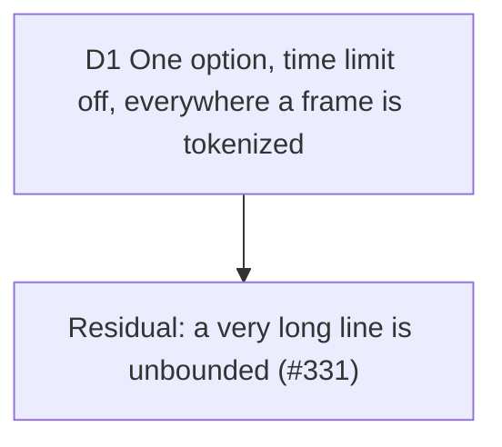

# Whole-line tokenization: no clock in the token plan

Builder on #315, 2026-10-14. The trigger: during the #307 review on a loaded
machine, keyer tests failed in a parallel run and passed alone. Shiki's per-line
time limit had cut `greet(name: string) {` into one token, and the client keyer's
cache kept it. Serves D12 (preview equals export); touches the two keyers of
[scene-break](2026-10-14-scene-break.md) and D5 of [staging](2026-10-08-staging.md).

Measured before deciding (TypeScript, github-dark, idle machine, limit off): a
72-column line, the width a scene is built for, tokenizes in 0.34 ms; 500 columns
10.5 ms; 5,000 columns 171 ms; 20,000 columns 1.1 s (507 ms with the limit);
50,000 columns 3.1 s; 100,000 columns 9.3 s; 200,000 columns 22 s.

## D1 One option, time limit off, everywhere a frame is tokenized

**Decision:** `WHOLE_LINE_TOKENIZATION` (`src/infrastructure/highlighting/whole-line-tokenization.ts`)
is `{ tokenizeTimeLimit: 0 }`. The studio's keyer, the server's keyer
(`server/remotion/magic-move-plan.ts`) and the static poster (`shiki.adapter.ts`),
the only three Shiki call sites in the repo, spread it into their options. At 0
vscode-textmate skips the check.

**Why:** the limit is wall clock, so with it the tokens depend on how busy the
machine is, and the hosted render (a shared node, staging D5) can build a
different plan from the device for the same project. Shiki 3.23 reads `tokens`
from `tokenizeLine2` and drops `stoppedEarly`, so a cut line cannot be detected
from outside: off is the only setting under which a cached tokenization is known
whole. For a line a frame is built for, the 500 ms limit never protected anything;
it only fired on a descheduled process.

**Rejected:** a raised finite limit with a retry (no signal to retry on; a
token-count heuristic misfires on comment lines, which are one token); keeping the
limit and not caching (the server has no cache and still diverges).

**Residual:** nothing bounds a very long line any more. The only caps are on whole
documents (`MAX_IMPORTED_CODE_CHARACTERS` 1,000,000, `MAX_STEP_CODE_CHARS`
50,000), none per line, and the time check ran between `scanNext` calls, so what it
really bounded was a long line with many tokens: a minified bundle line pasted or
imported. That line now freezes the studio's main thread (9.3 s at 100,000
columns, 22 s at 200,000) and costs the server up to about 3 s per step, 16 s per
render. Hostile backtracking is the rarer case of the same gap. The deterministic
bound is `tokenizeMaxLineLength`, ticket #331, which also has to normalise the
`""` colour Shiki gives the one token above the cap (the painter's `?? foreground`
keeps `""` and the canvas ignores it while the DOM inherits: a WYSIWYG split).

**Proof:** `tests/support/stalled-clock.ts` advances `Date.now()` a second per read,
which trips the limit on every line. Without the option the three tests fail (each
line one token); with it the studio's stalled plan equals the unhurried one and
its cache holds it, the server's plan for the hono fixture equals the studio's, and
the poster's HTML is the unhurried HTML.

**Impact:** `whole-line-tokenization.ts`, `magic-move-keyer.ts`, `shiki.adapter.ts`,
`server/remotion/magic-move-plan.ts`; tests in `tests/infrastructure/magic-move-keyer.test.ts`,
`tests/infrastructure/shiki-adapter.test.ts`, `tests/server/magic-move-plan.test.ts`,
`tests/support/stalled-clock.ts`; ticket #331.

**Pivot:** "A frozen studio on a pasted minified file is worse than a plan that
differs under load: put the limit back until #331 lands."
