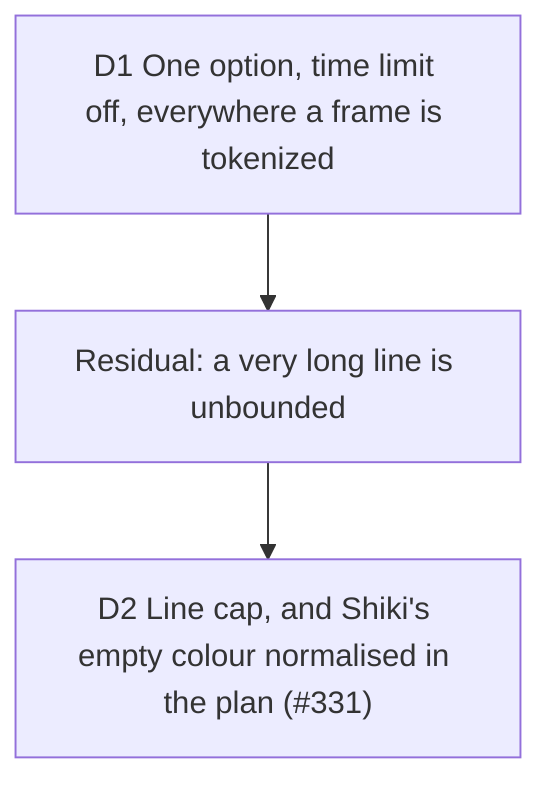

# Whole-line tokenization: no clock in the token plan

Builder on #315, 2026-10-14. The trigger: during the #307 review on a loaded
machine, keyer tests failed in a parallel run and passed alone. Shiki's per-line
time limit had cut `greet(name: string) {` into one token, and the client keyer's
cache kept it. Serves D12 (preview equals export); touches the two keyers of
[scene-break](2026-10-14-scene-break.md) and D5 of [staging](2026-10-08-staging.md).

Measured before deciding (TypeScript, github-dark, idle machine, limit off): a
72-column line, the width a scene is built for, tokenizes in 0.34 ms; 500 columns
10.5 ms; 5,000 columns 171 ms; 20,000 columns 1.1 s (507 ms with the limit);
50,000 columns 3.1 s; 100,000 columns 9.3 s; 200,000 columns 22 s.

## D1 One option, time limit off, everywhere a frame is tokenized

**Decision:** `WHOLE_LINE_TOKENIZATION` (`src/infrastructure/highlighting/whole-line-tokenization.ts`)
is `{ tokenizeTimeLimit: 0 }`. The studio's keyer, the server's keyer
(`server/remotion/magic-move-plan.ts`) and the static poster (`shiki.adapter.ts`),
the only three Shiki call sites in the repo, spread it into their options. At 0
vscode-textmate skips the check.

**Why:** the limit is wall clock, so with it the tokens depend on how busy the
machine is, and the hosted render (a shared node, staging D5) can build a
different plan from the device for the same project. Shiki 3.23 reads `tokens`
from `tokenizeLine2` and drops `stoppedEarly`, so a cut line cannot be detected
from outside: off is the only setting under which a cached tokenization is known
whole. For a line a frame is built for, the 500 ms limit never protected anything;
it only fired on a descheduled process.

**Rejected:** a raised finite limit with a retry (no signal to retry on; a
token-count heuristic misfires on comment lines, which are one token); keeping the
limit and not caching (the server has no cache and still diverges).

**Residual:** nothing bounds a very long line any more. The only caps are on whole
documents (`MAX_IMPORTED_CODE_CHARACTERS` 1,000,000, `MAX_STEP_CODE_CHARS`
50,000), none per line, and the time check ran between `scanNext` calls, so what it
really bounded was a long line with many tokens: a minified bundle line pasted or
imported. That line now freezes the studio's main thread (9.3 s at 100,000
columns, 22 s at 200,000) and costs the server up to about 3 s per step, 16 s per
render. Hostile backtracking is the rarer case of the same gap. D2 (#331) bounds
the length; backtracking under the cap stays open (D2 Residual).

**Proof:** `tests/support/stalled-clock.ts` advances `Date.now()` a second per read,
which trips the limit on every line. Without the option the three tests fail (each
line one token); with it the studio's stalled plan equals the unhurried one and
its cache holds it, the server's plan for the hono fixture equals the studio's, and
the poster's HTML is the unhurried HTML.

**Impact:** `whole-line-tokenization.ts`, `magic-move-keyer.ts`, `shiki.adapter.ts`,
`server/remotion/magic-move-plan.ts`; tests in `tests/infrastructure/magic-move-keyer.test.ts`,
`tests/infrastructure/shiki-adapter.test.ts`, `tests/server/magic-move-plan.test.ts`,
`tests/support/stalled-clock.ts`; ticket #331.

**Pivot:** "A frozen studio on a pasted minified file is worse than a plan that
differs under load: put the limit back until #331 lands." Fired by the residual
and answered by D2: the cap is the deterministic bound, so the limit stays off.

## D2 A line cap, and Shiki's empty colour normalised in the plan

**Decision:** `WHOLE_LINE_TOKENIZATION` also carries `tokenizeMaxLineLength:
MAX_TOKENIZED_LINE_COLUMNS` (2,000), so the three call sites get it from the one
object. Shiki returns a line of that length or more as a single token coloured
`""`. `planMagicMove` (`src/application/magic-move/plan.ts`, the one place every
token passes) plans an empty colour as `undefined`. The DOM preview leaves the
span's colour unset and inherits the card's foreground; the painter's
`token.color ?? foreground` now reaches its fallback. No renderer code changed:
the plan carries the meaning, and the three paint the theme foreground (a
three-level test pins it: plan, DOM, painter).

**Why:** the clock bounded a long line, nothing else did (D1 residual). Length
is as deterministic as the code, so a capped plan is the same on the device and
on a loaded render node. 2,000 columns is 3.1 times `VISIBLE_COL_LIMIT` (648),
the most any canvas shows, and 28 times the 72 a frame is designed for; below it
a line is highlighted as before, so the hono fixture plan is byte-identical (its
longest line is 77 columns; hash of both plans equal before and after). A capped
line costs 0.1 ms (a line just under the cap about 25 ms), where 200,000 columns
took 22 s in the measure above and 10 s on a second, lighter line (the same
superlinear shape; both measured, idle machine).
`""` could not be left to the renderers: the canvas ignores `fillStyle = ""` and
keeps the previous token's colour, the DOM inherits, and the export would
disagree with the preview.

**Rejected:** 4,000 or 5,000 columns (about 60 ms per line, a longer window in
which a row of long lines still stutters, and past 648 columns nothing is on screen to gain);
normalising in the painter and the canvas separately (two places to forget, and
the server video would still be a third); a token-count heuristic.

**Trade-off, accepted:** the visible 648 columns of a line over 2,000 lose their
highlighting and draw in the theme foreground. A minified line is unreadable at
the card's size either way; a long line a reader would want coloured is rarer than
a pasted bundle that freezes the studio.

**Residual:** a line under the cap is still tokenized in full (up to about 25 ms
each), and the cap bounds length, not backtracking: a hostile line under 2,000
columns can still cost the time its grammar takes, and no clock cuts it. Diffing two steps that each carry a 200,000-column line is a separate
cost (about 340 ms for three steps with the loop), inside `syncTokenKeys`, not
tokenization.

**Proof:** remove `tokenizeMaxLineLength` from the option and
`tests/infrastructure/capped-line.test.tsx` fails on the 200 ms bound and on the
one-token boundary, `tests/server/magic-move-plan.test.ts` on its bound and
single-token check, and `tests/infrastructure/shiki-adapter.test.ts` on the poster
span. Remove the `""` to `undefined` step in the plan and the plan test in
`tests/application/magic-move-plan.test.ts` and `capped-line.test.tsx` (plan and
canvas painter, whose `fillStyle` stays empty) fail; the DOM test passes by
design, since the DOM inherited already.

**Impact:** `whole-line-tokenization.ts` (`MAX_TOKENIZED_LINE_COLUMNS`),
`magic-move-keyer.ts` (option type), `application/magic-move/plan.ts`;
`CONTEXT.md` (Line cap); tests in `tests/infrastructure/capped-line.test.tsx`,
`tests/application/magic-move-plan.test.ts`, `tests/server/magic-move-plan.test.ts`,
`tests/infrastructure/shiki-adapter.test.ts`; ticket #331.
