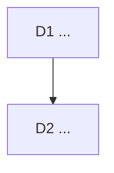

# Decision logs

One file per unit of work, dated, in `docs/decisions/YYYY-MM-DD-<slug>.md`.
The orchestrator writes it before the work starts and amends it when the work
lands. Bruno overturns any decision with its Pivot sentence.

## Format

```markdown
# <Title>: <one line that says what was decided>

<Three context lines: the owner's words or the trigger, the job served, the
earlier decisions this one touches.>

<Optional: what was measured before deciding.>



## D1 <Decision title>

**Decision:** ...

**Why:** ...

**Rejected:** ...

**Impact:** files, tickets, docs.

**Pivot:** "<the one sentence that overturns it>"
```

A decision that only Bruno can take (money, legal, public claims, security
posture, deleting data) is written as a diamond in the graph and marked
`needs owner`.

## Index

- 2026-08-09 [hero-direction](2026-08-09-hero-direction.md): the landing hero.
- 2026-08-09 [instrument-island](2026-08-09-instrument-island.md): the island.
- 2026-08-10 [social-chrome-reference](2026-08-10-social-chrome-reference.md):
  the social preview chrome.
- 2026-08-30 [multimedia-saas-foundation](2026-08-30-multimedia-saas-foundation.md):
  Project → Scene → Block → Asset, hosted boundaries, Creator before Studio.
- 2026-10-03 [operating-model](2026-10-03-operating-model.md): Fable as
  Product Owner, the tracker, the quality loop, Remotion under the Free
  License, one branch.
- 2026-10-03 [viability](2026-10-03-viability.md): positioning (sharpest,
  local, from a PR), the rule sharpened, Creator $12 or $99, free quotas, the
  headless path against HyperFrames, the sequence to the first euro.
