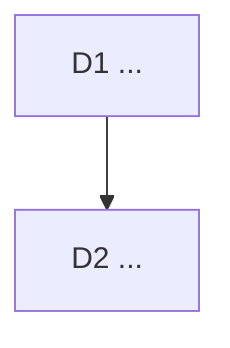

# Decision logs

One file per unit of work, dated, in `docs/decisions/YYYY-MM-DD-<slug>.md`.
The orchestrator writes it before the work starts and amends it when the work
lands. Bruno overturns any decision with its Pivot sentence.

## Format

```markdown
# <Title>: <one line that says what was decided>

<Three context lines: the owner's words or the trigger, the job served, the
earlier decisions this one touches.>

<Optional: what was measured before deciding.>



## D1 <Decision title>

**Decision:** ...

**Why:** ...

**Rejected:** ...

**Impact:** files, tickets, docs.

**Pivot:** "<the one sentence that overturns it>"
```

A decision that only Bruno can take (money, legal, public claims, security
posture, deleting data) is written as a diamond in the graph and marked
`needs owner`.

## Index

- 2026-08-09 [hero-direction](2026-08-09-hero-direction.md): the landing hero.
- 2026-08-09 [instrument-island](2026-08-09-instrument-island.md): the island.
- 2026-08-10 [social-chrome-reference](2026-08-10-social-chrome-reference.md):
  the social preview chrome.
- 2026-08-30 [multimedia-saas-foundation](2026-08-30-multimedia-saas-foundation.md):
  Project → Scene → Block → Asset, hosted boundaries, Creator before Studio.
- 2026-10-03 [operating-model](2026-10-03-operating-model.md): Fable as
  Product Owner, the tracker, the quality loop, Remotion under the Free
  License, one branch; amended 2026-10-05: no custom agents, Sonnet builders,
  CLAUDE.md versioned.
- 2026-10-03 [viability](2026-10-03-viability.md): positioning (sharpest,
  local, from a PR), the rule sharpened, Creator $12 or $99, free quotas, the
  headless path against HyperFrames, the sequence to the first euro.
- 2026-10-03 [autonomous-sprint](2026-10-03-autonomous-sprint.md): the
  backlog worked to done in waves; the landing aligned with the viability
  positioning; the painter learns text and image layers; one scene is a video.
- 2026-10-03 [canonical-card-width](2026-10-03-canonical-card-width.md): the
  card is sized on the measured advance through one placement table; the
  preview's plate and wall-clock mesh go.
- 2026-10-04 [open-source-e2e-and-growth](2026-10-04-open-source-e2e-and-growth.md):
  AGPL on launch day after a scrub; Playwright journeys in CI; tester.army as
  a spike; public pages for Cloud renders and release-to-video.
- 2026-10-04 [renderer-drifts-and-size-refusal](2026-10-04-renderer-drifts-and-size-refusal.md):
  the push-in clips under the chrome bar in all three renderers; the preview
  lays its card out at export size; a refused server render offers Device.
- 2026-10-05 [ui-passes](2026-10-05-ui-passes.md): the design system doc first,
  then every screen through Emil's loop with Craft, proof by screenshots and
  a ui-review verdict.
- 2026-10-05 [next-wave](2026-10-05-next-wave.md): the passes' open items
  screen by screen, API keys, render by URL and the Action's hosted output
  before staging, captions and audio stay hosted, issues close on main.
- 2026-10-06 [billing-polar](2026-10-06-billing-polar.md): Polar is the merchant
  of record, one gateway and Stripe deleted, the Creator prices confirmed in
  USD as two products, the production organisation is the owner's.
- 2026-10-08 [public-pages-fix](2026-10-08-public-pages-fix.md): the audit's
  findings on the import strip, the public render page, the billing return and
  the screens before the bundle.
- 2026-10-13 [hosted-render-sheet](2026-10-13-hosted-render-sheet.md): Cloud
  under Where for everyone, the press explains it (sign in in the sheet, the
  allowance and Upgrade on Free, Cloud chosen on Creator), the dead upgrade
  button deleted.
- 2026-10-13 [account-sheet](2026-10-13-account-sheet.md): signed in, the
  account is a modal bottom sheet with Projects, Plan and API keys tabs that keep
  their scroll and focus, Sign out in its foot; signed out, the panel stays.
- 2026-10-13 [pricing-page](2026-10-13-pricing-page.md): `/pricing` from the
  catalog and the Plan, no number without a price, the device card as true as
  GIF and the painter allow, the static host answers the route.
- 2026-10-13 [landing-figures-anatomy](2026-10-13-landing-figures-anatomy.md):
  Anatomy's rule as a review criterion on the five figures; scenes fails and is
  redrawn as a printed listing on a cutting mat, the other four pass.
- 2026-10-14 [cloud-intent](2026-10-14-cloud-intent.md): `/app#cloud` opens the
  hosted render sheet in the state the account is in, after the session and plan
  are read; the pricing page's Creator action is that link.
- 2026-10-14 [route-head](2026-10-14-route-head.md): one table for each public
  page's title, description, canonical and share card; the static host writes it
  into the served `index.html`, staging keeps the production canonical.
- 2026-10-14 [scene-break](2026-10-14-scene-break.md): a page or a new
  chapter of an import is a scene break; the plan walk matches no token across
  it, the two fades overlap so the card is never empty; stored as a V2
  crossfade.
- 2026-10-14 [whole-line-tokenization](2026-10-14-whole-line-tokenization.md):
  Shiki's per-line time limit is off in every keyer, so the token plan is a
  function of the code, never of the machine's load.
- 2026-11-11 [cloudflare-exit](2026-11-11-cloudflare-exit.md): staging leaves
  craft-prod; the API becomes a Worker, the render worker a `standard-2`
  Container woken by a Queue, the base Neon Free; one hourly cron replaces the
  pollers so Neon can sleep; supersedes staging D2, D7 and D8.
