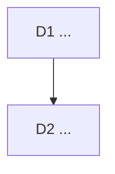

# Decision logs

One file per unit of work, dated, in `docs/decisions/YYYY-MM-DD-<slug>.md`.
The orchestrator writes it before the work starts and amends it when the work
lands. Bruno overturns any decision with its Pivot sentence.

## Format

```markdown
# <Title>: <one line that says what was decided>

<Three context lines: the owner's words or the trigger, the job served, the
earlier decisions this one touches.>

<Optional: what was measured before deciding.>



## D1 <Decision title>

**Decision:** ...

**Why:** ...

**Rejected:** ...

**Impact:** files, tickets, docs.

**Pivot:** "<the one sentence that overturns it>"
```

A decision that only Bruno can take (money, legal, public claims, security
posture, deleting data) is written as a diamond in the graph and marked
`needs owner`.

## Index

- 2026-08-09 [hero-direction](2026-08-09-hero-direction.md): the landing hero.
- 2026-08-09 [instrument-island](2026-08-09-instrument-island.md): the island.
- 2026-08-10 [social-chrome-reference](2026-08-10-social-chrome-reference.md):
  the social preview chrome.
- 2026-08-30 [multimedia-saas-foundation](2026-08-30-multimedia-saas-foundation.md):
  Project → Scene → Block → Asset, hosted boundaries, Creator before Studio.
- 2026-10-03 [operating-model](2026-10-03-operating-model.md): Fable as
  Product Owner, the tracker, the quality loop, Remotion under the Free
  License, one branch; amended 2026-10-05: no custom agents, Sonnet builders,
  CLAUDE.md versioned.
- 2026-10-03 [viability](2026-10-03-viability.md): positioning (sharpest,
  local, from a PR), the rule sharpened, Creator $12 or $99, free quotas, the
  headless path against HyperFrames, the sequence to the first euro.
- 2026-10-03 [autonomous-sprint](2026-10-03-autonomous-sprint.md): the
  backlog worked to done in waves; the landing aligned with the viability
  positioning; the painter learns text and image layers; one scene is a video.
- 2026-10-03 [canonical-card-width](2026-10-03-canonical-card-width.md): the
  card is sized on the measured advance through one placement table; the
  preview's plate and wall-clock mesh go.
- 2026-10-04 [open-source-e2e-and-growth](2026-10-04-open-source-e2e-and-growth.md):
  AGPL on launch day after a scrub; Playwright journeys in CI; tester.army as
  a spike; public pages for Cloud renders and release-to-video.
- 2026-10-04 [renderer-drifts-and-size-refusal](2026-10-04-renderer-drifts-and-size-refusal.md):
  the push-in clips under the chrome bar in all three renderers; the preview
  lays its card out at export size; a refused server render offers Device.
- 2026-10-05 [ui-passes](2026-10-05-ui-passes.md): the design system doc first,
  then every screen through Emil's loop with Craft, proof by screenshots and
  a ui-review verdict.
- 2026-10-05 [next-wave](2026-10-05-next-wave.md): the passes' open items
  screen by screen, API keys, render by URL and the Action's hosted output
  before staging, captions and audio stay hosted, issues close on main.
- 2026-10-06 [billing-polar](2026-10-06-billing-polar.md): Polar is the merchant
  of record, one gateway and Stripe deleted, the Creator prices confirmed in
  USD as two products, the production organisation is the owner's.
