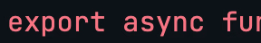
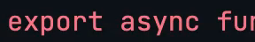

# typelapse-pr-to-video

An agent skill that turns a GitHub pull request into a code video on your
machine, then hands back the file and a link that reopens the same change in the
Typelapse editor, where you can recut the scenes, change the theme and export
again. No account, nothing uploaded.

```bash
npx skills add delhombre/typelapse --skill typelapse-pr-to-video
```

Then ask your agent, in one prompt:

> Render https://github.com/sindresorhus/slugify/pull/73 as a video.

It also takes `owner/repo#73`, "this PR" inside a checked-out repository, a
commit URL, or your branch's diff. It needs Node 24, pnpm and git; with the `gh`
CLI signed in, it reads private repositories too.

## What you get

```text
/your/dir/Perform_contraction_possession_replacement_before_main_pattern_replacement.mp4
1920x1080, 60 fps, 4.9 s, h264, 2.1 MB
http://localhost:5173/app#import=eyJzb3VyY2UiOi...
```

The skill runs `typelapse render <pr-url> --json --open` from a Typelapse
checkout (cloned to `~/.typelapse` on first use, or `$TYPELAPSE_HOME`), so the
file is the one the studio's export would make and the link imports the same
pull request into the editor.

## The sharper file is one click away

<table>
	<tr>
		<th>AV1 4:4:4, 43.63 dB</th>
		<th>H.264 4:2:0, 29.31 dB</th>
	</tr>
	<tr>
		<td></td>
		<td></td>
	</tr>
</table>

The same line of code at frame 45, cropped from two exports of one project and
measured in PSNR against the lossless frame (`docs/sharpness/sharpness.json`).
The skill's own MP4 is the H.264 4:2:0 file on the right, from the server
renderer. The link opens the project in the studio, whose WebM export writes the
AV1 4:4:4 file on the left.
